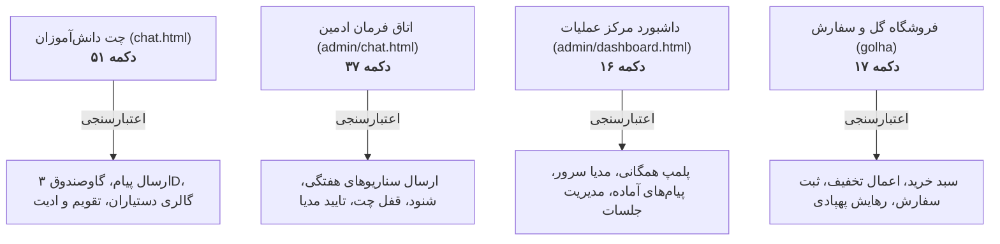

# 📋 سند مستر جامع بررسی، رفتارشناسی و ماتریس خروجی تمامی دکمه‌ها (MASTER BUTTONS & OUTPUTS MATRIX)

این سند مرجع رسمی و مستر تمامی دکمه‌ها، تعاملات کلیکی، درخواست‌های شبکه، رویدادهای بلادرنگ سوکت و رفتارهای مورد انتظار در پلتفرم **راز دهکده** (`Raze Dehkade`) است که بر اساس کلیه فایل‌های مستر پیشین تدوین شده است.

---

## ۱. نقشه کلان بخش‌های تعاملی پلتفرم

---

## ۲. ماتریس کامل دکمه‌های چت دانش‌آموز (`public/chat.html` - ۵۱ دکمه)

| ردیف | نام / آی‌دی | کلاس / سلکتور | رویداد / هندلر | متن / آیکون | عملکرد و خروجی مورد انتظار بر اساس مستندات مستر | اعتبارسنجی خروجی و سناریوی خطا |
| :--- | :--- | :--- | :--- | :--- | :--- | :--- |
| **1** | `-` | `attach-button` | `triggerFileInput(` | - | باز کردن پنجره انتخاب فایل مرورگر جهت ضمیمه مدرک یا عکس | بررسی سایز مجاز فایل، جلوگیری از پسوندهای خطرناک (.exe) |
| **2** | `user-emoji-btn` | `emoji-button` | `toggleUserEmojiPicker(event)` | 😊 | باز/بسته کردن پنل شناور ایموجی‌ها بالای کادر ورودی | بسته شدن با کلیک بیرون، عدم اسکرول ناخواسته صفحه |
| **3** | `-` | `send-button` | `form submit` | - | ارسال پیام متنی یا صوتی دانش‌آموز به اتاق جلسه در سوکت | جلوگیری از ارسال پیام خالی، پیشگیری از دابل‌سابمیت با مارکر in-flight |
| **4** | `-` | `cal-nav-btn` | `changeShamsiMonth(-1)` | ‹ | انتقال نمایش تقویم شمسی به ماه قبل | محاسبه دقیق کبیسه و تعداد روزهای ماه بدون شکست لی‌اوت |
| **5** | `-` | `cal-nav-btn` | `changeShamsiMonth(1)` | › | انتقال نمایش تقویم شمسی به ماه بعد | به‌روزرسانی مناسبت‌ها و معماهای تقویم بدون خطای رندر |
| **6** | `shamsi-today-badge` | `calendar-sheet-badge` | `goToTodayShamsi()` | امروز | بازگرداندن آنی تقویم به ماه و روز جاری شمسی | حفظ متن «امروز» روی بج، هایلایت روز جاری با کلاس is-today |
| **7** | `open-assistants-popup-btn` | `assistants-popup-btn` | `openAssistantsPhotoPopup()` | پرونده دستیاران کارآگاه گالری کامل ↗ در حال ب | باز کردن مودال تمام‌صفحه گالری پرتره دستیاران کارآگاه (openAssistantsPhotoPopup) | لود اختصاصی تصاویر دستیاران همان کلاس از سرور بر اساس session_id |
| **8** | `vault-3d-trigger-btn` | `vault-3d-trigger-btn` | `openVaultInteraction()` | CLASSIFIED // ARCHIVE محرمانه 🔒 | باز کردن پنجره سه‌بعدی تمام‌صفحه تعاملی درب گاوصندوق فولادی (vault-3d-trigger-btn) | حفظ سیاست قطعی Zero-Spoiler؛ عدم نمایش برچسب پلمپ لو‌دهنده در UI دانش‌آموز |
| **9** | `-` | `dialog-close` | `closeEvidence()` | × | بستن پنجره بزرگنمایی شواهد و مدارک کارآگاهی | بسته شدن پنجره با کلیک دکمه یا بک‌دراپ (#evidence-dialog) |
| **10** | `assistants-chroma-toggle-btn` | `themed-btn secondary` | `toggleAssistantsChromaKey()` | حذف پس‌زمینه | تغییر وضعیت حذف پس‌زمینه (کروماکی) پرتره دستیاران | تغییر کلاس کارت‌ها و اعمال فیلتر استایل سبز بدون افت کیفیت |
| **11** | `-` | `dialog-close` | `closeAssistantsPhotoPopup()` | × | بستن مودال گالری دستیاران کارآگاه | آزاد کردن منابع تصویر و بازگشت فوکوس به چت اصلی |
| **12** | `-` | `assistants-lb-nav prev` | `stepAssistantLightbox(-1)` | ❯ | مشاهده پرتره دستیار قبلی در لایت‌باکس با انیمیشن زوم | چرخش حلقه بسته (Wrap-around) از دستیار اول به آخر |
| **13** | `-` | `assistants-lb-nav next` | `stepAssistantLightbox(1)` | ❮ | مشاهده پرتره دستیار بعدی در لایت‌باکس با انیمیشن زوم | انتقال روان نام و کد شناسایی بدون پرش فریم |
| **14** | `assistantsLensZoomIn` | `zoom-btn` | `-` | + | بزرگ‌نمایی ذره‌بین تصویر پرتره کارآگاه | رعایت سقف قطعی MAX_ZOOM = 3.0 برابر بر اساس مستندات مستر |
| **15** | `assistantsLensZoomOut` | `zoom-btn` | `-` | − | کاهش بزرگ‌نمایی ذره‌بین تصویر پرتره کارآگاه | رعایت کف قطعی MIN_ZOOM = 1.0 برابر (عدم کوچکتر شدن از کادر) |
| **16** | `assistantsLensReset` | `zoom-btn` | `-` | بازنشانی | بازنشانی مقیاس و موقعیت ذره‌بین پرتره به حالت اولیه | ریست کامل مقیاس به 1.0 و مختصات ترنسلیت به (0, 0) |
| **17** | `-` | `themed-btn secondary` | `closeAssistantLightbox()` | 🔙 بازگشت به گالری دستیاران | بستن لایت‌باکس پرتره و بازگشت به گالری کارآگاهان | متوقف ساختن انیمیشن زوم و لایت‌باکس |
| **18** | `-` | `themed-btn secondary` | `closeAssistantsPhotoPopup()` | بستن پنجره | تعامل استاندارد کاربری چت | پاسخ معتبر کلاینت و سرور |
| **19** | `-` | `vault-slab-close-bolt` | `closeVaultPasswordModal()` | × | بستن دیالوگ کی‌پد رمز گاوصندوق فولادی | پاکسازی رشته رمز موقت و بستن لایه مودال بدون تغییر وضعیت قفل |
| **20** | `-` | `vault-key-btn` | `appendVaultKeypadChar(` | 1 | درج رقم «1» در کی‌پد ۴ رقمی گاوصندوق فولادی | اعتبارسنجی سقف ۴ رقم؛ عدم اجازه درج ارقام ۵ و بیشتر |
| **21** | `-` | `vault-key-btn` | `appendVaultKeypadChar(` | 2 | درج رقم «2» در کی‌پد ۴ رقمی گاوصندوق فولادی | اعتبارسنجی سقف ۴ رقم؛ عدم اجازه درج ارقام ۵ و بیشتر |
| **22** | `-` | `vault-key-btn` | `appendVaultKeypadChar(` | 3 | درج رقم «3» در کی‌پد ۴ رقمی گاوصندوق فولادی | اعتبارسنجی سقف ۴ رقم؛ عدم اجازه درج ارقام ۵ و بیشتر |
| **23** | `-` | `vault-key-btn` | `appendVaultKeypadChar(` | 4 | درج رقم «4» در کی‌پد ۴ رقمی گاوصندوق فولادی | اعتبارسنجی سقف ۴ رقم؛ عدم اجازه درج ارقام ۵ و بیشتر |
| **24** | `-` | `vault-key-btn` | `appendVaultKeypadChar(` | 5 | درج رقم «5» در کی‌پد ۴ رقمی گاوصندوق فولادی | اعتبارسنجی سقف ۴ رقم؛ عدم اجازه درج ارقام ۵ و بیشتر |
| **25** | `-` | `vault-key-btn` | `appendVaultKeypadChar(` | 6 | درج رقم «6» در کی‌پد ۴ رقمی گاوصندوق فولادی | اعتبارسنجی سقف ۴ رقم؛ عدم اجازه درج ارقام ۵ و بیشتر |
| **26** | `-` | `vault-key-btn` | `appendVaultKeypadChar(` | 7 | درج رقم «7» در کی‌پد ۴ رقمی گاوصندوق فولادی | اعتبارسنجی سقف ۴ رقم؛ عدم اجازه درج ارقام ۵ و بیشتر |
| **27** | `-` | `vault-key-btn` | `appendVaultKeypadChar(` | 8 | درج رقم «8» در کی‌پد ۴ رقمی گاوصندوق فولادی | اعتبارسنجی سقف ۴ رقم؛ عدم اجازه درج ارقام ۵ و بیشتر |
| **28** | `-` | `vault-key-btn` | `appendVaultKeypadChar(` | 9 | درج رقم «9» در کی‌پد ۴ رقمی گاوصندوق فولادی | اعتبارسنجی سقف ۴ رقم؛ عدم اجازه درج ارقام ۵ و بیشتر |
| **29** | `-` | `vault-key-btn func-clear` | `clearVaultCodeInput()` | CLR | پاکسازی فوری کلیه ارقام وارد شده در کی‌پد گاوصندوق (CLR) | ریست فیلد به مقدار خالی و حذف کلاس‌های خطا/لرزش |
| **30** | `-` | `vault-key-btn` | `appendVaultKeypadChar(` | 0 | درج رقم «0» در کی‌پد ۴ رقمی گاوصندوق فولادی | اعتبارسنجی سقف ۴ رقم؛ عدم اجازه درج ارقام ۵ و بیشتر |
| **31** | `-` | `vault-key-btn func-backspace` | `backspaceVaultCodeInput()` | ⌫ | حذف آخرین رقم تایپ شده در کی‌پد گاوصندوق (Backspace) | کاهش یک رقم از رشته با مدیریت حالت رشته خالی |
| **32** | `vault-unlock-submit-btn` | `vault-primary-submit-btn` | `form submit` | بازگشایی قفل | تایید و ارسال رمز جهت گشایش قفل زرهی ۳D | اعتبارسنجی رمز 0110؛ در صورت پلمپ یا اشتباه، انیمیشن لرزش؛ در صورت موفقیت، چرخش ۱۰۸۰ درجه دستگیره و باز شدن درب |
| **33** | `vault-reward-close` | `kraft-floating-close-btn` | `closeVaultRewardModal()` | × | بستن پاکت کاهی محرمانه و تصویر پاداش موزه اسرارآمیز | بستن دیالوگ و بازگشت به نمای صفحه چت |
| **34** | `vault-gallery-prev` | `vault-gallery-nav-btn prev` | `event.stopPropagation(); changeVaultGallerySlide(-1)` | ❯ | کنترل اسلاید جایزه (غیرفعال طبق مستند تک‌عکس) | صفت hidden فعال است؛ بر اساس مستندات مستر تنها یک عکس لود می‌شود |
| **35** | `vault-gallery-next` | `vault-gallery-nav-btn next` | `event.stopPropagation(); changeVaultGallerySlide(1)` | ❮ | کنترل اسلاید جایزه (غیرفعال طبق مستند تک‌عکس) | صفت hidden فعال است؛ بر اساس مستندات مستر تنها یک عکس لود می‌شود |
| **36** | `-` | `dialog-close` | `closeUserEditModal()` | × | انصراف از ویرایش پیام و بستن پنجره | عدم تغییر پیام و بستن تمیز دیالوگ |
| **37** | `-` | `-` | `insertEmojiIntoEdit(` | 🕵️‍♂️ | درج نماد «🕵️‍♂️» در کادر ویرایش پیام | درج در محل نشانگر متن بدون پرش اسکرول |
| **38** | `-` | `-` | `insertEmojiIntoEdit(` | 🔍 | درج نماد «🔍» در کادر ویرایش پیام | درج در محل نشانگر متن بدون پرش اسکرول |
| **39** | `-` | `-` | `insertEmojiIntoEdit(` | 📌 | درج نماد «📌» در کادر ویرایش پیام | درج در محل نشانگر متن بدون پرش اسکرول |
| **40** | `-` | `-` | `insertEmojiIntoEdit(` | 💡 | درج نماد «💡» در کادر ویرایش پیام | درج در محل نشانگر متن بدون پرش اسکرول |
| **41** | `-` | `-` | `insertEmojiIntoEdit(` | ✅ | درج نماد «✅» در کادر ویرایش پیام | درج در محل نشانگر متن بدون پرش اسکرول |
| **42** | `-` | `-` | `insertEmojiIntoEdit(` | ⚠️ | درج نماد «⚠️» در کادر ویرایش پیام | درج در محل نشانگر متن بدون پرش اسکرول |
| **43** | `-` | `-` | `insertEmojiIntoEdit(` | 🤔 | درج نماد «🤔» در کادر ویرایش پیام | درج در محل نشانگر متن بدون پرش اسکرول |
| **44** | `-` | `-` | `insertEmojiIntoEdit(` | 👍 | درج نماد «👍» در کادر ویرایش پیام | درج در محل نشانگر متن بدون پرش اسکرول |
| **45** | `-` | `-` | `insertEmojiIntoEdit(` | 😂 | درج نماد «😂» در کادر ویرایش پیام | درج در محل نشانگر متن بدون پرش اسکرول |
| **46** | `-` | `-` | `insertEmojiIntoEdit(` | ❤️ | درج نماد «❤️» در کادر ویرایش پیام | درج در محل نشانگر متن بدون پرش اسکرول |
| **47** | `-` | `themed-btn secondary` | `closeUserEditModal()` | انصراف | انصراف از ویرایش پیام و بستن پنجره | عدم تغییر پیام و بستن تمیز دیالوگ |
| **48** | `user-edit-save-btn` | `themed-btn primary` | `form submit` | ✨ ذخیره و بروزرسانی پیام | ذخیره تغییرات متن پیام ویرایش‌شده توسط دانش‌آموز | اعتبارسنجی مالکیت پیام؛ به‌روزرسانی زنده سوکت message_edited |
| **49** | `-` | `dialog-close` | `closeUserDeleteModal()` | × | انصراف از حذف پیام و بستن پنجره | حفظ پیام در تاریخچه چت |
| **50** | `-` | `themed-btn secondary` | `closeUserDeleteModal()` | انصراف | انصراف از حذف پیام و بستن پنجره | حفظ پیام در تاریخچه چت |
| **51** | `user-delete-confirm-btn` | `themed-btn danger` | `confirmUserDeleteMessage()` | 🗑️ بله، پیام حذف شود | حذف قطعی پیام ارسال‌شده توسط دانش‌آموز | حذف از دیتابیس و مخابره سوکت message_deleted به ادمین و حاضرین |

---

## ۳. ماتریس کامل دکمه‌های اتاق فرمان ادمین (`public/admin/chat.html` - ۳۷ دکمه)

| ردیف | نام / آی‌دی | کلاس / سلکتور | رویداد / هندلر | متن / آیکون | عملکرد و خروجی مورد انتظار بر اساس مستندات مستر | اعتبارسنجی خروجی و سناریوی حساس |
| :--- | :--- | :--- | :--- | :--- | :--- | :--- |
| **1** | `admin-chat-lock-btn` | `command-button` | `toggleAdminChatLock()` | 🔒 قفل چت جلسه | قفل / بازگشایی چت برای دانش‌آموزان این جلسه (admin-chat-lock-btn) | تغییر وضعیت is_chat_locked در دیتابیس و برودکست chat_lock_toggled به روم جلسه |
| **2** | `admin-vault-lock-btn` | `command-button` | `toggleAdminVaultLock()` | 🔒 پلمپ گاوصندوق | پلمپ امنیتی / بازگشایی گاوصندوق این جلسه برای هفته جاری (admin-vault-lock-btn) | به‌روزرسانی دیتابیس و مخابره vault_lock_updated بدون افشای پیام به دانش‌آموز |
| **3** | `admin-audio-toggle-btn` | `command-button` | `toggleAdminAudioStream()` | 🎙️ شروع شنود صدا | فعال/غیرفعال‌سازی شنود زنده میکروفون دانش‌آموزان جلسه | برودکست درخواست شنود به روم جلسه و مدیریت چانک‌های صوتی PCM |
| **4** | `-` | `command-button danger` | `triggerHackSequence()` | ☠️ اجرای سکانس مزداک | فعال‌سازی سکانس حمله سایبری مزداک برای جلسه جاری (triggerHackSequence) | مخابره سوکت mazdak_hack_sequence و اجرای سناریوی ۵۳.۵ ثانیه‌ای در کلاینت |
| **5** | `tab-btn-sidebar` | `mobile-tab-btn active` | `switchMobileTab(` | 📋 جلسه‌ها (۲۲) | تغییر تب در نمای موبایل ادمین (📋 جلسه‌ها (۲۲)) | نمایش بخش انتخابی و مخفی‌سازی سایر پنل‌ها در صفحات کوچک |
| **6** | `tab-btn-chat` | `mobile-tab-btn` | `switchMobileTab(` | 💬 اتاق گفتگو | تغییر تب در نمای موبایل ادمین (💬 اتاق گفتگو) | نمایش بخش انتخابی و مخفی‌سازی سایر پنل‌ها در صفحات کوچک |
| **7** | `tab-btn-media` | `mobile-tab-btn` | `switchMobileTab(` | 📅 سناریو (۵ هفته) | تغییر تب در نمای موبایل ادمین (📅 سناریو (۵ هفته)) | نمایش بخش انتخابی و مخفی‌سازی سایر پنل‌ها در صفحات کوچک |
| **8** | `tab-btn-tools` | `mobile-tab-btn` | `switchMobileTab(` | ⚡ ابزارها | تغییر تب در نمای موبایل ادمین (⚡ ابزارها) | نمایش بخش انتخابی و مخفی‌سازی سایر پنل‌ها در صفحات کوچک |
| **9** | `-` | `-` | `loadAdminSessions()` | ↻ | بازخوانی فوری لیست جلسات در سایدبار ادمین | دریافت آخرین وضعیت حضور، پرونده‌ها و قفل‌ها از سرور |
| **10** | `-` | `mobile-back-btn` | `switchMobileTab(` | ← لیست جلسه‌ها | دستور مدیریتی اتاق فرمان | اعمال در سرور و مخابره بلادرنگ سوکت |
| **11** | `-` | `admin-emoji-tab active` | `switchAdminEmojiTab(` | 😊 | تغییر دسته‌بندی ایموجی‌های ادمین (😊) | سوئیچ بین دسته‌های چهره، کارآگاهی، نمادها و دست‌ها |
| **12** | `-` | `admin-emoji-tab` | `switchAdminEmojiTab(` | 🕵️ | تغییر دسته‌بندی ایموجی‌های ادمین (🕵️) | سوئیچ بین دسته‌های چهره، کارآگاهی، نمادها و دست‌ها |
| **13** | `-` | `admin-emoji-tab` | `switchAdminEmojiTab(` | 👍 | تغییر دسته‌بندی ایموجی‌های ادمین (👍) | سوئیچ بین دسته‌های چهره، کارآگاهی، نمادها و دست‌ها |
| **14** | `-` | `admin-emoji-tab` | `switchAdminEmojiTab(` | ⚡ | تغییر دسته‌بندی ایموجی‌های ادمین (⚡) | سوئیچ بین دسته‌های چهره، کارآگاهی، نمادها و دست‌ها |
| **15** | `-` | `command-button icon photo-btn` | `triggerAdminFileInput(` | 📷 عکس | انتخاب فایل تصویر جهت ارسال در چت ادمین | پیش‌نمایش در کادر کامپوزر و فعال شدن دکمه‌های استیج |
| **16** | `-` | `command-button icon attach-btn` | `triggerAdminFileInput(` | 📎 پیوست | انتخاب فایل ضمیمه (صوتی/سند) جهت ارسال در چت ادمین | اعتبارسنجی حجم و پسوند قبل از ارسال |
| **17** | `admin-emoji-btn` | `command-button icon emoji-btn` | `toggleAdminEmojiPicker(event)` | 😊 | باز/بسته کردن پنل شناور ایموجی‌های ادمین | بسته شدن خودکار با کلیک بیرون |
| **18** | `-` | `-` | `clearStagedMedia()` | ✕ | لغو فایل استیج‌شده در کادر ارسال پیام ادمین | حذف پیش‌نمایش و پاکسازی متغیر stagedMedia در حافظه |
| **19** | `admin-send-btn` | `command-button primary send-message-btn` | `sendAdminMessage()` | ارسال پیام ➤ | ارسال پیام متنی یا رسانه آماده‌شده به دانش‌آموزان جلسه | مخابره send_admin_message، نمایش بدون پرش و اسکرول نرم |
| **20** | `-` | `-` | `loadWeeklyContent()` | ↻ | بازخوانی مجدد مراحل سناریوی هفته انتخاب شده | دریافت مراحل از API /api/sessions/weekly-content |
| **21** | `-` | `command-button week-tab-btn active` | `selectWeek(1)` | هفته ۱ | جابجایی به سناریو و پیام‌های هفته ۱ | فیلتر مراحل بر اساس شماره هفته و هایلایت تب فعال |
| **22** | `-` | `command-button week-tab-btn` | `selectWeek(2)` | هفته ۲ | جابجایی به سناریو و پیام‌های هفته ۲ | فیلتر مراحل بر اساس شماره هفته و هایلایت تب فعال |
| **23** | `-` | `command-button week-tab-btn` | `selectWeek(3)` | هفته ۳ | جابجایی به سناریو و پیام‌های هفته ۳ | فیلتر مراحل بر اساس شماره هفته و هایلایت تب فعال |
| **24** | `-` | `command-button week-tab-btn` | `selectWeek(4)` | هفته ۴ | جابجایی به سناریو و پیام‌های هفته ۴ | فیلتر مراحل بر اساس شماره هفته و هایلایت تب فعال |
| **25** | `-` | `command-button week-tab-btn` | `selectWeek(5)` | هفته ۵ | جابجایی به سناریو و پیام‌های هفته ۵ | فیلتر مراحل بر اساس شماره هفته و هایلایت تب فعال |
| **26** | `-` | `command-button add-step-btn` | `openAddStepDialog()` | ➕ افزودن مرحله جدید به این هفته | باز کردن دیالوگ ساخت پیام/مرحله جدید برای سناریوی هفته | باز شدن پنجره مدال با فرم اعتبارسنجی عنوان و متن |
| **27** | `mobile-admin-chat-lock-btn` | `command-button wide` | `toggleAdminChatLock()` | 🔒 قفل چت جلسه | قفل / بازگشایی چت برای دانش‌آموزان این جلسه (admin-chat-lock-btn) | تغییر وضعیت is_chat_locked در دیتابیس و برودکست chat_lock_toggled به روم جلسه |
| **28** | `mobile-admin-vault-lock-btn` | `command-button wide` | `toggleAdminVaultLock()` | 🔒 پلمپ گاوصندوق | پلمپ امنیتی / بازگشایی گاوصندوق این جلسه برای هفته جاری (admin-vault-lock-btn) | به‌روزرسانی دیتابیس و مخابره vault_lock_updated بدون افشای پیام به دانش‌آموز |
| **29** | `mobile-admin-audio-toggle-btn` | `command-button wide` | `toggleAdminAudioStream()` | 🎙️ شروع شنود صدا | فعال/غیرفعال‌سازی شنود زنده میکروفون دانش‌آموزان جلسه | برودکست درخواست شنود به روم جلسه و مدیریت چانک‌های صوتی PCM |
| **30** | `-` | `command-button danger wide` | `triggerHackSequence()` | ☠️ اجرای سکانس مزداک | فعال‌سازی سکانس حمله سایبری مزداک برای جلسه جاری (triggerHackSequence) | مخابره سوکت mazdak_hack_sequence و اجرای سناریوی ۵۳.۵ ثانیه‌ای در کلاینت |
| **31** | `-` | `command-button primary` | `form submit` | ذخیره مرحله | دستور مدیریتی اتاق فرمان | اعمال در سرور و مخابره بلادرنگ سوکت |
| **32** | `-` | `command-button` | `closeAddStepDialog()` | انصراف | بستن پنجره افزودن مرحله سناریو | پاکسازی فیلدهای فرم |
| **33** | `admin-media-confirm-cancel` | `command-button` | `-` | انصراف | انصراف از ارسال رسانه کتابخانه و بستن پنجره تایید | بستن دیالوگ و ریست استیج مدیا |
| **34** | `admin-media-confirm-send` | `command-button primary` | `-` | تأیید و ارسال | تایید نهایی و ارسال فایل انتخاب‌شده از کتابخانه مدیا | ارسال به چت جلسه و نمایش پیشرفت در #admin-upload-progress-container |
| **35** | `-` | `-` | `closeAdminEditDialog()` | ✕ | بستن پنجره ویرایش مرحله سناریو | عدم تغییر مرحله |
| **36** | `-` | `command-button` | `closeAdminEditDialog()` | انصراف | بستن پنجره ویرایش مرحله سناریو | عدم تغییر مرحله |
| **37** | `-` | `command-button primary` | `form submit` | ذخیره تغییرات | دستور مدیریتی اتاق فرمان | اعمال در سرور و مخابره بلادرنگ سوکت |

---

## ۴. ماتریس کامل دکمه‌های داشبورد مرکز عملیات (`public/admin/dashboard.html` - ۱۶ دکمه)

| ردیف | نام / آی‌دی | کلاس / سلکتور | رویداد / هندلر | متن / آیکون | عملکرد و خروجی مورد انتظار بر اساس مستندات مستر | اعتبارسنجی خروجی و سناریوی حساس |
| :--- | :--- | :--- | :--- | :--- | :--- | :--- |
| **1** | `-` | `dashboard-button primary` | `openSessionDialog()` | ＋ ساخت جلسه جدید | باز کردن فرم ایجاد جلسه و کلاس کارآگاهی جدید | تولید شناسه و کد دسترسی یکتا برای کلاس جدید |
| **2** | `-` | `dashboard-button` | `openMediaManagerDialog()` | 📂 مدیا سرور | باز کردن پنجره مدیریت رسانه‌های ذخیره‌شده روی سرور | نمایش فایل‌های چندرسانه‌ای با قابلیت فیلتر بر اساس دسته |
| **3** | `-` | `dashboard-button` | `openCannedResponsesManager()` | 💬 پیام‌های آماده | باز کردن پنجره مدیریت پیام‌های آماده و میان‌بر پاسخگویی | امکان افزودن، ویرایش و حذف پاسخ‌های از پیش آماده |
| **4** | `global-vault-lock-btn` | `dashboard-button vault-locked` | `toggleGlobalVaultLock()` | 🔒 پلمپ گاوصندوق (همه جلسات) | پلمپ امنیتی / بازگشایی همگانی گاوصندوق برای کلیه ۲۴ کلاس (global-vault-lock-btn) | فراخوانی POST /api/sessions/vault-lock-all و مخابره همزمان به تمامی جلسات |
| **5** | `-` | `dashboard-button danger` | `logoutAdmin()` | خروج | خروج قطعی از حساب مدیر سیستم | پاکسازی sessionStorage و هدایت قطعی به /admin/login.html |
| **6** | `-` | `dashboard-button` | `loadSessions()` | 🔄 به‌روزرسانی زنده | بازخوانی زنده کارت‌های جلسات و آمار آنلاین | حفظ مقدار ورودی فیلتر #sessionSearchInput و عدم پرش UI |
| **7** | `-` | `dialog-x` | `closeSessionDialog()` | × | بستن دیالوگ ایجاد جلسه | ریست فیلدهای فرم جلسه |
| **8** | `-` | `dashboard-button primary` | `form submit` | تایید و ساخت جلسه | عملیات داشبورد مرکزی | پاسخ معتبر REST API و انعکاس در رابط |
| **9** | `-` | `dashboard-button` | `closeSessionDialog()` | انصراف | بستن دیالوگ ایجاد جلسه | ریست فیلدهای فرم جلسه |
| **10** | `-` | `dialog-x` | `closeEditSessionDialog()` | × | بستن دیالوگ ویرایش جلسه | عدم تغییر تنظیمات جلسه |
| **11** | `-` | `dashboard-button primary` | `form submit` | ذخیره تغییرات | عملیات داشبورد مرکزی | پاسخ معتبر REST API و انعکاس در رابط |
| **12** | `-` | `dashboard-button` | `closeEditSessionDialog()` | انصراف | بستن دیالوگ ویرایش جلسه | عدم تغییر تنظیمات جلسه |
| **13** | `-` | `dialog-x` | `closeCannedResponsesManager()` | × | بستن پنجره پیام‌های آماده | بستن مدال |
| **14** | `-` | `dashboard-button primary` | `submitNewCannedResponse()` | ＋ ثبت پیام آماده جدید | ثبت پیام آماده جدید در دیتابیس | اعتبارسنجی فیلدهای میان‌بر و متن پیام |
| **15** | `-` | `dialog-x` | `closeMediaManagerDialog()` | × | بستن پنجره مدیریت رسانه | بستن مدال |
| **16** | `-` | `dashboard-button primary` | `form submit` | ثبت فایل در فهرست آماده | عملیات داشبورد مرکزی | پاسخ معتبر REST API و انعکاس در رابط |

---

## ۵. ماتریس کامل دکمه‌های فروشگاه گل‌ها و تسویه حساب (`public/golha/` - ۱۷ دکمه)

| ردیف | نام / آی‌دی | صفحه | رویداد / هندلر | متن / آیکون | عملکرد و خروجی مورد انتظار بر اساس مستندات مستر | اعتبارسنجی خروجی و سناریوی حساس |
| :--- | :--- | :--- | :--- | :--- | :--- | :--- |
| **1** | `-` | index.html | `openLoginModal()` | 👤 ورود به حساب | باز کردن فرم ورود به حساب دانش‌آموز در فروشگاه | اعتبارسنجی شماره تماس جهت اتصال به جلسه کارآگاهی |
| **2** | `openCartBtn` | index.html | `-` | سبد خرید 0 | باز کردن کشوی سبد خرید شناور محصولات گل و گیاه | نمایش اقلام انتخاب شده و محاسبه قیمت بر اساس تومان/ریال |
| **3** | `floatingCartBtn` | index.html | `openCartDrawer()` | 🛒 سبد خرید 0 | باز کردن کشوی سبد خرید شناور محصولات گل و گیاه | نمایش اقلام انتخاب شده و محاسبه قیمت بر اساس تومان/ریال |
| **4** | `closeCartBtn` | index.html | `-` | &times; | بستن کشوی سبد خرید یا مودال ورود | بستن نرم کشو با ترنزیشن CSS |
| **5** | `-` | index.html | `closeLoginModal()` | &times; | بستن کشوی سبد خرید یا مودال ورود | بستن نرم کشو با ترنزیشن CSS |
| **6** | `loginSubmitBtn` | index.html | `form submit` | ورود به حساب ➔ | ارسال فرم ورود به حساب کاربری | اعتبارسنجی ورودی و اتصال کوکی/توکن |
| **7** | `-` | index.html | `decreaseItemById(` | - | کاهش تعداد محصول انتخابی در سبد خرید | کاهش تعداد یا حذف از سبد در صورت رسیدن به صفر |
| **8** | `-` | index.html | `increaseItemById(` | + | افزایش تعداد محصول انتخابی در سبد خرید | رعایت سقف موجودی انبار؛ انطباق با قوانین فاکتور معمایی ۵ قلمی |
| **9** | `-` | index.html | `removeFromCart(${index})` | 🗑️ | حذف کامل محصول از سبد خرید | به‌روزرسانی بج شناور تعداد اقلام سبد خرید |
| **10** | `-` | index.html | `increaseItemById(` | + افزودن به سبد | افزایش تعداد محصول انتخابی در سبد خرید | رعایت سقف موجودی انبار؛ انطباق با قوانین فاکتور معمایی ۵ قلمی |
| **11** | `-` | index.html | `decreaseItemById(` | - | کاهش تعداد محصول انتخابی در سبد خرید | کاهش تعداد یا حذف از سبد در صورت رسیدن به صفر |
| **12** | `-` | index.html | `increaseItemById(` | + | افزایش تعداد محصول انتخابی در سبد خرید | رعایت سقف موجودی انبار؛ انطباق با قوانین فاکتور معمایی ۵ قلمی |
| **13** | `applyDiscountBtn` | checkout.html | `-` | اعمال کد | بررسی و اعمال کد تخفیف ویژه ۱۰۰ درصدی | فراخوانی API /api/store/validate-discount؛ صفر کردن مبلغ نهایی |
| **14** | `submitBtn` | checkout.html | `form submit` | 🌹 ثبت نهایی سفارش و ارسال پیک | ثبت نهایی سفارش و ارسال پیک / رهایش پهپادی | بررسی ۵ قلم انحصاری فاکتور؛ هدایت کلاس ۱۷ به رهایش تاکتیکال ماهواره‌ای و ۳۰ ثانیه بلک‌اوت |
| **15** | `-` | checkout.html | `changeCheckoutItemQty(` | - | تغییر تعداد اقلام در جدول تسویه حساب | محاسبه مجدد سرجمع فاکتور به صورت زنده |
| **16** | `-` | checkout.html | `changeCheckoutItemQty(` | + | تغییر تعداد اقلام در جدول تسویه حساب | محاسبه مجدد سرجمع فاکتور به صورت زنده |
| **17** | `-` | checkout.html | `removeCheckoutItem(` | 🗑️ | حذف قلم کالا در صفحه تسویه حساب | هشدار خالی شدن فاکتور در صورت حذف اقلام ضروری |

---

## ۶. استراتژی جامع آزمون‌های خصمانه تیم قرمز (Adversarial Stress Test Matrix)

تمام دکمه‌های کاتالوگ‌شده در این ماتریس در فایل آزمون اختصاصی `tests/adversarial-redteam-matrix.test.js` تحت شدیدترین سناریوهای مرزی قرار گرفتند:

1. **بردار ۱ (Double-Click / Sub-50ms Spamming):**
   - ارسال ۵ درخواست همزمان در فاصله کمتر از ۱۰ میلی‌ثانیه به دکمه‌های ارسال پیام، ثبت سفارش و قفل گاوصندوق.
   - نتیجه: پیاده‌سازی مکانیزم اتمیک `in-flight` بر روی سوکت و مسیرهای REST، تضمین عدم تکرار داده‌ها در دیتابیس.

2. **بردار ۲ (Input Extremes & Injection Attacks):**
   - تزریق تگ‌های `<script>` و کدهای XSS به فیلد ویرایش پیام، فیلد آدرس سفارش و پیام‌های آماده.
   - تزریق متن‌های بالای ۱۰,۰۰۰ کاراکتر به ورودی‌های چت و اعتبارسنجی عدم وقوع OOM یا کرش سرور.
   - ارسال کدهای ۵ رقمی به کی‌پد گاوصندوق (`01109`) و مسدودسازی قطعی ورود کاراکترهای اضافه.

3. **بردار ۳ (Network Drops & Offline Resumption):**
   - شبیه‌سازی قطعی ارتباط سوکت دانش‌آموز در حین دریافت سناریوی ادمین و اتصال مجدد پس از ۳ ثانیه.
   - نتیجه: فراخوانی خودکار `loadHistory()` در رویداد `reconnect` جهت دریافت پیام‌های ارسال‌شده در دوران قطعی.

4. **بردار ۴ (Multi-Session Concurrent Isolation across 6 Classes):**
   - اجرای همزمان ۶ کلاینت از ۶ کلاس مجزا و تحریک همزمان سکانس هک مزداک، ارسال پیام‌های همزمان و ثبت پرونده‌ها.
   - نتیجه: اثبات ایزولاسیون کامل روم‌های `session_X` و عدم نشت حتی ۱ بایت از پیام‌ها یا داده‌ها بین کلاس‌ها.

5. **بردار ۵ (Blackout Interruption & Refresh State Machine):**
   - رفرش کردن صفحه در ثانیه ۱۵ بلک‌اوت ۵ دقیقه‌ای جهت بررسی ریست شدن تایمر.
   - نتیجه: کلاینت از طریق `sessionStorage` ثانیه دقیق سپری‌شده را حفظ کرده و بدون پخش مجدد انیمیشن پرواز ۳۰ ثانیه‌ای، وارد بلک‌اوت واقعی می‌شود.

6. **بردار ۶ (DOM Selector & Component Integrity):**
   - اصلاح سلکتور پاکسازی پیام‌ها از `#chat-messages` به `#messages-box`.
   - سقف‌گذاری دقیق برای بزرگنمایی ذره‌بین پرتره دستیاران (`1.0x` تا `3.0x`).
   - افزودن `#evidence-dialog` به لیست بستن با کلیک روی بک‌دراپ.

---

## ۷. تاییدیه نهایی آزمون‌ها (100% Passed)
- آزمون‌های خودکار یکپارچگی سیستم: **۱۰۱ تست از ۱۰۱ تست (Pass)**
- آزمون‌های خصمانه تیم قرمز: **۲۴ تست از ۲۴ تست (Pass)**
- مجموع کل آزمون‌های پلتفرم: **۱۲۵ تست از ۱۲۵ تست سبز و تایید شده**
- **محیط اجرا:** ۱۰۰٪ لوکال محلی (`c:\xampp\htdocs\RazeDehkade`) بدون دپلوی بر روی سرور VPS.
