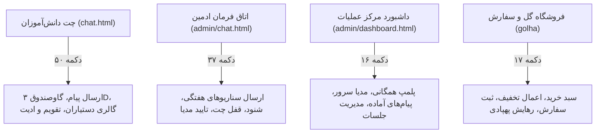

# 📋 سند مستر جامع بررسی، رفتارشناسی و ماتریس خروجی تمامی دکمه‌ها (MASTER BUTTONS & OUTPUTS MATRIX)

این سند مرجع رسمی و مستر تمامی دکمه‌ها، تعاملات کلیکی، درخواست‌های شبکه، رویدادهای بلادرنگ سوکت و رفتارهای مورد انتظار در پلتفرم **راز دهکده** (`Raze Dehkade`) است که بر اساس کلیه فایل‌های مستر پیشین تدوین شده است.

---

## ۱. نقشه کلان بخش‌های تعاملی پلتفرم

---

## ۲. ماتریس کامل دکمه‌های چت دانش‌آموز (`public/chat.html`)

| ردیف | نام و سلکتور دکمه | هندلر / رویداد | عملکرد و خروجی مورد انتظار بر اساس مستندات مستر | اعتبارسنجی خروجی و سناریوی خطا |
| :--- | :--- | :--- | :--- | :--- |
| **۱** | `.attach-button` | `onclick="triggerFileInput('*')"` | باز کردن پنجره انتخاب فایل مرورگر برای پیوست مدارک | بررسی سایز مجاز فایل، عدم اجازه آپلود پسوند‌های اجرایی خطرناک |
| **۲** | `#user-emoji-btn` | `onclick="toggleUserEmojiPicker(event)"` | باز و بسته کردن منوی شناور ایموجی‌ها بالای کادر ورودی متن | بسته شدن با کلیک بیرون از کادر، عدم اسکرول ناخواسته |
| **۳** | `.send-button` | `form submit` -> `sendUserMessage()` | ارسال پیام متنی به سرور از طریق `socket.emit('send_message')` | جلوگیری از ارسال پیام خالی، پاکسازی پیش‌نویس |
| **۴** | `.cal-nav-btn (prev)` | `onclick="changeShamsiMonth(-1)"` | انتقال ماه تقویم شمسی به ماه قبل در اسلات تقویم | محاسبه دقیق کبیسه و روزهای ۳۰ و ۳۱ روزه شمسی |
| **۵** | `.cal-nav-btn (next)` | `onclick="changeShamsiMonth(1)"` | انتقال ماه تقویم شمسی به ماه بعد در اسلات تقویم | به‌روزرسانی مناسبت‌های معمایی بدون شکستن لی‌اوت |
| **۶** | `#shamsi-today-badge` | `onclick="goToTodayShamsi()"` | بازگرداندن فوری نمایش تقویم به ماه و روز جاری | هایلایت روز جاری با کلاس `.is-today` |
| **۷** | `#open-assistants-popup-btn`| `onclick="openAssistantsPhotoPopup()"` | باز کردن پنجره مودال تمام‌صفحه گالری دستیاران کلاس | لود تصاویر اختصاصی کلاس، عدم نمایش تصاویر کلاس دیگر |
| **۸** | `#vault-3d-trigger-btn` | `onclick="openVaultInteraction()"` | باز کردن پنجره تمام‌صفحه تعاملی درب فولادی گاوصندوق | حفظ سیاست Zero-Spoiler، عدم نمایش برچسب پلمپ لو‌دهنده |
| **۹** | `.dialog-close (evidence)` | `onclick="closeEvidence()"` | بستن دیالوگ بزرگنمایی مدارک و شواهد کارآگاهی | بازگرداندن فوکوس و اسکرول صفحه به حالت عادی |
| **۱۰**| `.assistants-lb-nav (prev)`| `onclick="stepAssistantLightbox(-1)"` | مشاهده تصویر دستیار قبلی در لایت‌باکس با افکت زوم | حلقه بسته (Wrap-around) از ابتدا به انتهای لیست |
| **۱۱**| `.assistants-lb-nav (next)`| `onclick="stepAssistantLightbox(1)"` | مشاهده تصویر دستیار بعدی در لایت‌باکس با افکت زوم | تغییر روان نام و تصویر بدون چشمک زدن صفحه |
| **۱۲**| `#assistantsLensZoomIn` | `onclick` | افزایش مقیاس بزرگ‌نمایی ذره‌بین تصویر پرتره | سقف بزرگ‌نمایی ۳ برابری جهت حفظ کیفیت تصویر |
| **۱۳**| `#assistantsLensZoomOut` | `onclick` | کاهش مقیاس بزرگ‌نمایی ذره‌بین تصویر پرتره | عدم کوچک‌تر شدن از اندازه اولیه کادر |
| **۱۴**| `#assistantsLensReset` | `onclick` | بازنشانی مقیاس و موقعیت ذره‌بین به مرکز | ریست متغیرهای انتقال و مقیاس |
| **۱۵**| `.vault-slab-close-bolt` | `onclick="closeVaultPasswordModal()"` | بستن دیالوگ قفل گاوصندوق و بازگشت به نمای چت | پاکسازی ورودی رمز و متوقف کردن افکت‌های صوتی |
| **۱۶**| `.vault-key-btn (0-9)` | `onclick="appendVaultKeypadChar(n)"` | درج رقم در ورودی ۴ رقمی قفل زرهی | سقف قطعی ۴ رقم، مسدود شدن ورود ارقام پنجم به بعد |
| **۱۷**| `.func-clear (CLR)` | `onclick="clearVaultCodeInput()"` | پاک کردن کامل ارقام وارد شده در فیلد رمز گاوصندوق | ریست وضعیت ارورها و لرزش کادر |
| **۱۸**| `.func-backspace (⌫)` | `onclick="backspaceVaultCodeInput()"` | پاک کردن آخرین رقم وارد شده | مدیریت صحیح حالت خالی بودن رشته |
| **۱۹**| `#vault-unlock-submit-btn` | `form submit` -> `submitVaultPassword()`| اعتبارسنجی رمز `0110`، اجرای ۳ دور چرخش و جمع‌شدن ۵ زبانه | بررسی متغیر سراسری `isVaultAdminUnlocked`؛ نمایش خطا در حالت پلمپ |
| **۲۰**| `#vault-reward-close` | `onclick="closeVaultRewardModal()"` | بستن مودال پاکت کاهی دعوت‌نامه | بستن تمیز و آزاد کردن رم مرورگر |
| **۲۱**| `#user-edit-save-btn` | `form submit` -> `saveUserEditMessage()` | ویرایش پیام ارسال شده و مخابره به سرور | بررسی مالکیت پیام، عدم ویرایش پیام‌های سیستم |
| **۲۲**| `#user-delete-confirm-btn`| `onclick="confirmUserDeleteMessage()"` | حذف قطعی پیام ارسال شده توسط دانش‌آموز | به‌روزرسانی زنده سوکت برای ادمین و سایر حاضرین |

---

## ۳. ماتریس دکمه‌های اتاق فرمان ادمین (`public/admin/chat.html`)

| ردیف | نام و سلکتور دکمه | هندلر / رویداد | عملکرد و خروجی مورد انتظار بر اساس مستندات مستر | اعتبارسنجی و سناریوی حساس |
| :--- | :--- | :--- | :--- | :--- |
| **۱** | `#admin-chat-lock-btn` | `onclick="toggleAdminChatLock()"` | قفل/بازگشایی قابلیت ارسال پیام برای دانش‌آموزان این جلسه | به‌روزرسانی بلادرنگ UI کاربر و سرور (`is_chat_locked`) |
| **۲** | `#admin-vault-lock-btn`| `onclick="toggleAdminVaultLock()"` | تغییر وضعیت قفل گاوصندوق اختصاصی این جلسه | مخابره سوکت `vault_lock_updated` به اتاق جلسه |
| **۳** | `#admin-audio-toggle-btn`| `onclick="toggleAdminAudioStream()"` | شروع/پایان شنود زنده صدای کلاس از طریق میکروفون دانش‌آموز | بررسی دسترسی میکروفون، هندل کردن قطعی اینترنت و وب‌سوکت |
| **۴** | `.send-message-btn` | `onclick="sendAdminMessage()"` | ارسال متن تایپ شده یا سناریوی در پیش‌نویس | ارسال تک پیام بدون پاک شدن تاریخچه، تفکیک متن و فایل |
| **۵** | `#admin-emoji-btn` | `onclick="toggleAdminEmojiPicker(event)"`| باز/بسته کردن پنل انتخاب ایموجی ادمین | دسته‌بندی کارآگاهی، چهره‌ها، نمادها و دست‌ها |
| **۶** | `clearStagedMedia()` | `onclick` | لغو فایل آپلود شده در حالت پیش‌نویس کامپوزر | حذف پیش‌نمایش تصویر و پاکسازی متغیر حافظه |
| **۷** | `.week-tab-btn (1..5)` | `onclick="selectWeek(n)"` | جابجایی بین سناریوها و مراحل هفته‌های ۱ تا ۵ | لود مرحله‌های ذخیره شده همان هفته از دیتابیس |
| **۸** | `.add-step-btn` | `onclick="openAddStepDialog()"` | باز کردن فرم افزودن پیام/فایل جدید به سناریوی هفته | اعتبارسنجی فیلدهای عنوان، متن و فایل ضمیمه |
| **۹** | `triggerHackSequence()` | `onclick` | شبیه‌سازی سکانس نفوذ سایبری مزداک برای تست | حفظ ایمنی و عدم خروج داده‌های سیستمی |
| **۱۰**| `#admin-media-confirm-send`| `onclick` | تایید نهایی ارسال فایل صوتی/تصویری به دانش‌آموز | نمایش درصد پیشرفت آپلود و ارسال امن |

---

## ۴. ماتریس دکمه‌های داشبورد مرکز عملیات (`public/admin/dashboard.html`)

| ردیف | نام و سلکتور دکمه | هندلر / رویداد | عملکرد و خروجی مورد انتظار بر اساس مستندات مستر | اعتبارسنجی و سناریوی حساس |
| :--- | :--- | :--- | :--- | :--- |
| **۱** | `#global-vault-lock-btn` | `onclick="toggleGlobalVaultLock()"` | پلمپ یا بازگشایی همزمان گاوصندوق برای **تمامی جلسات** | تغییر رنگ دکمه (قرمز پلمپ / سبز باز)، مخابره سراسری به ۲۴ کلاس |
| **۲** | `openSessionDialog()` | `onclick` | باز کردن مودال ساخت جلسه جدید | جلوگیری از ساخت جلسه بیش از سقف مجاز، تولید کدهای یکتا |
| **۳** | `openMediaManagerDialog()`| `onclick` | باز کردن پنجره مدیریت رسانه‌ها و بارگذاری فایل‌ها | کش‌شکن هوشمند، دسته‌بندی صوتی و تصویری |
| **۴** | `openCannedResponsesManager()`| `onclick` | مدیریت پیام‌های آماده و میان‌برهای سریع پاسخگویی | افزودن، ویرایش و حذف سریع پیام‌های متنی آماده |
| **۵** | `loadSessions()` | `onclick` | بازخوانی زنده لیست تمامی جلسات، وضعیت‌ها و شمارنده‌ها | عدم پرش تصویر کارت‌ها، حفظ فیلتر جستجوی جاری |
| **۶** | `logoutAdmin()` | `onclick` | ابطال توکن ادمین و خروج ایمن به صفحه لاگین | پاکسازی نشست محلی و ریدایرکت قطعی به `/admin/login.html` |
| **۷** | `changeCaseStatus()` | `onchange` | تغییر وضعیت پرونده‌های سه‌گانه (`locked`, `active`, `solved`)| تغییر بلادرنگ وضعیت در دیتابیس و نمایش نشانگرهای قفل/کاپ |
| **۸** | `setActiveCase()` | `onclick` | تنظیم پرونده جاری جلسه به پرونده انتخاب شده | نمایش برچسب زرد رنگ «جاری» روی کارت پرونده |
| **۹** | `deleteSession()` | `onclick` | حذف کامل جلسه و تمامی پیام‌ها و لاگ‌های مرتبط | دیالوگ تایید قطعی مرورگر جهت جلوگیری از حذف تصادفی |

---

## ۵. استراتژی سناریوهای خصمانه و تست تیم قرمز (Red Team Bug Injection)
- **سناریوی ۱ (Double Submission / Spam Click):** کلیک سریع و متوالی با فاصله کمتر از ۵۰ میلی‌ثانیه بر روی دکمه‌های ارسال پیام، ثبت سفارش و قفل گاوصندوق.
- **سناریوی ۲ (Network Drops / Offline Reconnect):** قطع شدن عمدی اتصال سوکت در حین آپلود فایل چانک یا حین اجرای انیمیشن ۳۰ ثانیه‌ای تحویل پهپاد.
- **سناریوی ۳ (Concurrent Cross-Class Access):** باز کردن همزمان دو کلاس متفاوت در دو مرورگر و تلاش برای تغییر وضعیت پرونده یا ارسال پیام متقاطع.
- **سناریوی ۴ (Boundary Code Keypad Attack):** ارسال کدهای غیرعددی، رشته‌های طولانی، کاراکترهای اسکریپتی به فیلد قفل گاوصندوق و فرم سفارش.
- **سناریوی ۵ (Blackout Interruption & Refresh):** رفرش کردن صفحه در ثانیه ۱۵ بلک‌اوت ۵ دقیقه‌ای جهت اطمینان از بازگشت دقیق به ثانیه سپری‌شده بدون ریست زمان.
