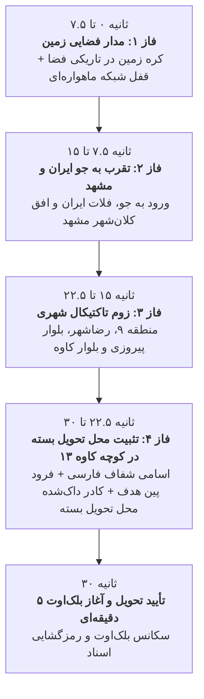

# مستر پلن جامع: سیستم رهگیری ماهواره‌ای و زوم فوتورئال از مدار زمین تا محل تحویل بسته (Class 17)
> **مستند معماری، زمان‌بندی و پیاده‌سازی زوم فضایی تا خیابانی (Earth-to-Street Zoom Engine)**  
> **مختصات محل تحویل:** `36.2843, 59.5448`  
> **آدرس دقیق:** مشهد، بلوار شهید کاوه، کوچه شهید کاوه ۱۳ (رودکی ۲۰)  
> **کلاس اختصاصی:** کلاس ۱۷ («زارع و احمدی» با کد سفارش `590019` و کد چت `699275`)  

---

## ۱. هدف و فلسفه بازطراحی (Continuous Earth-to-Street Zoom & Zero-Scroll 100vh)
تجربه کاربری طبق بازخورد مستقیم کاربر با رعایت اصول فوق‌حرفه‌ای بازطراحی گردید:
- **شروع از مدار فضایی زمین و زوم پیوسته ۶۰ فریم بر ثانیه (Continuous 60FPS Zoom Engine):** بدون تعویض اسلایدی ناگهانی، تمام لایه‌ها با محاسبات ریاضی پیوسته در `requestAnimationFrame` در طول ۳۰ ثانیه زوم و فید می‌شوند.
- **بدون اسکرول و دید کامل در یک نگاه (Zero-Scroll 100vh):** صفحه در `body.is-drone-mode` دارای `overflow: hidden !important` و ارتفاع دقیق `100dvh` است. مانیتور ماهواره‌ای تمام فضای عمودی را پر کرده و دایال تکراری پایین حذف شده است تا کاربر نیاز به هیچ‌گونه اسکرول عمودی نداشته باشد.
- **تغییر قطعی عنوان به «محل تحویل بسته»:** عبارت «آدرس جلسه» کاملاً حذف شده و به **«📍 محل تحویل بسته»** تغییر یافت.
- **کارت مشخصات داک‌شده در پایین کادر (Docked Bottom HUD Card):** کارت آدرس در پایین کادر به صورت شیشه‌ای داک شده تا نام کوچه‌ها («کاوه ۱۳»، «رودکی ۲۰»، «بلوار شهید کاوه») در مرکز تصویر کاملاً باز، واضح و بدون پوشیدگی قابل خواندن باشند.
- **کاهش خطوط اسکن نویز:** لایه اسکن‌لاین به شفافیت کم (۰.۱۵) تنظیم شده تا نقشه و حروف فارسی شفافیت کریستالی و فوق‌العاده بالایی داشته باشند.

---

## ۲. سناریو و زمان‌بندی دقیق ۳۰ ثانیه‌ای (Timeline Choreography)



### جزییات هر فاز:
1. **فاز ۱ (۰ تا ۷.۵ ثانیه):**
   - **تصویر:** کره زمین در اعماق فضا با زوم پیوسته از مقیاس 1.0 به 2.55.
   - **HUD ماهواره‌ای:** `OPTICS-714 // RECON // GPS: 36.2843°N, 59.5448°E`
   - **تیتر وضعیت فارسی:** `رهگیری ماهواره‌ای مختصات هدف // شناسایی محل تحویل بسته`
   - **تایمر سربرگ:** ثانیه‌شمار زنده دیجیتال ۳۰ ثانیه تا تحویل.

2. **فاز ۲ (۷.۵ تا ۱۵ ثانیه):**
   - **تصویر:** ورود از مدار به اتمسفر و زوم بر روی منطقه خاورمیانه و کلان‌شهر مشهد با زوم پیوسته از مقیاس 0.92 به 2.70.
   - **HUD ماهواره‌ای:** `ALTITUDE: 18,500m -> 4,500m // MACH 2.4`
   - **تیتر وضعیت فارسی:** `تقرب مداری به حریم هوایی مشهد // کاهش ارتفاع عملیاتی`

3. **فاز ۳ (۱۵ تا ۲۲.۵ ثانیه):**
   - **تصویر:** زوم ماهواره‌ای تاکتیکال به سمت منطقه ۹، بافت رضاشهر و بلوار کاوه با زوم پیوسته از مقیاس 0.94 به 2.34.
   - **HUD ماهواره‌ای:** `ALTITUDE: 4,500m -> 650m // SECTOR: KAVEH BLVD`
   - **تیتر وضعیت فارسی:** `تثبیت ماهواره‌ای روی منطقه ۹ و رضاشهر // تقرب به بلوار کاوه`

4. **فاز ۴ (۲۲.۵ تا ۳۰ ثانیه):**
   - **تصویر:** زوم حداکثری و شفاف نقشه خیابانی با اسامی کاملاً خوانای فارسی:
     - «کاوه ۱۳ - 13th Kaveh»
     - «رودکی ۲۰»
     - «بلوار شهید کاوه»
     - «بلوار پیروزی»
   - **پین هدف:** فرود آمدن نشانگر قطره‌ای قرمز رنگ با موج تپنده و رتیکل چرخشی در مختصات دقیق `[36.2843, 59.5448]`.
   - **کارت مشخصات داک‌شده:**  
     **«📍 محل تحویل بسته: مشهد، بلوار شهید کاوه، کوچه شهید کاوه ۱۳ (رودکی ۲۰)»**
     داک‌شده در پایین کادر جهت دید کامل و باز معابر.
   - **کادر معرفی آدرس:**
     ```
     📍 آدرس جلسه اینجاست
     مشهد، بلوار شهید کاوه، کوچه شهید کاوه ۱۳ (رودکی ۲۰)
     مختصات: ۳۶.۲۸۴۳ , ۵۹.۵۴۴۸
     ```
   - **تیتر وضعیت فارسی:** `موقعیت مکانی محل تحویل بسته با موفقیت تثبیت شد`

5. **پایان ۳۰ ثانیه و انتقال:**
   - نمایش پیام تحویل موفقیت‌آمیز در مختصات محل تحویل بسته.
   - ورود به سکانس ۵ دقیقه بلک‌اوت (خاموشی صفحه) و سپس ترنزیشن اسکن سایبری و ورود به درگاه اسناد.

---

## ۳. معماری فنی و مهندسی تایل‌ها (Tile Storage & 60fps Smooth Zoom)
برای جلوگیری از مشکلات فیلترینگ، تحریم یا قطعی اینترنت کاربر در حین انیمیشن:
1. **دانلود و ذخیره‌سازی محلی (Local Asset Bundling):**
   - تایل‌های ماهواره‌ای و نقشه‌ای برای سطوح زوم گوناگون در مسیر `public/assets/map/` دانلود و کش می‌شوند.
   - شامل تایل‌های زوم ۰ تا ۱۸، تایل‌های شفاف اسامی فارسی و فریم‌های فضایی رزولوشن بالا.
2. **رندرینگ نرم بر پایه Canvas و CSS Transform سه‌بعدی:**
   - استفاده از GPU Acceleration با `will-change: transform` و درون‌یابی مکعبی نرم (cubic bezier).
   - سوئیچ تدریجی شفافیت (Cross-fade) بین لایه فضا -> ماهواره -> نقشه برداری دقیق فارسی تا هیچ پرش یا کادر خالی به وجود نیاید.
3. **سازگاری کامل با آزمون‌های خودکار و ایزولاسیون:**
   - منحصراً برای کلاس ۱۷ («زارع و احمدی» با کد `590019`).
   - سایر کلاس‌ها بدون کوچک‌ترین تداخل، فرمت تحویل استاندارد خود را حفظ می‌کنند.
