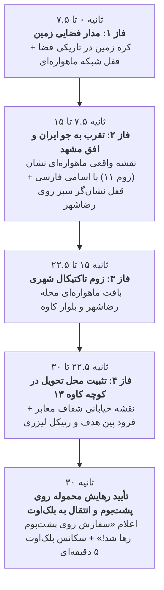

# مستر پلن جامع: سیستم رهگیری ماهواره‌ای و زوم فوتورئال از مدار زمین تا محل تحویل بسته (Class 17)
> **مستند معماری، زمان‌بندی و پیاده‌سازی زوم فضایی تا خیابانی (Earth-to-Street Zoom Engine)**  
> **مختصات دقیق محل تحویل:** `36.28379888932916, 59.545839183469155` (نمایش: `36.2838°N, 59.5458°E`)  
> **آدرس دقیق:** مشهد، رضاشهر، تقاطع بلوار شهید کاوه و کوچه شهید کاوه ۱۳ (رودکی ۲۰)  
> **کلاس اختصاصی:** کلاس ۱۷ («زارع و احمدی» با کد سفارش `590019` و کد چت `699275`)  

---

## ۱. هدف و فلسفه بازطراحی (Continuous Earth-to-Street Zoom & Zero-Scroll 100vh)
تجربه کاربری طبق بازخورد مستقیم کاربر با رعایت اصول فوق‌حرفه‌ای بازطراحی گردید:
- **شروع از مدار فضایی زمین و زوم پیوسته ۶۰ فریم بر ثانیه (Continuous 60FPS Zoom Engine):** بدون تعویض اسلایدی ناگهانی، تمام لایه‌ها با محاسبات ریاضی پیوسته در `requestAnimationFrame` در طول ۳۰ ثانیه زوم و فید می‌شوند.
- **بدون اسکرول و دید کامل در یک نگاه (Zero-Scroll 100vh):** صفحه در `body.is-drone-mode` دارای `overflow: hidden !important` و ارتفاع دقیق `100dvh` است. مانیتور ماهواره‌ای تمام فضای عمودی را پر کرده و دایال تکراری پایین حذف شده است تا کاربر نیاز به هیچ‌گونه اسکرول عمودی نداشته باشد.
- **تغییر قطعی عنوان به «محل تحویل بسته»:** عبارت «آدرس جلسه» کاملاً حذف شده و به **«📍 محل تحویل بسته»** تغییر یافت.
- **اعلام تحویل اختصاصی روی پشت‌بوم:** در لحظه تحویل نهایی، به صورت کاملاً شفاف و مشخص اعلام می‌شود: **«سفارش روی پشت‌بوم رها شد!»**.
- **کارت مشخصات داک‌شده در پایین کادر (Docked Bottom HUD Card):** کارت آدرس در پایین کادر به صورت شیشه‌ای داک شده تا نام کوچه‌ها («کاوه ۱۳»، «رودکی ۲۰»، «بلوار شهید کاوه») در مرکز تصویر کاملاً باز، واضح و بدون پوشیدگی قابل خواندن باشند.
- **کاهش خطوط اسکن نویز:** لایه اسکن‌لاین به شفافیت کم (۰.۱۵) تنظیم شده تا نقشه و حروف فارسی شفافیت کریستالی و فوق‌العاده بالایی داشته باشند.
- **جلوگیری قطعی از کش مرورگر (Cache-Busting):** تمام دارایی‌های تصویری مجهز به پارامترهای نگارش صریح (`?v=...`) و نام‌های فایل اختصاصی هستند تا مرورگر کاربر هرگز تصویر اشتباه یا قدیمی را از Disk Cache لود نکند.

---

## ۲. سناریو و زمان‌بندی دقیق ۳۰ ثانیه‌ای (Timeline Choreography)

### جزییات هر فاز:
1. **فاز ۱ (۰ تا ۷.۵ ثانیه):**
   - **تصویر:** کره زمین در اعماق فضا با زوم پیوسته از مقیاس 1.0 به 2.55 (`earth-orbital-space.jpg`). نسبت تصویر ۱۶:۹ واقعی بدون هیچ‌گونه دفرمه شدن و خطوط فیک هوش مصنوعی.
   - **HUD ماهواره‌ای:** `OPTICS-714 // RECON // GPS: 36.2838°N, 59.5458°E`
   - **تیتر وضعیت فارسی:** `رهگیری ماهواره‌ای مختصات هدف // شناسایی محل تحویل بسته`
   - **تایمر سربرگ:** ثانیه‌شمار زنده دیجیتال ۳۰ ثانیه تا تحویل.

2. **فاز ۲ (۷.۵ تا ۱۵ ثانیه):**
   - **تصویر (نقشه از دور مشهد):** نقشه ماهواره‌ای واقعی کلان‌شهر مشهد با زوم ۱۱ منطبق بر نقشه معتبر نشان (`mashhad-regional-neshan.jpg`). دارای نام‌های مشخص و خوانای فارسی: «رضاشهر»، «بوستان کوهسنگی»، «احمدآباد»، «پارک ملت مشهد»، «آزادشهر»، «سرافرازان»، «فرودگاه بین‌المللی» و رشته‌کوه‌های بینالود.
   - **تراز نشان‌گر سبز ره‌گیری (AUTO-TRACK):** نشان‌گر مرکزی در مختصات دقیق `(50.00% , 50.00%)` مستقیماً روی **محله «رضاشهر» و ابتدای بلوار شهید کاوه** قفل می‌شود (همان نقطه که در نقشه نشان علامت‌گذاری شد) و به هیچ وجه مناطق بیابانی یا کوهستانی اشتباه را هدف قرار نمی‌دهد.
   - **HUD ماهواره‌ای:** `ALTITUDE: 18,500m -> 4,500m // MACH 2.4 // SENSOR: MULTISPECTRAL // FOV: 45° MASHHAD`
   - **تیتر وضعیت فارسی:** `تقرب مداری به حریم هوایی مشهد // کاهش ارتفاع عملیاتی`

3. **فاز ۳ (۱۵ تا ۲۲.۵ ثانیه):**
   - **تصویر:** زوم ماهواره‌ای تاکتیکال به سمت منطقه ۹، بافت رضاشهر و بلوار کاوه (`mashhad-kaveh-satellite.jpg`) با تراز دقیق مرکز روی نقطه `(65.95% , 71.73%)`.
   - **HUD ماهواره‌ای:** `ALTITUDE: 4,500m -> 650m // SECTOR: KAVEH BLVD // LOCKING KAVEH 13...`
   - **تیتر وضعیت فارسی:** `تثبیت ماهواره‌ای روی منطقه ۹ و رضاشهر // تقرب به بلوار کاوه`

4. **فاز ۴ (۲۲.۵ تا ۳۰ ثانیه):**
   - **تصویر:** زوم حداکثری و فوق‌العاده شفاف نقشه خیابانی با اسامی کاملاً خوانای فارسی (`mashhad-kaveh-street-map.png`):
     - «کاوه ۱۳ - 13th Kaveh»
     - «رودکی ۲۰»
     - «بلوار شهید کاوه»
     - «بلوار پیروزی»
   - **پین هدف و رتیکل لیزری:** فرود آمدن نشانگر با رتیکل چرخشی لیزری در مختصات دقیق `[36.2838, 59.5458]`.
   - **کارت مشخصات داک‌شده:**  
     **«📍 محل تحویل بسته: مشهد، بلوار شهید کاوه، کوچه شهید کاوه ۱۳ (رودکی ۲۰)»**  
     داک‌شده در پایین کادر جهت دید کامل و باز معابر.
   - **تیتر وضعیت فارسی:** `موقعیت مکانی محل تحویل بسته با موفقیت تثبیت شد`

5. **پایان ۳۰ ثانیه و تحویل نهایی:**
   - نمایش پیام رسمی رهایش محموله:  
     **تیتر:** `سفارش روی پشت‌بوم رها شد!`  
     **زیرنویس:** `بسته با موفقیت توسط ریزپرنده روی پشت‌بوم مقصد (مشهد، کوچه شهید کاوه ۱۳) رها و مستقر گردید.`
   - نمایش ۸ ثانیه‌ای بنر تایید تحویل همراه با شمارش معکوس جهت اطمینان از مطالعه کامل توسط کاربر.
   - ورود خودکار به سکانس ۵ دقیقه بلک‌اوت (خاموشی صفحه) و سپس ترنزیشن اسکن سایبری و ورود به درگاه اسناد.

---

## ۳. معماری فنی و مهندسی تایل‌ها (Tile Storage & 60fps Smooth Zoom)
1. **دانلود و ذخیره‌سازی محلی (Local Asset Bundling):**
   - تمام فایل‌های تصویری در مسیر `public/assets/map/` محلی‌سازی شده‌اند.
   - برای تضمین عدم لود نسخه‌های قدیمی از کش مرورگر، نام جدید `mashhad-regional-neshan.jpg` به همراه پارامتر نسخه `?v=20261015_04` پیاده‌سازی شده است.
2. **رندرینگ نرم بر پایه GPU و CSS Transform:**
   - استفاده از GPU Acceleration با `will-change: transform` و درون‌یابی مکعبی نرم (cubic bezier).
   - انیمیشن پیوسته در جاوااسکریپت و بدون کوچک‌ترین پرش یا کادر سفید.
3. **سازگاری کامل با آزمون‌های خودکار و ایزولاسیون:**
   - منحصراً برای کلاس ۱۷ («زارع و احمدی» با کد `590019`).
   - سایر کلاس‌ها بدون کوچک‌ترین تداخل، فرمت تحویل استاندارد خود را حفظ می‌کنند.
