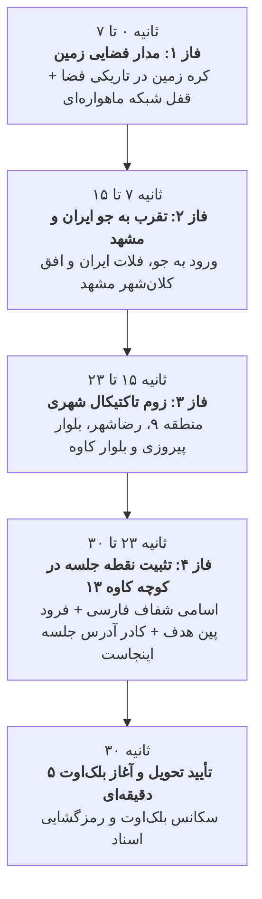

# مستر پلن جامع: سیستم رهگیری ماهواره‌ای و زوم فوتورئال از مدار زمین تا کوچه جلسه (Class 17)
> **مستند معماری، زمان‌بندی و پیاده‌سازی زوم فضایی تا خیابانی (Earth-to-Street Zoom Engine)**  
> **مختصات جلسه:** `36.2843, 59.5448`  
> **آدرس دقیق:** مشهد، بلوار شهید کاوه، کوچه شهید کاوه ۱۳ (رودکی ۲۰)  
> **کلاس اختصاصی:** کلاس ۱۷ («زارع و احمدی» با کد سفارش `590019` و کد چت `699275`)  

---

## ۱. هدف و فلسفه بازطراحی (Why Earth-to-Street Zoom?)
کاربر به‌طور کامل انیمیشن‌های ساده کارتونی یا فریم‌های ریزپرنده قبلی را رد کرده و یک تجربه حرفه‌ای، شیک، سینمایی و واقع‌گرایانه (Google Earth Reconnaissance Style) درخواست کرده است:
- شروع سکانس ۳۰ ثانیه‌ای از بالای بالای مدار زمین (نمای فضایی کره زمین).
- زوم پیوسته، فوق‌العاده نرم، بدون لرزش و پرواز به اعماق نقشه.
- فرود آمدن دقیق بر روی مختصات `36.2843, 59.5448`.
- نمایش بی‌نهایت شفاف و واضح کوچه‌ها و نام خیابان‌ها به فارسی:
  - **کوچه شهید کاوه ۱۳**
  - **رودکی ۲۰**
  - **بلوار شهید کاوه**
  - **بلوار پیروزی و رضاشهر**
- فرود پین (نشانگر) قرمز رنگ در نقطه دقیق جلسه به همراه کادر مشخصات:  
  **«آدرس جلسه اینجاست: مشهد، بلوار شهید کاوه، کوچه شهید کاوه ۱۳ (رودکی ۲۰)»**

---

## ۲. سناریو و زمان‌بندی دقیق ۳۰ ثانیه‌ای (Timeline Choreography)



### جزییات هر فاز:
1. **فاز ۱ (۰ تا ۷ ثانیه):**
   - **تصویر:** نمای فضایی باکیفیت و سینمایی از سیاره زمین در تاریکی کهکشان با چرخش آرام و هاله نوری اتمسفر.
   - **HUD ماهواره‌ای:** `ORBITAL RECON SATELLITE // GPS LOCK // 36.2843°N 59.5448°E`
   - **تیتر وضعیت فارسی:** `رهگیری ماهواره‌ای مختصات هدف // شناسایی موقعیت جلسه`
   - **توضیحات تلمتری:** ماهواره شناسایی روی مختصات جغرافیایی هدف قفل اپتیکال کرده و در حال تقرب به جو است.

2. **فاز ۲ (۷ تا ۱۵ ثانیه):**
   - **تصویر:** ورود از مدار به اتمسفر و زوم بر روی منطقه خاورمیانه، ایران و شمال‌شرق کشور (خراسان رضوی و کلان‌شهر مشهد).
   - **HUD ماهواره‌ای:** `ALTITUDE: 15,000m -> 4,200m // SECTOR: MASHHAD METRO`
   - **تیتر وضعیت فارسی:** `تقرب مداری به حریم هوایی مشهد // کاهش ارتفاع عملیاتی`
   - **توضیحات تلمتری:** عبور از ابرها و اسکن لایه‌های شهری استان خراسان رضوی و ورود به محدوده جنوب مشهد.

3. **فاز ۳ (۱۵ تا ۲۳ ثانیه):**
   - **تصویر:** زوم ماهواره‌ای تاکتیکال به سمت منطقه ۹، بافت رضاشهر و شریان‌های اصلی (بلوار پیروزی، میدان حر، بلوار شهید کاوه).
   - **HUD ماهواره‌ای:** `ALTITUDE: 1,200m -> 350m // OPTICAL RESOLUTION: 0.25m/px`
   - **تیتر وضعیت فارسی:** `تثبیت ماهواره‌ای روی منطقه ۹ و رضاشهر // تقرب به بلوار کاوه`
   - **توضیحات تلمتری:** تفکیک پلاک‌ها و شبکه‌بندی خیابان‌های فرعی در محور بلوار شهید کاوه.

4. **فاز ۴ (۲۳ تا ۳۰ ثانیه):**
   - **تصویر:** زوم حداکثری و شفاف نقشه خیابانی با اسامی کاملاً خوانای فارسی:
     - «کاوه ۱۳ - 13th Kaveh»
     - «رودکی ۲۰»
     - «بلوار شهید کاوه»
     - «بلوار پیروزی»
   - **پین هدف:** فرود آمدن نشانگر قطره‌ای قرمز رنگ با موج تپنده در مختصات دقیق `[36.2843, 59.5448]`.
   - **کادر معرفی آدرس:**
     ```
     📍 آدرس جلسه اینجاست
     مشهد، بلوار شهید کاوه، کوچه شهید کاوه ۱۳ (رودکی ۲۰)
     مختصات: ۳۶.۲۸۴۳ , ۵۹.۵۴۴۸
     ```
   - **تیتر وضعیت فارسی:** `موقعیت مکانی جلسه با موفقیت تثبیت شد`

5. **پایان ۳۰ ثانیه و انتقال:**
   - نمایش پیام تحویل موفقیت‌آمیز در مختصات جلسه.
   - ورود به سکانس ۵ دقیقه بلک‌اوت (خاموشی صفحه) و سپس ترنزیشن اسکن سایبری و ورود به درگاه اسناد.

---

## ۳. معماری فنی و مهندسی تایل‌ها (Tile Storage & 60fps Smooth Zoom)
برای جلوگیری از مشکلات فیلترینگ، تحریم یا قطعی اینترنت کاربر در حین انیمیشن:
1. **دانلود و ذخیره‌سازی محلی (Local Asset Bundling):**
   - تایل‌های ماهواره‌ای و نقشه‌ای برای سطوح زوم گوناگون در مسیر `public/assets/map/` دانلود و کش می‌شوند.
   - شامل تایل‌های زوم ۰ تا ۱۸، تایل‌های شفاف اسامی فارسی و فریم‌های فضایی رزولوشن بالا.
2. **رندرینگ نرم بر پایه Canvas و CSS Transform سه‌بعدی:**
   - استفاده از GPU Acceleration با `will-change: transform` و درون‌یابی مکعبی نرم (cubic bezier).
   - سوئیچ تدریجی شفافیت (Cross-fade) بین لایه فضا -> ماهواره -> نقشه برداری دقیق فارسی تا هیچ پرش یا کادر خالی به وجود نیاید.
3. **سازگاری کامل با آزمون‌های خودکار و ایزولاسیون:**
   - منحصراً برای کلاس ۱۷ («زارع و احمدی» با کد `590019`).
   - سایر کلاس‌ها بدون کوچک‌ترین تداخل، فرمت تحویل استاندارد خود را حفظ می‌کنند.
