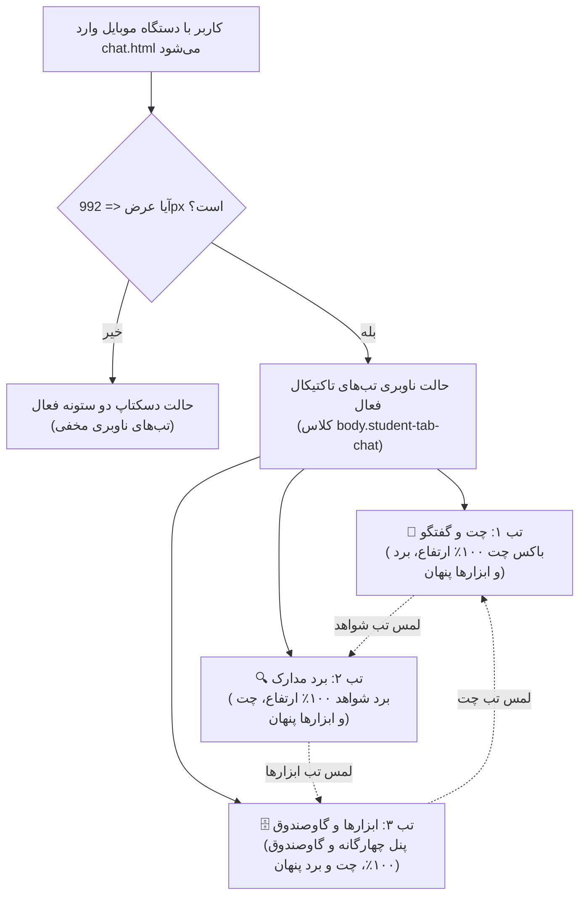

# MASTER: معماری ریسپانسیو سه‌گانه پایانه کارآگاهی دانش‌آموز، انطباق پویا با ویوپورت و مصون‌سازی کیبورد مجازی (Student Terminal Responsive Engine)

> **سند مرجع اصلی در درخت اسناد پروژه:** [`docs/ai/masters/MASTER_08_STUDENT_TERMINAL_RESPONSIVE_ENGINE.md`](file:///e:/projects/RazeDehkade/docs/ai/masters/MASTER_08_STUDENT_TERMINAL_RESPONSIVE_ENGINE.md)  
> **پروتکل مرجع:** پروتکل جامع معماری مستر و حافظه شناختی هوش مصنوعی ([`UNIVERSAL_AI_MASTER_PROTOCOL.md`](file:///e:/projects/RazeDehkade/UNIVERSAL_AI_MASTER_PROTOCOL.md))  
> **تاریخ تدوین:** 2026-10-20  
> **وضعیت سند:** VALIDATED & READY FOR DEPLOYMENT  

---

## ۱. بیانیه تصمیم و فلسفه مهندسی
پایانه کارآگاهی دانش‌آموز (`public/chat.html`) تا پیش از این به عنوان یک نمایشگر عریض رومیزی طراحی شده بود (`min-width: 980px`). این امر در دستگاه‌های موبایل و تبلت با نمایشگرهای باریک (۳۶۰ پیکسل الی ۹۹۲ پیکسل) منجر به فشرده‌شدن حباب‌های چت، دشواری اسکرول و اختلال در دسترسی به گاوصندوق ۳D و برد شواهد می‌شد.

طبق تصمیم معماری **`DEC-0029`**، معماری ریسپانسیو پایانه بر پایه ۳ اصل تخطی‌ناپذیر پایه‌ریزی شد:
1. **Desktop Invariant Guard:** در صفحات دسکتاپ عریض (`> 992px`)، چیدمان دو ستونه کلاسیک با برد مدارک در چپ و باکس چت در راست، **۱۰۰٪ بدون کوچک‌ترین تغییر** دست‌نخورده باقی می‌ماند. نوار تب‌های موبایل در دسکتاپ به طور قاطع با `display: none !important;` مخفی است.
2. **Mobile Tactical Tabs:** در ابعاد تبلت و موبایل (`<= 992px`)، صفحه به ۳ تب تاکتیکال مجزا با تمام قد (`100% height`) تفکیک می‌شود:
   - 💬 **اتاق چت و پیام‌ها (`chat`):** برای گفتگوی زنده با کارآگاه و ارسال مدارک.
   - 🔍 **برد مدارک و شواهد (`evidence`):** برای بررسی سرنخ‌ها و ذره‌بین ۳x.
   - 🗄️ **ابزارها و گاوصندوق (`tools`):** برای تقویم شمسی، پرتره دستیاران، مانیتورینگ N-LOG و گاوصندوق ۳D اسلات ۴.
3. **VisualViewport Keyboard Shield:** مهار دقیق باز و بسته شدن کیبورد نرم‌افزاری گوشی با رویدادهای `window.visualViewport` و متغیر `--viewport-height`، اعمال `flex-shrink: 0` و پدینگ `safe-area-inset-bottom` تا کامپوزر همیشه بالای صفحه کلید باقی بماند.

---

## ۲. دیاگرام وضعیت ناوبری و تغییر تب‌ها

---

## ۳. ماتریس فایل‌ها و تغییرات انجام شده

| فایل | نقش و نوع تغییر | وضعیت |
|---|---|---|
| [`public/assets/css/student-mobile.css`](file:///e:/projects/RazeDehkade/public/assets/css/student-mobile.css) | استایل‌های ریسپانسیو، کانتینر سیال، متغیر `--viewport-height`، سوئیچ تب‌ها و محافظت کیبورد | ایجاد شد |
| [`public/chat.html`](file:///e:/projects/RazeDehkade/public/chat.html) | اتصال `student-mobile.css` و تعبیه نوار تاکتیکال `<nav class="student-mobile-nav-tabs">` | به‌روزرسانی شد |
| [`public/assets/js/user-chat.js`](file:///e:/projects/RazeDehkade/public/assets/js/user-chat.js) | پیاده‌سازی متدهای `switchStudentMobileTab`، `initStudentMobileViewport` و به‌روزرسانی بج‌ها | به‌روزرسانی شد |
| [`tests/student-responsive.test.js`](file:///e:/projects/RazeDehkade/tests/student-responsive.test.js) | سوئیت آزمون خودکار ۷ گانه برای اعتبارسنجی DOM، دسکتاپ، موبایل، کیبورد و اینواریانت‌ها | ایجاد شد |
| [`docs/ai/masters/MASTER_08_STUDENT_TERMINAL_RESPONSIVE_ENGINE.md`](file:///e:/projects/RazeDehkade/docs/ai/masters/MASTER_08_STUDENT_TERMINAL_RESPONSIVE_ENGINE.md) | سند مستر تفصیلی طبق استاندارد UMAC-P | ایجاد شد |

---

## ۴. نتایج آزمون‌های خودکار و تضمین عدم شکستگی (Zero Regression)
- تست اختصاصی ماژول: `tests/student-responsive.test.js` -> **۷ تست سبز (PASS 7/7)**
- تست کلی کل سیستم: `node scripts/test-runner.js` -> **۱۱۶ تست سبز (PASS 116/116, 0 FAIL)**
- پایداری ویژگی‌های کلیدی:
  - تراز پیام‌ها: پیام کاربر سمت راست (`flex-start`)، پیام ادمین سمت چپ (`flex-end`).
  - ریپلای دوطرفه: کوت‌باکس شیشه‌ای، بنر کامپوزر و اسکرول نرم کاملاً فعال.
  - گاوصندوق ۳D: رمز اختصاصی `0110`، چرخش ۱۰۸۰ درجه، پلمپ بدون اسپویلر و ریست در رفرش کاملاً فعال.
