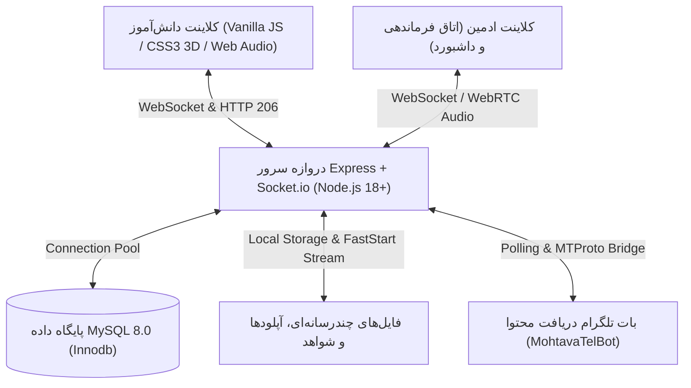
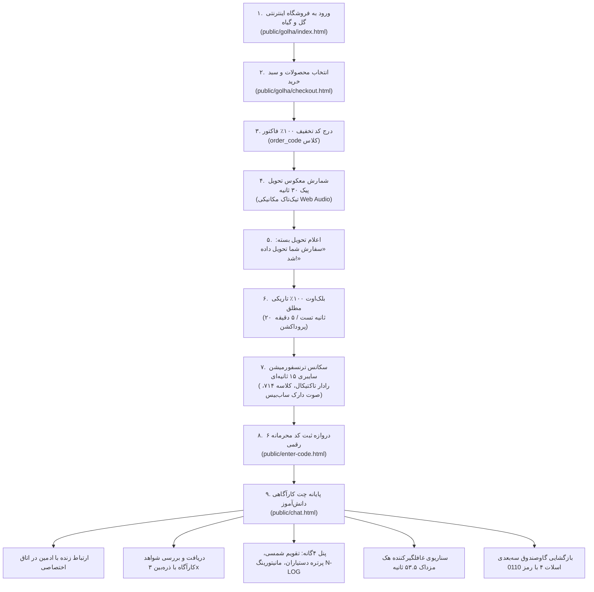

# 🌐 سند والد ریشه پلتفرم کارآگاهی «راز دهکده» (ROOT_MASTER.md)
# Universal AI Master Architecture & Core System Blueprint
> **سند والد ریشه (Parent Root Master):** عالی‌ترین مرجع معماری کلان، خطوط قرمز، درخت دامنه‌ها و چرخه داده‌های پلتفرم «راز دهکده»  
> **نسخه سند:** V10.0 (سازگار ۱۰۰٪ با پروتکل جامع UMAC-P)  
> **آخرین بازبینی و اعتبارسنجی:** ۱۸ اکتبر ۲۰۲۶ — وضعیت: **رسمی، قطعی و الزام‌آور برای تمام مدل‌های هوش مصنوعی**

---

## ۱. بیانیه مأموریت و دکترین بنیادین سیستم (Mission & Philosophy)

پلتفرم «راز دهکده» یک اکوسیستم وب تعاملی، چندرسانه‌ای و بلادرنگ برای برگزاری بازی‌های کارآگاهی-آموزشی زنده در مقیاس مدارس و تیم‌های چندگانه است.
این سیستم کاربران (دانش‌آموزان) را در قالب یک پوشش بیزنسی بسیار طبیعی (یک فروشگاه اینترنتی گل و گیاه) وارد داستان کرده و پس از تکمیل سناریوی خرید، تحویل، بلک‌اوت و دگردیسی سایبری، آن‌ها را به یک پایانه کارآگاهی تاکتیکال هدایت می‌کند که در آن به حل معماها، برقراری ارتباط زنده با کارآگاه/ادمین، کاوش اسناد و شواهد، مواجهه با رخدادهای غیرمنتظره هکری و بازگشایی گاوصندوق زرهی اسناد محرمانه می‌پردازند.

### منشور پنج‌گانه مهندسی:
1. **اصالت سند مستر (`Single Source of Truth`):** تمامی قوانین رفتاری، تعرفه‌ها، رویدادهای صوتی و تصویری و پروتکل‌های سوکت در این مستند و اسناد وابسته ثبت شده‌اند. هیچ مدل هوش مصنوعی اجازه تخطی یا حدس زدن قوانین خارج از این اسناد را ندارد.
2. **سلسله‌مراتب والد و فرزند (`Parent-Child Hierarchy`):** `ROOT_MASTER.md` سند ریشه است. زیرمجموعه آن ۵ سند والد دامنه در `docs/ai/domains/` و ۶ سند فرزند اجرایی در `docs/ai/masters/` تعریف شده‌اند.
3. **نبایدها برتر از بایدها (`Invariants First`):** ۲۵ قانون طلایی پروژه (ثبت‌شده در `docs/ai/DECISIONS.md`) خطوط قرمز مطلق و غیرقابل‌مذاکره هستند.
4. **راستی‌آزمایی مستند (`Anti-Fraud Verification`):** هر تغییری باید با آزمون‌های خودکار `npm test` اعتبارسنجی شود. ادعای موفقیت بدون گذراندن تست‌های واقعی باطل است.
5. **پیوستگی تحویل شیفت (`Continuous Handoff`):** تمامی هوش‌های مصنوعی پیش از شروع به کار، بالای فایل `docs/ai/PROJECT_STATE.md` را خوانده و پس از پایان، امضای گزارش خود را درج می‌کنند.

---

## ۲. پشته فناوری و زیرساخت فنی (Technology Stack)



- **محیط اجرا (Runtime):** Node.js 18+ (سازگار با ویندوز XAMPP و لینوکس Ubuntu VPS)
- **فریم‌ورک وب:** Express 4.19.2 (پشتیبانی از gzip/brotli compression، هدرهای HTTP 206 Partial Content، و middleware های محافظت URL)
- **ارتباطات بلادرنگ:** Socket.io 4.7.5 (جداسازی اتاق‌ها به ازای هر کلاس: `session_${sessionId}`، کنترل اسپم پیام، رویدادهای هک مزداک و حضور آنلاین)
- **پایگاه داده:** MySQL 8.0 با درایور `mysql2/promise` (استفاده از سیستم مایگریشن اختصاصی `src/db/migrate.js` و سیدینگ جلسات `src/db/seed-classes.js`)
- **احراز هویت:** JWT (`jsonwebtoken 9.0.2`) و رمزنگاری کلمات عبور با `bcryptjs 2.4.3`
- **پخش و استریم رسانه:** سیستم تبدیل خودکار `mp4FastStart.js` بر پایه جاوااسکریپت خالص (انتقال اتم `moov` پیش از `mdat`) بدون وابستگی به باینری خارجی ffmpeg
- **تایپوگرافی و طراحی بصری:** فونت هندسی و مدرن «استعداد» (`Estedad Variable`) بارگذاری‌شده به صورت ۱۰۰٪ لوکال

---

## ۳. نقشه ساختار درختی پروژه و مستندات (Repository Tree)

```
RazeDehkade/
├── docs/ai/                              # [چتر جامع حافظه و معماری هوش مصنوعی]
│   ├── ROOT_MASTER.md                    # [همین سند: مرجع کلان سیستم]
│   ├── PROJECT_STATE.md                  # [حافظه زنده و فعال با آخرین امضا]
│   ├── CHANGELOG.md                      # [گاه‌شمار تاریخی تغییرات]
│   ├── DECISIONS.md                      # [دفتر تصمیمات قطعی DEC-0001 تا DEC-0025]
│   ├── BACKLOG.md                        # [نیازمندی‌های آینده و توسعه‌های بعدی]
│   ├── INDEX.md                          # [شاخص و رادار جستجوی سریع کدها]
│   ├── domains/                          # [اسناد والد دامنه‌های پنج‌گانه]
│   │   ├── AUTH_AND_SESSIONS.md          # دامنه احراز هویت، نشست‌ها و جداسازی کلاس‌ها
│   │   ├── STORE_AND_DELIVERY.md         # دامنه فروشگاه گل، سبد خرید، بلک‌اوت و دلیوری
│   │   ├── REALTIME_CHAT_ENGINE.md       # دامنه موتور چت سوکت، شنود زنده و هک
│   │   ├── MEDIA_STREAMING_AND_BOT.md    # دامنه آپلود تکه‌ای، استریم آنی و بات تلگرام
│   │   └── QUAD_PANEL_AND_3D_VAULT.md    # دامنه پنل ۴گانه، تقویم، گالری و گاوصندوق ۳D
│   └── masters/                          # [اسناد فرزند اجرایی تسک‌ها]
│       ├── MASTER_01_INITIAL_SETUP_AND_STORE.md
│       ├── MASTER_02_DELIVERY_BLACKOUT_AND_TRANSFORMATION.md
│       ├── MASTER_03_REALTIME_CHAT_AND_LIVE_LISTENING.md
│       ├── MASTER_04_MEDIA_STREAMING_TELEGRAM_BOT.md
│       ├── MASTER_05_QUAD_PANEL_AND_3D_VAULT.md
│       └── MASTER_06_BUTTONS_AND_OUTPUTS_MATRIX.md
│       ├── MASTER_11_LIVE_AUDIO_BROADCAST_AND_MULTI_ADMIN.md
│       └── MASTER_12_MAZDAK_CYBER_BREACH_AND_EMERGENCY_PORTAL.md
├── server.js                             # نقطه ورود سرور اصلی (Express, Socket.io, HTTP 206)
├── package.json                          # اسکریپت‌ها، وابستگی‌ها و دستور اجرای تست‌ها
├── src/                                  # سورس‌کد ماژولار بک‌اند
│   ├── db/                               # اتصالات، مایگریشن‌ها و دیتای اولیه
│   ├── middleware/                       # محافظت احراز هویت و توکن‌های JWT
│   ├── models/                           # مدل‌های داده و تعامل با جداول MySQL
│   ├── routes/                           # روت‌های RESTful API
│   ├── socket/                           # هندلرهای رویدادهای بلادرنگ سوکت
│   └── utils/                            # ابزارهای کمکی (mp4FastStart, logger, classMatcher)
├── public/                               # فایل‌های استاتیک فرانت‌اند
│   ├── golha/                            # پوسته فروشگاه گل، سبد خرید و پیگیری تحویل
│   ├── admin/                            # اتاق فرماندهی کارآگاه، داشبورد و لاگین
│   ├── chat.html                         # پایانه کارآگاهی دانش‌آموزان
│   ├── enter-code.html                   # دروازه ورود کد ۶ رقمی بسته
│   └── assets/                           # استایل‌های CSS، اسکریپت‌های JS و فایل‌های سه‌بعدی
├── MohtavaTelBot/                        # ربات تلگرامی مدیریت محتوای پرونده
└── tests/                                # سوئیت تست‌های یکپارچگی (۱۰۲ تست سبز)
```

---

## ۴. فلوچارت کلان تجربه کاربری و سناریوی بازی (User Experience Flow)



---

## ۵. چکیده ۲۵ قانون طلایی و خطوط قرمز مطلق (Executive Codex of Invariants)

| ردیف | شناسه تصمیم | موضوع قانون طلایی | شرح خط قرمز فنی |
|---|---|---|---|
| ۱ | `DEC-0001` | عدم اختراع قوانین بیزینس | هیچ فرضیه‌ای جایگزین سوال از کاربر نمی‌شود؛ سناریوهای مبهم متوقف می‌شوند. |
| ۲ | `DEC-0002` | واحد پولی ریال | در تمام بخش‌های فروشگاه فقط واحد «ریال» استفاده شده و کلمه تومان ممنوع است. |
| ۳ | `DEC-0003` | ۵ محصول کلیدی | بیلچه، سانسوریا، لیلیوم، کاکتوس و کود تراریم همواره در میان ۱۵ محصول پخش هستند. |
| ۴ | `DEC-0004` | برندینگ گل و گیاه | نام «فروشگاه اینترنتی گل و گیاه» و شعار «ارسال خیـــــلی خیـــــلی خیـــــلی سریع». |
| ۵ | `DEC-0005` | ممنوعیت opacity: 0 | بارگذاری تصاویر هرگز نباید با `opacity: 0` انجام شود تا ریسک سفیدی به صفر برسد. |
| ۶ | `DEC-0006` | بلک‌اوت و ترنسفورمیشن | تاریکی ۱۰۰٪ مطلق با `cursor: none` و سکانس سایبری بدون بیپ‌های خنده‌دار. |
| ۷ | `DEC-0007` | بازرسی تصاویر | زوم شواهد در محدوده استاندارد ۱.۰ تا ۳.۰ برابر با پشتیبانی از چرخ موس و تاچ. |
| ۸ | `DEC-0008` | فونت سراسری | بارگذاری فونت محلی مدرن `Estedad Variable` بدون نیاز به اینترنت. |
| ۹ | `DEC-0009` | پایداری سوکت و ضداسپم | جلوگیری از دابل‌سابمیت با مارکر in-flight و دیبانس در کلاینت و سرور. |
| ۱۰ | `DEC-0010` | پنل ایموجی دوطرفه | در کادر ارسال پیام کاربر و ادمین پنل ایموجی شناور تعبیه شده است. |
| ۱۱ | `DEC-0011` | حذف ویس دانش‌آموز | حذف ارسال ویس کاربر هم‌زمان با فعال بودن کامل شنود صدای محیط توسط ادمین. |
| ۱۲ | `DEC-0012` | پنل چهارگانه زیر برد | ۱) تقویم شمسی واقعی ۲) دکمه عکس دستیاران ۳) ترمینال لاگ ۴) گاوصندوق زرهی ۳D. |
| ۱۳ | `DEC-0013` | ادیت و حذف پیام کاربر | امکان ویرایش و حذف پیام‌های ارسالی توسط خود دانش‌آموز با مودال اختصاصی. |
| ۱۴ | `DEC-0014` | چیدمان حباب‌های چت | پیام‌های کاربر حتماً سمت راست (`flex-start`) و ادمین/کارآگاه سمت چپ (`flex-end`). |
| ۱۵ | `DEC-0015` | حذف هدر و فوتر چت | هدر بالا و فوتر پایین در چت کاربر جهت اختصاص ۱۰۰٪ ارتفاع به سناریو حذف شده‌اند. |
| ۱۶ | `DEC-0016` | کارت هشدار ۱۰ ثانیه‌ای | اضافه شدن مدرک جدید کارآگاه با کارت کوچک در مرکز چت و محو خودکار پس از ۱۰ ثانیه. |
| ۱۷ | `DEC-0017` | ساعت دیجیتالی نئونی | نمایش زنده ساعت دقیق در هدر باکس چت با استایل نئونی بدون شلوغی‌های قدیمی. |
| ۱۸ | `DEC-0018` | استاندارد کامپوزر ادمین | ارسال با `Enter`، ارتفاع ثابت دکمه‌ها (`42px`) و ریسپانسیو بی‌نقص در تبلت/موبایل. |
| ۱۹ | `DEC-0019` | تفکیک فایل‌های کاربر | عکس‌های کاربر در چت باقی می‌ماند و هرگز روی برد شواهد کارآگاه پین نمی‌شود. |
| ۲۰ | `DEC-0020` | آپلود تکه‌ای ۲۰۰KB | ارسال قطعات ۲۰۰ کیلوبایتی جهت عبور از محدودیت پیش‌فرض `client_max_body_size` انجینکس. |
| ۲۱ | `DEC-0021` | نام‌های ۳ پرونده بایگانی | سندروم فراموشی (چپ)، راز دهکده (وسط)، دادگاه عدالت (راست). |
| ۲۲ | `DEC-0022` | نمایش ۱۰۰٪ تصویر مودال | تناسب ابعاد و دیده‌شدن تمام فریم عکس‌های عمودی در مودال بدون بریدگی. |
| ۲۳ | `DEC-0023` | استریم آنی HTTP 206 | پخش آنلاین صوت/ویدیو با FastStart و ممنوعیت قفل کش که باعث توقف در ثانیه ۲ می‌شد. |
| ۲۴ | `DEC-0024` | پنهان‌سازی عناوین بات | عناوین داخلی ادمین (`پیام ۱`، `بعد از ۵ دقیقه`) هرگز نباید به دانش‌آموز نشان داده شوند. |
| ۲۵ | `DEC-0025` | گاوصندوق ۳D اسلات ۴ | بدنه تمام‌فولادی، سیاست عدم لو دادن سناریو، چرخش ۱۰۸۰ درجه، رمز 0110 و ریست با رفرش. |
| ۲۶ | `DEC-0026` | ریپلای دوطرفه و ایزولاسیون | ارجاع متقارن کاربر/ادمین مقید به نشست جاری، خنثی‌سازی ارجاع فرامرزی و دابل‌سابمیت ایمن. |
| ۲۷ | `DEC-0027` | کوت‌باکس حباب و پالس نئونی | نوار عمودی رنگی فرستنده، اسکرول نرم به پیام والد و انیمیشن درخشش پالس نئونی ۱.۸ ثانیه‌ای. |
| ۲۸ | `DEC-0028` | بنر پیش‌نمایش کامپوزر | اکشن `↩️`، دابل‌کلیک، فوکوس خودکار، لغو با `Escape` و حفظ کامل لایوت موبایل و کیبورد. |
| ۲۹ | `DEC-0029` | ناوبری سه‌گانه و ویوپورت موبایل | ۳ تب تاکتیکال در موبایل/تبلت، پنهان در دسکتاپ، مهار کیبورد با visualViewport و flex-shrink. |
| ۳۰ | `DEC-0030` | نشانه‌گذاری کارآگاهی تقویم | تیک، ضربدر و دایره قرمز از ۲۵ مهر تا تاریخ جاری بدون تسری به آینده. |

---

## ۶. پیوند به اسناد والد دامنه‌ها (Domain Masters Registry)

تمامی جزئیات تخصصی در اسناد والد اختصاصی زیر مدون شده‌اند:
- 🔐 [دامنه احراز هویت، نشست‌ها و ایزولاسیون](file:///c:/xampp/htdocs/RazeDehkade/docs/ai/domains/AUTH_AND_SESSIONS.md)
- 🌸 [دامنه فروشگاه گل، سبد خرید، بلک‌اوت و دلیوری](file:///c:/xampp/htdocs/RazeDehkade/docs/ai/domains/STORE_AND_DELIVERY.md)
- 💬 [دامنه موتور چت سوکت، شنود زنده و هک](file:///c:/xampp/htdocs/RazeDehkade/docs/ai/domains/REALTIME_CHAT_ENGINE.md)
- 📽️ [دامنه آپلود تکه‌ای، استریم آنی و بات تلگرام](file:///c:/xampp/htdocs/RazeDehkade/docs/ai/domains/MEDIA_STREAMING_AND_BOT.md)
- 🗄️ [دامنه پنل چهارگانه، تقویم، گالری و گاوصندوق ۳D](file:///c:/xampp/htdocs/RazeDehkade/docs/ai/domains/QUAD_PANEL_AND_3D_VAULT.md)

---

## ۷. پیوند به اسناد فرزند اجرایی تسک‌ها (Child Task Masters Registry)

- [MASTER_01: راه‌اندازی فروشگاه و کاتالوگ محصولات](file:///c:/xampp/htdocs/RazeDehkade/docs/ai/masters/MASTER_01_INITIAL_SETUP_AND_STORE.md)
- [MASTER_02: شمارش معکوس دلیوری، بلک‌اوت و ترنسفورمیشن سایبری](file:///c:/xampp/htdocs/RazeDehkade/docs/ai/masters/MASTER_02_DELIVERY_BLACKOUT_AND_TRANSFORMATION.md)
- [MASTER_03: چت بلادرنگ سوکت، شنود زنده و سکانس هک](file:///c:/xampp/htdocs/RazeDehkade/docs/ai/masters/MASTER_03_REALTIME_CHAT_AND_LIVE_LISTENING.md)
- [MASTER_04: استریم رسانه HTTP 206، آپلود تکه‌ای و ربات تلگرام](file:///c:/xampp/htdocs/RazeDehkade/docs/ai/masters/MASTER_04_MEDIA_STREAMING_TELEGRAM_BOT.md)
- [MASTER_05: پنل چهارگانه زیر برد شواهد و گاوصندوق ۳D اسلات ۴](file:///c:/xampp/htdocs/RazeDehkade/docs/ai/masters/MASTER_05_QUAD_PANEL_AND_3D_VAULT.md)
- [MASTER_06: ماتریس جامع دکمه‌ها و رفتارهای کلیکی پلتفرم](file:///c:/xampp/htdocs/RazeDehkade/docs/ai/masters/MASTER_06_BUTTONS_AND_OUTPUTS_MATRIX.md)
- [MASTER_07: سامانه ریپلای دوطرفه پیام‌ها، کوت‌باکس و پیش‌نمایش کامپوزر](file:///e:/projects/RazeDehkade/docs/ai/masters/MASTER_07_TWO_WAY_REPLY_AND_QUOTE_ENGINE.md)
- [MASTER_08: معماری ریسپانسیو سه‌گانه پایانه دانش‌آموز، انطباق ویوپورت و مصون‌سازی کیبورد](file:///e:/projects/RazeDehkade/docs/ai/masters/MASTER_08_STUDENT_TERMINAL_RESPONSIVE_ENGINE.md)
- [MASTER_09: سامانه نشانه‌گذاری تاکتیکال تقویم شمسی کارآگاهی](file:///e:/projects/RazeDehkade/docs/ai/masters/MASTER_09_DETECTIVE_CALENDAR_TACTICAL_MARKINGS.md)
- [MASTER_10: معماری سینمایی نفوذ سایبری مزداک و صعود پایانه N-LOG کلاسه ۱۴](file:///e:/projects/RazeDehkade/docs/ai/masters/MASTER_09_MAZDAK_CYBER_BREACH_ENGINE.md)
- [MASTER_11: سامانه استریم شنود صوتی پیش‌فرض و برودکست هم‌زمان چند ادمین](file:///e:/projects/RazeDehkade/docs/ai/masters/MASTER_11_LIVE_AUDIO_BROADCAST_AND_MULTI_ADMIN.md)
- [MASTER_12: نفوذ سایبری مزداک نسخه ۲، ایزولاسیون کلاسی، درگاه اضطراری و اخراج ۱۲۰ ثانیه‌ای](file:///e:/projects/RazeDehkade/docs/ai/masters/MASTER_12_MAZDAK_CYBER_BREACH_AND_EMERGENCY_PORTAL.md)
- [MASTER_13: ارتقای سکانس صعود و فرود هیدرولیک ترمینال با FLIP پورتال‌شده و سنتز صوتی Web Audio](file:///e:/projects/RazeDehkade/docs/ai/masters/MASTER_13_TERMINAL_CINEMATIC_ELEVATION_AND_SLAM.md)
- [MASTER_14: یکپارچه‌سازی و وحدت بصری ۱۰۰٪ درگاه احراز هویت اضطراری با تم Warm Noir](file:///e:/projects/RazeDehkade/docs/ai/masters/MASTER_14_VISUAL_THEME_UNIFICATION_AND_PORTAL_POLISH.md)
- [MASTER_15: نبرد سایبری مزداک، قفل تامپر ابزارها، استامپ رسانه‌ها، رفع پرش لاگ‌ها، نبرد فیک چت، تمدید مودال خروج به ۵ دقیقه و فرم تک‌فیلدی اضطراری](file:///e:/projects/RazeDehkade/docs/ai/masters/MASTER_15_MAZDAK_CYBER_WARFARE_AND_LOCKDOWN.md)
- [MASTER_16: پولیش نبرد سایبری مزداک، اصلاح استامپ رسانه‌ها، رفع لرزش و توقف استریم روتین ترمینال، و سناریوی دیالوگ طبیعی جعل هویت](file:///e:/projects/RazeDehkade/docs/ai/masters/MASTER_16_MAZDAK_CYBER_WARFARE_POLISH.md)
