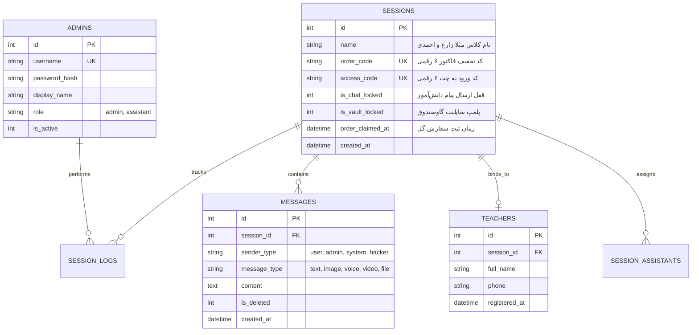
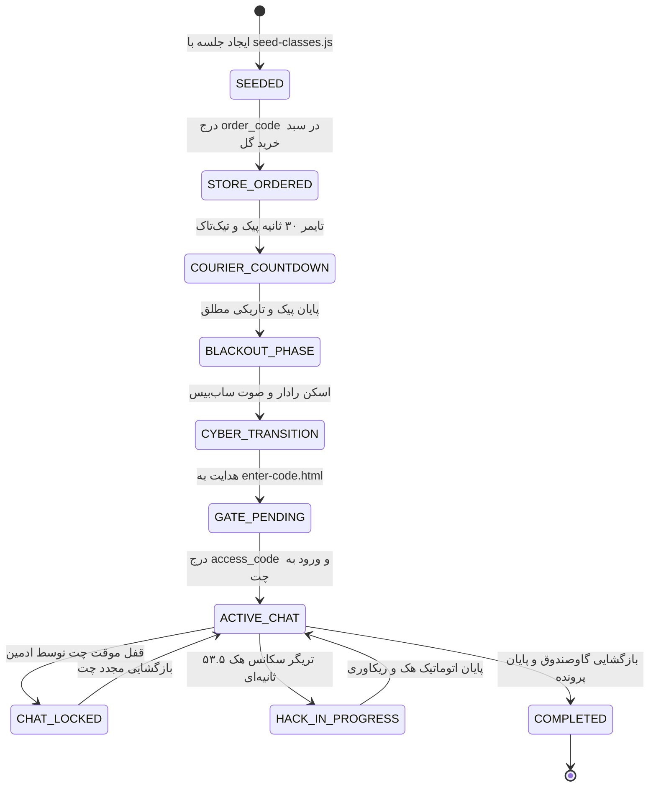

# 🔐 سند والد دامنه احراز هویت، نشست‌ها و ایزولاسیون کلاس‌ها (AUTH_AND_SESSIONS.md)
> **سند والد دامنه (Parent Domain Master):** مدیریت چرخه حیات نشست‌های بازی، کدهای دسترسی، احراز هویت ادمین، اتصال شماره معلم و ایزولاسیون اتاق‌های ۲۴ کلاس.  
> **سند بالادستی (Parent):** [`docs/ai/ROOT_MASTER.md`](file:///c:/xampp/htdocs/RazeDehkade/docs/ai/ROOT_MASTER.md)

---

## ۱. اهداف، معماری و منطق بیزینس دامنه (Domain Overview)

این دامنه قلب امنیتی و سازمان‌دهی پلتفرم «راز دهکده» است. بازی برای ۲۴ کلاس درس به صورت موازی اجرا می‌شود. هر کلاس دارای یک نشست (`Session`) اختصاصی در پایگاه داده با دو کد مجزا است:
1. **کد سفارش (`order_code`):** کد ۶ رقمی که دانش‌آموزان در فرم فاکتور فروشگاه گل به عنوان کد تخفیف ۱۰۰٪ وارد می‌کنند تا سفارش ثبت شود.
2. **کد دسترسی (`access_code`):** کد ۶ رقمی که پس از سناریوی بلک‌اوت و ترنسفورمیشن سایبری، در صفحه `/enter-code.html` وارد می‌شود تا توکن احراز هویت جلسه تولید شده و به ترمینال چت `/chat.html` هدایت شوند.

### سطوح دسترسی (RBAC):
- **دانش‌آموز (User):** احراز هویت بدون رمز عبور و تنها با `access_code` شش رقمی. توکن JWT با نقش `role: 'user'` صادر شده و فقط اجازه ارسال پیام، دریافت مدارک، ویرایش پیام‌های خود و بازگشایی گاوصندوق کلاس خود را دارد.
- **کارآگاه / مدیر سیستم (Admin):** احراز هویت از طریق `/admin/login` با نام کاربری و پسورد هش‌شده با bcrypt. توکن JWT با نقش `role: 'admin'` صادر شده و دسترسی هم‌زمان به تمامی جلسات، شنود لایو، قفل چت و سناریوهای هفتگی دارد.
- **دستیار کارآگاه (Assistant):** نقش مانیتورینگ کمکی برای نظارت بر جلسات بدون اجازه تغییرات تخریبی.

---

## ۲. خطوط قرمز و نبایدهای دامنه (Domain Invariants)

> ⛔ **هرگونه تخطی از موارد زیر منجر به رد قطعی کد خواهد شد:**
1. **ایزولاسیون مطلق اتاق‌های سوکت (`Strict Room Segregation`):** هیچ دانش‌آموزی از کلاس A تحت هیچ شرایطی نباید پیام‌ها، فایل‌ها یا رویدادهای هک کلاس B را دریافت کند. تمام برودکست‌های چت باید محدود به روم `session_${sessionId}` باشند.
2. **عدم ذخیره پسورد خام (`No Plaintext Passwords`):** تمامی پسوردهای مدیران باید با سالت و توابع `bcryptjs` هش شوند.
3. **اعتبارسنجی شماره معلم (`Teacher Phone Binding`):** شماره تماس وارده در فرم سفارش گل باید پاکسازی (`cleanPhone = phone.replace(/[^0-9]/g, '')`) شده و به جلسه متصل گردد.
4. **جلوگیری از ساخت جلسات ساختگی:** کدهای دسترسی و سفارش جلسات باید یکتا بوده و از قبل در جدول `sessions` وجود داشته باشند (`src/db/seed-classes.js`).

---

## ۳. نمودار رابطه موجودیت‌ها و ترنزیشن وضعیت‌ها (Mermaid Diagrams)

### ۳.۱. مدل داده‌های احراز هویت و جلسات (ERD)

### ۳.۲. ماشین وضعیت نشست بازی (State Machine)

---

## ۴. نگاشت میکروسکوپی فایل‌ها و ماژول‌ها (Deterministic Code Locations)

- **مدل نشست جلسات (`Session`):**  
  مسیر: [`src/models/Session.js`](file:///c:/xampp/htdocs/RazeDehkade/src/models/Session.js#L1-L260)  
  متدهای کلیدی: `findByOrderCode`, `findByAccessCode`, `claimOrder`, `toggleChatLock`, `toggleVaultLock`.
- **میدل‌ور احراز هویت JWT (`authMiddleware`):**  
  مسیر: [`src/middleware/auth.js`](file:///c:/xampp/htdocs/RazeDehkade/src/middleware/auth.js#L1-L65)  
  توابع: `generateToken`, `verifyToken`, `requireAdmin`.
- **روت‌های ورود و احراز هویت:**  
  مسیر: [`src/routes/auth.js`](file:///c:/xampp/htdocs/RazeDehkade/src/routes/auth.js#L18-L115)  
  نقاط انتهایی: `/api/auth/admin/login` و `/api/auth/user/login-code`.
- **مدیریت جلسات توسط ادمین:**  
  مسیر: [`src/routes/sessions.js`](file:///c:/xampp/htdocs/RazeDehkade/src/routes/sessions.js#L25-L340)  
  توابع: لیست جلسات، قفل چت، پلمپ گاوصندوق.

---

## ۵. ماتریس اعتبارسنجی خودکار (Automated Verification Matrix)

| شناسه تست | سناریوی آزمون | دستور / فایل تست | خروجی مورد انتظار | وضعیت |
|---|---|---|---|---|
| TC-AUTH-01 | لاگین ادمین با پسورد معتبر | `tests/api.test.js` | دریافت توکن JWT با ساختار معتبر | PASS |
| TC-AUTH-02 | ورود دانش‌آموز با کد ۶ رقمی بسته | `tests/api.test.js` | تایید `access_code` و ایجاد سشن چت | PASS |
| TC-AUTH-03 | ایزولاسیون کامل روم‌های ۲ کلاس مجزا | `tests/api.test.js` | عدم نشت پیام‌های کلاس ۱ به کلاس ۴ | PASS |
| TC-AUTH-04 | اتصال شماره موبایل آموزگار | `tests/api.test.js` | ثبت شماره در جدول `teachers` | PASS |
| TC-AUTH-05 | قفل و بازگشایی چت توسط ادمین | `tests/api.test.js` | رد پیام دانش‌آموز در حالت قفل | PASS |
