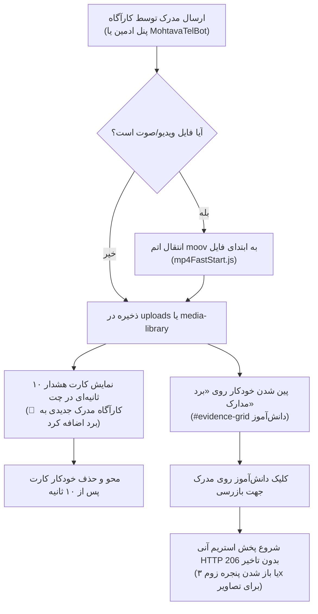

# 📽️ سند والد دامنه استریم رسانه، آپلود تکه‌ای و ربات تلگرام (MEDIA_STREAMING_AND_BOT.md)
> **سند والد دامنه (Parent Domain Master):** استریم آنی صوت و ویدیو با HTTP 206، بهینه‌سازی FastStart، آپلود تکه‌ای ۲۰۰KB، برد مدارک، کارت هشدار ۱۰ ثانیه‌ای و ربات تلگرامی مدیریت محتوا.  
> **سند بالادستی (Parent):** [`docs/ai/ROOT_MASTER.md`](file:///c:/xampp/htdocs/RazeDehkade/docs/ai/ROOT_MASTER.md)

---

## ۱. اهداف و معماری دامنه چندرسانه‌ای (Domain Overview)

در طول بازی کارآگاهی، اسناد محرمانه، ویس‌های ضبط‌شده مظنونین، ویدیوهای دوربین مداربسته و فایل‌های شواهد به صورت پیوسته برای دانش‌آموزان ارسال می‌شوند. جهت تضمین اجرای بدون تاخیر حتی در شبکه‌های ضعیف، معماری چندرسانه‌ای زیر پیاده‌سازی شده است:
1. **استریم آنی ویدیو و صوت (True Instant HTTP 206 Streaming):**
   - تمامی فایل‌های MP4 به صورت خودکار توسط ماژول `mp4FastStart.js` به فرمت FastStart درمی‌آیند (انتقال اتم `moov` پیش از داده‌های `mdat`).
   - سرور Express فایل‌های رسانه را با هدرهای استاندارد `Accept-Ranges: bytes`، `Cache-Control: public, max-age=3600, no-transform` و غیرفعال‌سازی بافر Nginx (`X-Accel-Buffering: no`) سرو می‌کند تا پخش بلافاصله پس از کلیک بدون انتظار برای دانلود کل فایل آغاز شود.
2. **برد شواهد و تفکیک فایل‌ها:**
   - مدارک ارسالی کارآگاه روی «برد اسناد و مدارک» (`#evidence-grid`) پین می‌شوند. در جریان چت فقط یک کارت هشدار ۱۰ ثانیه‌ای ظاهر می‌شود تا جریان گفتگو مسدود نگردد.
   - عکس‌های ارسالی خود دانش‌آموز فقط در حباب چت کاربر می‌مانند و به برد شواهد راه پیدا نمی‌کنند.
3. **آپلود تکه‌ای ۲۰۰ کیلوبایتی (Chunked Upload):**
   - جهت عبور از محدودیت پیش‌فرض `client_max_body_size 1m` در Nginx و پراکسی‌های سرور، کلاینت فایل‌ها را در بلوک‌های ۲۰۰KB ارسال کرده و در سرور تجمیع می‌نماید.
4. **ربات تلگرام دریافت محتوا (`MohtavaTelBot`):**
   - ربات اختصاصی با دسترسی انحصاری برای ادمین تلگرام `5490508090` جهت ارسال آسان سناریوها و فایل‌های هفتگی به سرور.
   - فیلتر قطعی عناوین داخلی ادمین (مانند `پیام ۱` یا `بعد از ۵ دقیقه`) و جایگزینی با عناوین رازآلود برای دانش‌آموزان.

---

## ۲. خطوط قرمز و نبایدهای دامنه (Domain Invariants)

> ⛔ **قوانین غیرقابل‌تغییر دامنه چندرسانه‌ای و استریم:**
1. **ممنوعیت قفل کش و تعویض سورس در حین پخش (`No HTTP Cache Lock`):** استفاده از تگ‌های موازی `<link rel="preload">` یا فراخوانی‌های هم‌زمان `fetch` که باعث قفل شدن کش مرورگر کروم و توقف استریم در ثانیه ۲ (`0:02`) می‌شد اکیداً ممنوع است (`DEC-0023`).
2. **پنهان‌سازی کامل عناوین ربات از دانش‌آموزان (`Zero Admin Leaks`):** متون راهنمای بات تلگرام هرگز نباید در چت دانش‌آموز، روی برد مدارک یا در عنوان مودال بازرسی شواهد ظاهر شوند (`DEC-0024`).
3. **کارت هشدار ۱۰ ثانیه‌ای شکیل:** با ارسال مدرک جدید کارآگاه، فقط کارت هشدار کوچک «📌 کارآگاه مدرک جدیدی به برد اسناد اضافه کرد» در چت نمایش داده شده و پس از ۱۰ ثانیه محو می‌شود (`DEC-0016`).
4. **پشتیبانی از تمامی فرمت‌های تصویری:** سیستم آپلود باید از فرمت‌های مدرن و کلاسیک (`jpg`, `jpeg`, `png`, `webp`, `heic`, `avif`, `gif`, `bmp`, `svg`) پشتیبانی نموده و نام فایل‌های فارسی را بدون به‌هم‌ریختگی انکود کند (`DEC-0019`).
5. **ممنوعیت محاسبه اشتباه بافر (Tail Probe):** محاسبه درصد بافر استریم باید بازه پایانی بررسی متادیتا در کروم را نادیده بگیرد تا هرگز عدد ۱۰۰٪ کاذب در ثانیه اول نشان داده نشود (`DEC-0023`).

---

## ۳. فلوچارت جریان استریم و برد شواهد (Mermaid Diagrams)

---

## ۴. نگاشت میکروسکوپی فایل‌ها و ماژول‌ها (Deterministic Code Locations)

- **استریم فایل‌های استاتیک و هدرهای HTTP 206:**  
  مسیر: [`server.js`](file:///c:/xampp/htdocs/RazeDehkade/server.js#L53-L115)  
  توابع: فیلتر `compression` برای معافیت استریم، هدرهای `Accept-Ranges`، `X-Accel-Buffering` و `Cache-Control`.
- **ماژول بهینه‌سازی FastStart ویدیوها:**  
  مسیر: [`src/utils/mp4FastStart.js`](file:///c:/xampp/htdocs/RazeDehkade/src/utils/mp4FastStart.js#L1-L180)  
  توابع: `ensureMp4FastStart`, `optimizeVideosInDirectories`.
- **آپلود تکه‌ای و فایل‌های چندرسانه‌ای:**  
  مسیر: [`src/routes/upload.js`](file:///c:/xampp/htdocs/RazeDehkade/src/routes/upload.js#L1-L150)  
  توابع: روت `/api/upload`، روت `/api/upload/chunk` و تجمیع چانک‌ها.
- **ربات تلگرام محتوای هفتگی:**  
  مسیر: [`MohtavaTelBot/bot.js`](file:///c:/xampp/htdocs/RazeDehkade/MohtavaTelBot/bot.js#L1-L450)  
  توابع: دریافت فایل‌های تلگرام، شماره‌گذاری خودکار (`پیام ۱`، `پیام ۲`)، اتصال به سوکت.
- **کنترلر کلاینت شواهد، زوم و استریم:**  
  مسیر: [`public/assets/js/user-chat.js`](file:///c:/xampp/htdocs/RazeDehkade/public/assets/js/user-chat.js#L540-L750)  
  توابع: `openEvidence`, `renderEvidenceBoard`, `getRealStreamBufferStats`, `showEvidenceBanner`.

---

## ۵. ماتریس اعتبارسنجی خودکار (Automated Verification Matrix)

| شناسه تست | سناریوی آزمون | دستور / فایل تست | خروجی مورد انتظار | وضعیت |
|---|---|---|---|---|
| TC-MED-01 | استریم HTTP 206 و هدرهای بدون بافر | `tests/api.test.js` | وجود Accept-Ranges و معافیت از compression | PASS |
| TC-MED-02 | ماسک کردن عناوین بات از دید دانش‌آموز | `tests/api.test.js` | جایگزینی عنوان داخلی با عنوان کارآگاهی | PASS |
| TC-MED-03 | فیلتر شناسه ادمین در بات تلگرام | `tests/api.test.js` | پذیرش تنها از ادمین 5490508090 | PASS |
| TC-MED-04 | عدم نمایش ۱۰۰٪ کاذب در شروع بافر | `tests/api.test.js` | فیلتر Tail Probe انتهای فایل کروم | PASS |
| TC-MED-05 | زوم تصاویر شواهد با سقف ۳.۰x | `tests/adversarial-redteam-matrix.test.js` | عدم تجاوز از ضریب ۳.۰ و کف ۱.۰ | PASS |
