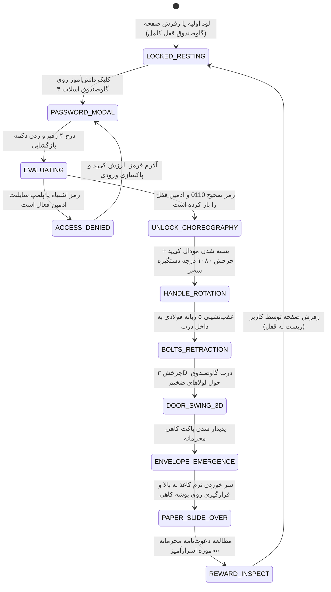

# 🗄️ سند والد دامنه پنل چهارگانه، تقویم، گالری پرتره‌ها و گاوصندوق سه‌بعدی (QUAD_PANEL_AND_3D_VAULT.md)
> **سند والد دامنه (Parent Domain Master):** ساختار پنل چهارگانه زیر برد شواهد، تقویم شمسی جلالی پویا، گالری پرتره دستیاران ۲۴ کلاس، ترمینال مانیتورینگ N-LOG و گاوصندوق فولادی ۳D زرهی اسلات ۴ با پاکت کاهی محرمانه.  
> **سند بالادستی (Parent):** [`docs/ai/ROOT_MASTER.md`](file:///c:/xampp/htdocs/RazeDehkade/docs/ai/ROOT_MASTER.md)

---

## ۱. اهداف و معماری پنل چهارگانه عملیاتی (Domain Overview)

در ستون سمت چپ پایانه دانش‌آموز (`public/chat.html`)، فضای زیر برد شواهد به یک گرید ۲×۲ شامل ۴ بخش کاملاً کاربردی و داستانی تقسیم شده است:
1. **اسلات اول (تقویم شمسی پویا - Jalali Calendar):**
   - برگه تقویم شمسی واقعی با محاسبه ماه‌های جلالی (مهر، آبان و...)، روزهای رسمی هفته (`ش` تا `ج`)، نشانگر روز جاری با هایلایت طلایی و قابلیت ورق زدن ماه‌ها بدون افت استایل.
2. **اسلات دوم (دکمه پاپ‌آپ گالری پرتره دستیاران کارآگاه):**
   - کارت تعاملی با نوشته «عکس دستیاران» که با کلیک روی آن، مودال تمام‌صفحه لود می‌شود. تصاویر پرتره بر اساس نام کلاس از پوشه اختصاصی ۲۴ کلاس استخراج شده، دابل‌لودها (PNG/WEBP) حذف شده و قابلیت فیلتر کروماکی و ذره‌بین ۳x فعال است.
3. **اسلات سوم (پایانه مانیتورینگ زنده N-LOG):**
   - پنجره کنسول امنیتی با فونت ریز monospace که جریان لحظه‌ای بسته‌ها، پایش سوکت و لاگ‌های سیستم را به شکل زنده نمایش می‌دهد.
4. **اسلات چهارم (گاوصندوق زرهی ۳D اسناد محرمانه V10.0):**
   - شاهکار تعاملی بازی: گاوصندوق فولادی سنگین واقعی اداری/بانکی با پوشش ۱۰۰٪ فول‌بلید کل اسلات چهارم.
   - دستگیره سه‌شاخه کروم در مرکز شافت توپی سمت راست (`left: 66.49%; top: 49.10%`).
   - ورود رمز در کی‌پد ۴ رقمی (رمز اختصاصی و قطعی: `0110`).
   - پس از تایید رمز: چرخش ۳ دور دستگیره سه‌پر (`1080deg`)، عقب‌نشینی ۵ زبانه فولادی به داخل درب، باز شدن سه‌بعدی درب، خروج پاکت کاهی محرمانه با انیمیشن نرم دو مرحله‌ای، و قرارگیری برگه دعوت‌نامه «موزه اسرارآمیز» بر روی پوشه کاهی.

---

## ۲. خطوط قرمز و نبایدهای دامنه (Domain Invariants)

> ⛔ **قوانین غیرقابل‌تغییر دامنه گاوصندوق و پنل چهارگانه:**
1. **قانون هوک معمایی و عدم لو دادن سناریو (`Zero-Spoiler Policy`):** نه روی بدنه گاوصندوق و نه در پنجره کی‌پد نباید هیچ اشاره‌ای به محتوای داخل آن، کارآگاه، جلسه آخر یا برچسب پلمپ لو‌دهنده وجود داشته باشد تا یک معمای کشف‌نشده باقی بماند (`DEC-0025`).
2. **حذف پیام سبز تایید رمز در کی‌پد:** هنگام وارد کردن رمز صحیح `0110`، هیچ کادر یا نوشته سبزی با متن «رمز تایید شد» نمایش داده نمی‌شود؛ فقط LED کوچک سبز شده و انیمیشن مکانیکی دستگیره آغاز می‌گردد (`VAULT_SLOT4_MASTER.md`).
3. **رمز انحصاری گاوصندوق (`Strict Passcode 0110`):** رمز گاوصندوق در تمام فایل‌های پروژه منحصراً و فقط رشته `0110` است و هیچ رقم دیگری مجاز نیست.
4. **بسته شدن با رفرش صفحه (`Reset to Lock on Refresh`):** وضعیت باز بودن گاوصندوق هرگز نباید در `localStorage` یا `sessionStorage` ذخیره شود. با هر رفرش صفحه گاوصندوق مجدداً قفل کامل می‌شود.
5. **جایگذاری دقیق دستگیره سه‌پر (`Handle Alignment`):** محور چرخش دستگیره سه‌شاخه باید دقیقاً در مختصات `left: 66.49%; top: 49.10%` درب قرار گیرد.
6. **پاداش تک‌عکس دعوت‌نامه:** در داخل پاکت کاهی فقط یک تصویر دعوت‌نامه قرار دارد و دکمه‌های اسلاید بعدی/قبلی باید مخفی (`hidden`) باشند.
7. **پلمپ سایلنت هفتگی توسط ادمین:** تا زمانی که ادمین قفل گاوصندوق را از پنل خود باز نکند، وارد کردن رمز صحیح 0110 نیز آلارم خطا و لرزش قرمز می‌دهد (Silent Lock).

---

## ۳. ماشین وضعیت بازگشایی گاوصندوق سه‌بعدی (State Diagram)

---

## ۴. نگاشت میکروسکوپی فایل‌ها و ماژول‌ها (Deterministic Code Locations)

- **کنترلر گاوصندوق سه‌بعدی و انیمیشن پاکت کاهی:**  
  مسیر: [`public/assets/js/vault-3d.js`](file:///c:/xampp/htdocs/RazeDehkade/public/assets/js/vault-3d.js#L1-L450)  
  توابع: `openVaultInteraction`, `validateVaultCode`, `runVaultUnlockChoreography`, `warmBrowserAssetCacheOnFirstVisit`.
- **استایل‌های گاوصندوق سه‌بعدی، پره‌ها و پاکت کاهی:**  
  مسیر: [`public/assets/css/vault-3d.css`](file:///c:/xampp/htdocs/RazeDehkade/public/assets/css/vault-3d.css#L1-L550)  
  کلاس‌ها و انیمیشن‌ها: `@keyframes kraft-paper-smooth-out-and-over`, `.vault-spoke-handle`, `.vault-bolts-strip`.
- **کنترلر تقویم شمسی جلالی داینامیک:**  
  مسیر: [`public/assets/js/user-chat.js`](file:///c:/xampp/htdocs/RazeDehkade/public/assets/js/user-chat.js#L180-L290)  
  توابع: `initDynamicShamsiCalendar`, `changeShamsiMonth`, `goToTodayShamsi`.
- **کنترلر گالری پرتره دستیاران ۲۴ کلاس:**  
  مسیر: [`public/assets/js/user-chat.js`](file:///c:/xampp/htdocs/RazeDehkade/public/assets/js/user-chat.js#L300-L460)  
  توابع: `openAssistantsPhotoPopup`, `toggleAssistantsChromaKey`, `stepAssistantLightbox`.
- **مدل رجیستری دستیاران و انطباق پوشه‌ها:**  
  مسیر: [`src/models/SessionAssistant.js`](file:///c:/xampp/htdocs/RazeDehkade/src/models/SessionAssistant.js#L1-L220) و [`src/utils/classFolderMatcher.js`](file:///c:/xampp/htdocs/RazeDehkade/src/utils/classFolderMatcher.js#L1-L90).

---

## ۵. ماتریس اعتبارسنجی خودکار (Automated Verification Matrix)

| شناسه تست | سناریوی آزمون | دستور / فایل تست | خروجی مورد انتظار | وضعیت |
|---|---|---|---|---|
| TC-VLT-01 | الزام رمز انحصاری 0110 | `tests/vault-passcode-and-lock.test.js` | تایید رمز 0110 و رد سایر اعداد | PASS |
| TC-VLT-02 | سیاست عدم لو دادن سناریو (Zero-Spoiler) | `tests/vault-slot4.test.js` | عدم وجود برچسب پلمپ لو‌دهنده در UI | PASS |
| TC-VLT-03 | ابعاد تمام‌صفحه فول‌بلید گاوصندوق | `tests/vault-slot4.test.js` | تطابق ابعاد ۱۰۰٪ اسلات ۴ و چرخش ۱۰۸۰ | PASS |
| TC-VLT-04 | ریست قفل گاوصندوق با هر رفرش | `tests/vault-slot4.test.js` | عدم ذخیره در localStorage و قفل در لود | PASS |
| TC-VLT-05 | خروج نرم کاغذ بر روی پوشه کاهی | `tests/vault-slot4.test.js` | انیمیشن `kraft-paper-smooth-out-and-over` | PASS |
| TC-VLT-06 | پلمپ سایلنت و پلمپ همگانی از داشبورد | `tests/vault-passcode-and-lock.test.js` | کنترل موفق وضعیت قفل در دیتابیس و داشبورد | PASS |
