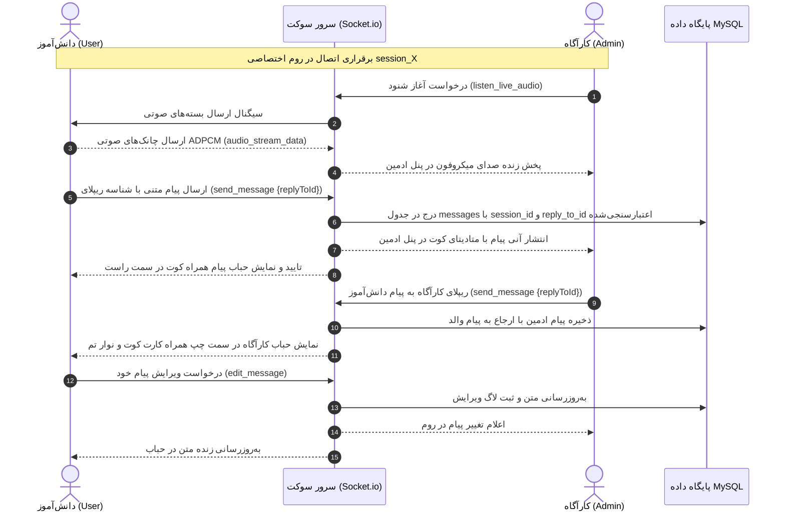

# 💬 سند والد دامنه موتور چت بلادرنگ، شنود زنده و هک (REALTIME_CHAT_ENGINE.md)
> **سند والد دامنه (Parent Domain Master):** زیرساخت سوکت روم‌ها، تبادل زنده پیام‌ها، چیدمان حباب‌ها، ویرایش/حذف پیام توسط دانش‌آموز، شنود صوتی محیطی توسط ادمین، قفل چت و سناریوی هک مزداک.  
> **سند بالادستی (Parent):** [`docs/ai/ROOT_MASTER.md`](file:///c:/xampp/htdocs/RazeDehkade/docs/ai/ROOT_MASTER.md)

---

## ۱. اهداف و معماری موتور چت (Domain Overview)

این دامنه بستر اصلی تعامل کارآگاه و دانش‌آموزان است. ارتباط از طریق وب‌سوکت (`Socket.io 4.7.5`) روی روم‌های ایزوله `session_${sessionId}` برقرار می‌شود. پایانه دانش‌آموز دارای طراحی دارک کارآگاهی نوار با حداکثر فضای مفید و حذف هدر و فوترهای مزاحم است.
قابلیت‌های کلیدی موتور چت:
- **تفکیک حباب‌های گفتگو:** پیام‌های خود کاربر در سمت راست و پیام‌های کارآگاه/ادمین/هکر در سمت چپ.
- **امکان ویرایش و حذف پیام توسط خود دانش‌آموز:** پاپ‌آپ اختصاصی با تم شیشه‌ای Liquid Glass برای اصلاح متن.
- **سیستم شنود صدای محیط کلاس توسط کارآگاه:** استریم صدای میکروفون کلاینت به اتاق ادمین به صورت بسته‌های صوتی ADPCM هم‌زمان با حذف دکمه ارسال ویس دانش‌آموز.
- **قفل/بازگشایی چت:** ادمین می‌تواند در لحظات حساس سناریو ارسال پیام دانش‌آموزان را متوقف کند.
- **سکانس هک ۵۳.۵ ثانیه‌ای مزداک:** رویداد سینمایی تعاملی شامل گلیچ صفحه، سنتز صدای فرکانسی، متن‌های تهدیدآمیز هکر و بازگشت خودکار به وضعیت عادی.

---

## ۲. خطوط قرمز و نبایدهای دامنه (Domain Invariants)

> ⛔ **قوانین غیرقابل‌تغییر دامنه چت و شنود:**
1. **چیدمان استاندارد حباب‌های چت (`Bubble Alignment`):** پیام‌های خود کاربر (`.message-bubble.user`) حتماً سمت راست (`align-self: flex-start`) و پیام‌های ادمین/کارآگاه/هکر حتماً سمت چپ (`align-self: flex-end`) قرار می‌گیرند (`DEC-0014`).
2. **مجوز ویرایش و حذف پیام:** دانش‌آموز فقط و فقط می‌تواند پیام‌های ارسال‌شده توسط خودش (`sender_type === 'user'`) را ویرایش یا حذف کند و امکان دستکاری پیام‌های کارآگاه وجود ندارد (`DEC-0013`).
3. **حفظ استریم شنود زنده میکروفون:** دکمه ضبط ویس دانش‌آموز از رابط کاربری حذف شده اما سیستم شنود زنده محیطی توسط ادمین باید کاملاً سالم و فعال باقی بماند (`DEC-0011`).
4. **پیشگیری از دابل‌سابمیت و اسپم پیام:** فلگ `in-flight` در کلاینت و کش ۵ ثانیه‌ای ضدتکرار در سرور باید از ثبت پیام‌های تکراری جلوگیری کنند (`DEC-0009`).
5. **استاندارد کامپوزر ادمین:** زدن کلید `Enter` پیام را ارسال کرده و دکمه‌ها باید دارای ارتفاع ثابت ۴۲px و تراز پایینی باشند (`DEC-0018`).
6. **ایزولاسیون و سلامت لایه ریپلای دوطرفه (`Two-Way Reply & Quote Engine`):** ریپلای پیام‌ها باید متقارن (دانش‌آموز به کارآگاه و کارآگاه به دانش‌آموز) و منحصراً مقید به نشست جاری باشد. هرگونه ارجاع فرامرزی یا نامعتبر باید خنثی شده (`reply_to_id = null`) و افزودن کوت‌باکس در کامپوزر نباید موجب پرش لایوت یا برهم‌خوردن کیبورد مجازی موبایل گردد (`DEC-0026`, `DEC-0027`, `DEC-0028`, [`MASTER_07`](file:///e:/projects/RazeDehkade/docs/ai/masters/MASTER_07_TWO_WAY_REPLY_AND_QUOTE_ENGINE.md)).

---

## ۳. نمودار توالی ارسال پیام و شنود صوتی (Mermaid Sequence Diagram)

---

## ۴. نگاشت میکروسکوپی فایل‌ها و ماژول‌ها (Deterministic Code Locations)

- **هندلرهای سوکت چت، ریپلای و شنود صوتی:**  
  مسیر: [`src/socket/index.js`](file:///e:/projects/RazeDehkade/src/socket/index.js)  
  توابع: رویدادهای `send_message` (با پشتیبانی از `replyToId` و اعتبارسنجی نشست)، `edit_message`، `delete_message`، `listen_live_audio`، `audio_stream_data`.
- **مایگریشن و مدل داده پیام‌ها و ارجاعات ریپلای:**  
  مسیرها: [`src/db/migrations/004_add_reply_to_messages.sql`](file:///e:/projects/RazeDehkade/src/db/migrations/004_add_reply_to_messages.sql), [`src/models/Message.js`](file:///e:/projects/RazeDehkade/src/models/Message.js)  
  فیلدها: `reply_to_id` (FK با `ON DELETE SET NULL`) و جوین‌های اطلاعات فرستنده والد.
- **مدیریت سناریوی هک مزداک:**  
  مسیر: [`src/socket/index.js`](file:///e:/projects/RazeDehkade/src/socket/index.js#L510-L585)  
  توابع: `start_hack_sequence` و `stop_hack_sequence`.
- **کنترلر کلاینت چت دانش‌آموز:**  
  مسیر: [`public/assets/js/user-chat.js`](file:///e:/projects/RazeDehkade/public/assets/js/user-chat.js)  
  توابع: `sendMessage`, `stageUserReply`, `cancelUserReply`, `jumpToMessage`, `openUserEditModal`, `deleteUserMessage`, `initMicrophoneListening`.
- **کنترلر کامپوزر و پنل ادمین:**  
  مسیر: [`public/assets/js/admin-chat.js`](file:///e:/projects/RazeDehkade/public/assets/js/admin-chat.js)  
  توابع: `sendAdminMessage`, `stageAdminReply`, `cancelAdminReply`, `jumpToAdminMessage`, `toggleLiveAudioListener`, `insertCannedResponseToComposer`.
- **استایل‌های حباب‌های چت، کوت‌باکس و بنر ریپلای:**  
  مسیرها: [`public/assets/css/terminal.css`](file:///e:/projects/RazeDehkade/public/assets/css/terminal.css), [`public/assets/css/admin.css`](file:///e:/projects/RazeDehkade/public/assets/css/admin.css)  
  کلاس‌ها: `.message-reply-quote`, `.composer-reply-preview`, `.admin-reply-preview`, `.highlight-pulse`.

---

## ۵. ماتریس اعتبارسنجی خودکار (Automated Verification Matrix)

| شناسه تست | سناریوی آزمون | دستور / فایل تست | خروجی مورد انتظار | وضعیت |
|---|---|---|---|---|
| TC-CHT-01 | ارسال و تفکیک حباب‌های کاربر و ادمین | `tests/api.test.js` | چیدمان صحیح راست/چپ و عدم تداخل | PASS |
| TC-CHT-02 | ویرایش و حذف پیام توسط دانش‌آموز | `tests/api.test.js` | اجازه ویرایش پیام خود و رد پیام ادمین | PASS |
| TC-CHT-03 | قفل چت توسط ادمین و رد پیام | `tests/api.test.js` | مسدود شدن ارسال پیام دانش‌آموز | PASS |
| TC-CHT-04 | فشرده‌سازی و یکپارچگی صوتی ADPCM | `tests/live-audio-codec.test.js` | کدگذاری و دیکد مستقل بدون خطا | PASS |
| TC-CHT-05 | سناریوی هک ۵۳.۵ ثانیه‌ای مزداک | `tests/hack-sequence.test.js` | اجرای تمام فازها و بازیابی کنترل | PASS |
| TC-CHT-06 | یکپارچگی موتور ریپلای دوطرفه و ایزولاسیون | `tests/chat-reply.test.js` | ریپلای دوطرفه، نشت‌ناپذیری بین کلاس‌ها و استایل‌ها | PASS |
