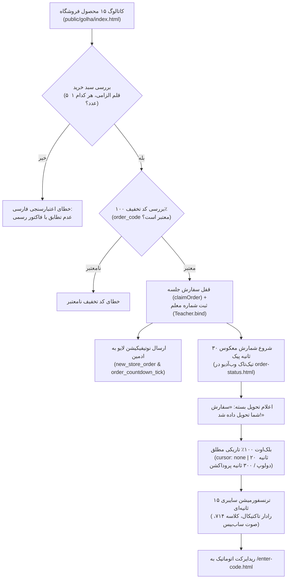

# 🌸 سند والد دامنه فروشگاه گل، سفارش، بلک‌اوت و دلیوری (STORE_AND_DELIVERY.md)
> **سند والد دامنه (Parent Domain Master):** پوشش تجاری فروشگاه گل و گیاه، سبد خرید، اعتبارسنجی فاکتور ۵ قلمی، شمارش معکوس پیک، بلک‌اوت تاریکی مطلق، ترنسفورمیشن سایبری و دلیوری پهپادی کلاس ۱۷.  
> **سند بالادستی (Parent):** [`docs/ai/ROOT_MASTER.md`](file:///c:/xampp/htdocs/RazeDehkade/docs/ai/ROOT_MASTER.md)

---

## ۱. اهداف و سناریوی بیزینس فروشگاه (Domain Overview)

این دامنه دروازه ورودی مخفی بازی است. دانش‌آموزان به عنوان یک تکلیف یا سفارش خرید گل وارد سایتی به ظاهر معمولی به نام **«فروشگاه اینترنتی گل و گیاه»** می‌شوند. آنان ۵ محصول خاص مشخص‌شده در فاکتور کاغذی را در فروشگاه پیدا کرده، به سبد خرید اضافه نموده و با کد تخفیف ۱۰۰٪ (`order_code`) سفارش را ثبت می‌کنند.
به محض ثبت سفارش، یک جریان مهیج چندمرحله‌ای آغاز می‌شود:
1. **شمارش معکوس تحویل پیک (۳۰ ثانیه):** شبیه‌سازی صدای تیک‌تاک مکانیکی ساعت با Web Audio API بدون نیاز به دانلود فایل صوتی خارجی.
2. **اعلام تحویل بسته:** نمایش پیام قطعی «سفارش شما تحویل داده شد!» به همراه هدایت به سناریوی فیزیکی دریافت بسته در کلاس.
3. **بلک‌اوت تاریکی مطلق (`Pitch Black`):** خاموشی ۱۰۰٪ صفحه با مخفی شدن نشانگر موس (`cursor: none`) به مدت ۲۰ ثانیه در حالت تست و ۳۰۰ ثانیه (۵ دقیقه) در پروداکشن تا هیچ حواسی در محیط جلب نشود.
4. **سکانس دگردیسی سایبری (Cyber Transformation):** آغاز افکت‌های ماتریسی، اسکن راداری کلاس کلاسه ۷۱۴، نفوذ به لایه‌های ضدجاسوسی و پخش موزیک ساب‌بیس تریلر سینمایی.
5. **انتقال به درگاه ورود کد محرمانه:** ریدایرکت خودکار به `/enter-code.html`.
6. **سناریوی اختصاصی پهپاد شناسایی (کلاس ۱۷ - زارع و احمدی):** رهایش محموله از فضا به سقف مجتمع در بلوار کاوه مشهد با دید حرارتی FLIR.

---

## ۲. خطوط قرمز و نبایدهای دامنه (Domain Invariants)

> ⛔ **قوانین غیرقابل‌تغییر دامنه فروشگاه و دلیوری:**
1. **واحد پولی انحصاری «ریال» (`Strictly Rials`):** کلمه تومان در کل فروشگاه و سبد خرید اکیداً ممنوع است. تمام مبالغ کاتالوگ و فاکتور به ریال درج می‌شوند (`DEC-0002`).
2. **توزیع ۵ محصول فاکتور در کاتالوگ ۱۵ عددی (`Distributed 5 Items`):**
   - بیلچه: ۱,۵۰۰,۰۰۰ ریال (id: 1)
   - سانسوریا پاکوتاه: ۱۰,۵۰۰,۰۰۰ ریال (id: 2)
   - لیلیوم صورتی: ۸,۰۰۰,۰۰۰ ریال (id: 3)
   - کاکتوس ساکولنت: ۷,۰۰۰,۰۰۰ ریال (id: 4)
   - کود تراریم پروتکت: ۳,۰۰۰,۰۰۰ ریال (id: 5)
   این ۵ قلم باید حتماً در بین ۱۰ محصول دیگر پخش باشند (`DEC-0003`).
3. **اعتبارسنجی دقیق اقلام سبد خرید:** سبد خرید هنگام ثبت نهایی باید دقیقاً و فقط شامل همین ۵ قلم کالا (هر کدام دقیقاً ۱ عدد) باشد؛ در غیر این صورت با خطای فارسی عدم موجودی رد می‌شود.
4. **برندینگ ثابت:** نام رسمی «فروشگاه اینترنتی گل و گیاه» و شعار «ارسال خیـــــلی خیـــــلی خیـــــلی سریع» با کشش تایپوگرافی (`DEC-0004`).
5. **ممنوعیت تیک‌تاک یا بیپ در بلک‌اوت:** در طول زمان بلک‌اوت هیچ صدایی نباید پخش شود و سکوت و تاریکی مطلق رعایت گردد (`DEC-0006`).

---

## ۳. فلوچارت جریان سفارش و دلیوری (Mermaid Diagrams)

---

## ۴. نگاشت میکروسکوپی فایل‌ها و ماژول‌ها (Deterministic Code Locations)

- **کاتالوگ محصولات و اعتبارسنجی سبد خرید:**  
  مسیر: [`src/routes/store.js`](file:///c:/xampp/htdocs/RazeDehkade/src/routes/store.js#L12-L140)  
  توابع: آرایه `PRODUCTS`، روت `POST /api/store/validate-discount`، روت `POST /api/store/order`.
- **شمارش معکوس و اطلاع‌رسانی لایو به ادمین:**  
  مسیر: [`src/routes/store.js`](file:///c:/xampp/htdocs/RazeDehkade/src/routes/store.js#L170-L280)  
  توابع: محاسبه زمان پیک و بلک‌اوت، تایمر ثانیه‌ای `order_countdown_tick` و به‌روزرسانی فاز کلاس.
- **اسکریپت کلاینت پیگیری سفارش، بلک‌اوت و ترنسفورمیشن:**  
  مسیر: [`public/assets/js/delivery.js`](file:///c:/xampp/htdocs/RazeDehkade/public/assets/js/delivery.js#L1-L320)  
  توابع: `playMechanicalTickTock`, `triggerPitchBlackout`, `startCyberTransformation`.
- **استایل‌های دلیوری و هاد نظامی پهپادی:**  
  مسیر: [`public/assets/css/delivery.css`](file:///c:/xampp/htdocs/RazeDehkade/public/assets/css/delivery.css#L1-L280)  
  کلاس‌ها: `.delivery-blackout-overlay`, `.cyber-transformation-layer`, `.drone-recon-hud`.

---

## ۵. ماتریس اعتبارسنجی خودکار (Automated Verification Matrix)

| شناسه تست | سناریوی آزمون | دستور / فایل تست | خروجی مورد انتظار | وضعیت |
|---|---|---|---|---|
| TC-STR-01 | دریافت کاتالوگ محصولات با مبالغ ریال | `tests/api.test.js` | وجود ۱۵ محصول و واحد ریال | PASS |
| TC-STR-02 | اعمال کد تخفیف ۱۰۰٪ معتبر | `tests/api.test.js` | تایید تخفیف ۱۰۰٪ و نام جلسه | PASS |
| TC-STR-03 | ثبت سفارش با اقلام نامعتبر | `tests/api.test.js` | رد سفارش با پیام فارسی عدم موجودی | PASS |
| TC-STR-04 | دلیوری اختصاصی پهپادی کلاس ۱۷ | `tests/drone-delivery-class17.test.js` | اجرای سناریوی زوم زمین به بلوار کاوه | PASS |
| TC-STR-05 | رفتار بلک‌اوت و حذف تیک‌تاک | `tests/admin-ux-and-blackout.test.js` | تاریکی مطلق و انتقال به ترنسفورمیشن | PASS |
