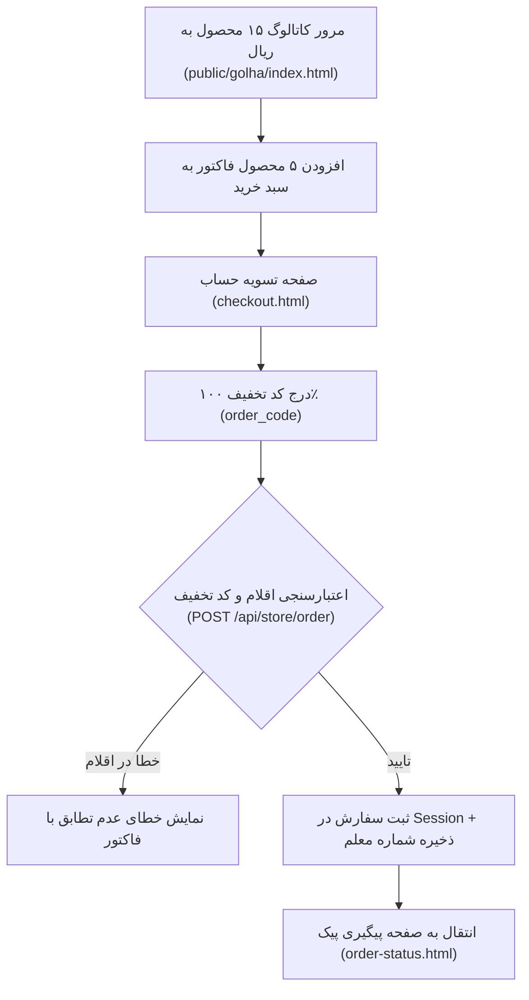

# MASTER-01: راه‌اندازی فروشگاه اینترنتی گل و گیاه، کاتالوگ ۱۵ محصول و ثبت سفارش با فاکتور رسمی

**تاریخ تدوین:** 2026-10-18  
**وضعیت سند:** VALIDATED & DEPLOYED  
**سند والد (Parent Document):** [`docs/ai/domains/STORE_AND_DELIVERY.md`](file:///c:/xampp/htdocs/RazeDehkade/docs/ai/domains/STORE_AND_DELIVERY.md)  
**ماژول هدف:** `src/routes/store.js`, `public/golha/`  
**هوش مصنوعی تدوین‌کننده:** Antigravity  

---

## ۱. چرایی، دستور کارفرما و نیازمندی‌ها (Context & Requirements)
> **دستور دقیق کارفرما:** «پوشش بازی باید یک فروشگاه اینترنتی طبیعی با نام فروشگاه اینترنتی گل و گیاه و شعار ارسال خیـــــلی خیـــــلی خیـــــلی سریع باشد. تمام قیمت‌ها باید فقط به ریال درج شوند و ۵ محصول کلیدی فاکتور کاغذی (بیلچه، سانسوریا پاکوتاه، لیلیوم صورتی، کاکتوس ساکولنت، کود تراریم) در بین ۱۵ محصول کاتالوگ پخش باشند. سبد خرید فقط با هر ۵ قلم کالا و کد تخفیف ۱۰۰٪ فاکتور اجازه ثبت دارد.»

### ۱.۱. اهداف فنی و بیزینسی تسک:
- [x] ایجاد کاتالوگ ۱۵ محصول با تصاویر مدرن WebP بهینه (زیر ۷۰ کیلوبایت) و قیمت‌های رسمی به ریال.
- [x] پیاده‌سازی پخش تصادفی ۵ قلم کلیدی در میان کاتالوگ و اعتبارسنجی دقیق سبد خرید (هر ۵ قلم دقیقاً ۱ عدد).
- [x] اتصال کد تخفیف ۱۰۰٪ (`order_code`) به پایگاه داده و جلوگیری از سفارش‌های تکراری با `Session.claimOrder`.
- [x] ثبت شماره تماس معلم و اتصال آن به جلسه (`Teacher.bindTeacherPhone`).

---

## ۲. منشور نبایدها و خطوط قرمز ویژه این تسک (Task-Specific Invariants)
> ⛔ هرگونه تخطی از موارد زیر منجر به رد خودکار کار خواهد شد:
1. **نباید کلمه تومان در هیچ کجای فروشگاه، فاکتور یا کاتالوگ استفاده شود:** واحد پولی مطلقاً ریال است (`DEC-0002`).
2. **نباید ۵ محصول کلیدی در ابتدای لیست کاتالوگ متمرکز شوند:** باید به شکل متوازن در سراسر کاتالوگ ۱۵ عددی پخش باشند (`DEC-0003`).
3. **نباید تصاویری با `opacity: 0` لود شوند** تا از سفید ماندن کارت‌ها در شبکه‌های کند جلوگیری شود (`DEC-0005`).
4. **نباید نام‌های انگلیسی یا نام «گلها» در تایتل، هدر یا فوتر به کار رود** (`DEC-0004`).

---

## ۳. معماری فنی، ساختار داده و دیاگرام‌های رفتاری (Technical Blueprint)

### ۳.۱. دیاگرام جریان و ترنزیشن‌ها (Mermaid Diagram)

### ۳.۲. ماتریس تغییر فایل‌ها و نمادها (File Mutation Matrix)
| فایل هدف | شماره خطوط | نوع تغییر | نمادها (توابع / کلاس‌ها) | ریسک و اقدام کنترلی |
|---|---|---|---|---|
| `src/routes/store.js` | L13-L29 | نگهداری | `PRODUCTS` | حفظ دقیق مبالغ ریال و عدم تمرکز ۵ قلم فاکتور |
| `src/routes/store.js` | L43-L69 | نگهداری | `POST /validate-discount` | استعلام اتمیک سشن از جدول sessions بر اساس order_code |
| `src/routes/store.js` | L75-L150 | نگهداری | `POST /order` | کنترل دقیق اقلام فاکتور و جلوگیری از سفارش مضاعف با claimOrder |
| `public/golha/index.html`| L1-L180 | نگهداری | ویترین فروشگاه | برندینگ «فروشگاه اینترنتی گل و گیاه» و فونت استعداد |

---

## ۴. برنامه جامع آزمون و ماتریس اعتبارسنجی (Automated Verification Matrix)
| شناسه آزمون | سناریوی آزمون | داده ورودی | خروجی مورد انتظار | وضعیت اجرا |
|---|---|---|---|---|
| TC-MS01-01 | دریافت لیست محصولات فروشگاه | `GET /api/store/products` | آرایه ۱۵ محصول با واحد ریال | PASS |
| TC-MS01-02 | بررسی کد تخفیف ۱۰۰٪ معتبر | `{ discountCode: '542810' }` | دریافت تخفیف ۱۰۰٪ و شناسه کلاس | PASS |
| TC-MS01-03 | رد سفارش با اقلام نامربوط | سبد خرید حاوی اقلام خارج از ۵ قلم | کد وضعیت 400 و پیام فارسی عدم تطابق | PASS |
| TC-MS01-04 | ثبت موفق سفارش و ثبت شماره معلم | ۵ قلم کامل + شماره همراه معلم | موفقیت سفارش، ثبت پیک و وضعیت دلیوری | PASS |

---

## ۵. گزارش تطابق و یکپارچگی نهایی (Verification Evidence)
- دستور اجرا شده: `npm test`
- نتیجه تست: تمام تست‌های وابسته به فروشگاه در `tests/api.test.js` با موفقیت ۱۰۰٪ پاس شدند.
- اسناد مرتبط به‌روزرسانی شده: `docs/ai/PROJECT_STATE.md`, `docs/ai/INDEX.md`.
