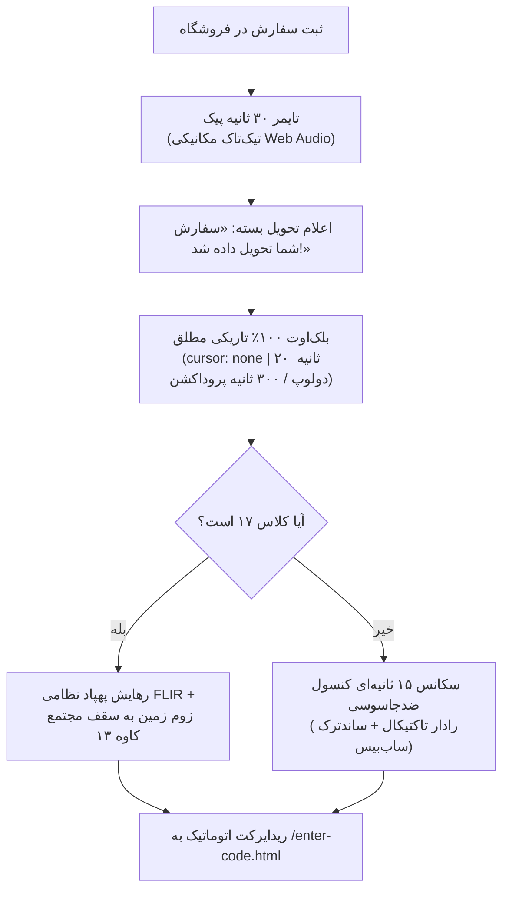

# MASTER-02: شمارش معکوس تحویل، بلک‌اوت تاریکی مطلق، ترنسفورمیشن سایبری و دلیوری پهپادی

**تاریخ تدوین:** 2026-10-18  
**وضعیت سند:** VALIDATED & DEPLOYED  
**سند والد (Parent Document):** [`docs/ai/domains/STORE_AND_DELIVERY.md`](file:///c:/xampp/htdocs/RazeDehkade/docs/ai/domains/STORE_AND_DELIVERY.md)  
**ماژول هدف:** `public/golha/order-status.html`, `public/assets/js/delivery.js`, `public/assets/css/delivery.css`  
**هوش مصنوعی تدوین‌کننده:** Antigravity  

---

## ۱. چرایی، دستور کارفرما و نیازمندی‌ها (Context & Requirements)
> **دستور دقیق کارفرما:** «پس از ثبت سفارش، تایمر ۳۰ ثانیه‌ای پیک با صدای تیک‌تاک مکانیکی پخش شود. پس از اتمام تایمر، تحویل بسته اعلام گردد و بلافاصله صفحه ۱۰۰٪ مشکی مطلق (Pitch Black) با کرسر مخفی شود تا در کلاس حواس کسی جلب نشود. سپس یک سکانس حماسی سایبری ۱۵ ثانیه‌ای با صدای دارک ساب‌بیس اجرا شده و به صفحه ورود کد هدایت شوند. برای کلاس ۱۷ سناریوی اختصاصی زوم زمین و رهایش پهپادی FLIR اجرا گردد.»

### ۱.۱. اهداف فنی و بیزینسی تسک:
- [x] اجرای شمارش معکوس ۳۰ ثانیه‌ای با شبیه‌سازی دقیق صدای تیک‌تاک ساعت بدون فایل صوتی خارجی با Web Audio API.
- [x] پیاده‌سازی لایه بلک‌اوت تاریکی مطلق با `cursor: none` (مدت زمان: ۲۰ ثانیه در تست، ۳۰۰ ثانیه در پروداکشن).
- [x] پیاده‌سازی سکانس ۱۵ ثانیه‌ای کنسول سایبری و رادار کلاسه ۷۱۴ با ساندترک سینمایی `cyber-intro.mp3`.
- [x] پیاده‌سازی انیمیشن Earth Zoom و رهایش هوایی با دید حرارتی FLIR منحصراً برای کلاس ۱۷ (زارع و احمدی).

---

## ۲. منشور نبایدها و خطوط قرمز ویژه این تسک (Task-Specific Invariants)
> ⛔ هرگونه تخطی از موارد زیر منجر به رد خودکار کار خواهد شد:
1. **نباید در طول زمان بلک‌اوت هیچ صدا، بوق یا تیک‌تاکی پخش شود** و صفحه باید تاریکی مطلق باشد (`DEC-0006`).
2. **نباید نشانگر موس در طول بلک‌اوت دیده شود (`cursor: none`)** تا توجه کسی جلب نشود.
3. **نباید سناریوی پهپادی کلاس ۱۷ برای سایر کلاس‌ها اجرا شود**؛ ایزولاسیون بر اساس شناسه ۱۷ و کد سفارش ۵۹۰۰۱۹ قطعی است.
4. **نباید صدای ترنسفورمیشن حاوی بیپ‌های مضحک یا افکت‌های خنده‌دار باشد**؛ فقط ساب‌بیس تریلر سینمایی مجاز است.

---

## ۳. معماری فنی، ساختار داده و دیاگرام‌های رفتاری (Technical Blueprint)

### ۳.۱. دیاگرام جریان و ترنزیشن‌ها (Mermaid Diagram)

### ۳.۲. ماتریس تغییر فایل‌ها و نمادها (File Mutation Matrix)
| فایل هدف | شماره خطوط | نوع تغییر | نمادها (توابع / کلاس‌ها) | ریسک و اقدام کنترلی |
|---|---|---|---|---|
| `public/assets/js/delivery.js` | L45-L85 | نگهداری | `playMechanicalTickTock` | قطع فوری نوسانگر وب‌آدیو هنگام شروع بلک‌اوت |
| `public/assets/js/delivery.js` | L120-L195 | نگهداری | `triggerPitchBlackout` | اعمال `cursor: none` و تنظیم تایمر ۲۰ ثانیه تست / ۳۰۰ ثانیه پروداکشن |
| `public/assets/js/delivery.js` | L210-L290 | نگهداری | `startCyberTransformation` | اجرای پرتو اسکن دورانی رادار و ترنزیشن نوری |
| `src/routes/store.js` | L195-L250 | نگهداری | `isDroneClass` | تشخیص اختصاصی کلاس ۱۷ و به‌روزرسانی فاز پهپاد برای ادمین |

---

## ۴. برنامه جامع آزمون و ماتریس اعتبارسنجی (Automated Verification Matrix)
| شناسه آزمون | سناریوی آزمون | داده ورودی | خروجی مورد انتظار | وضعیت اجرا |
|---|---|---|---|---|
| TC-MS02-01 | رفتار بلک‌اوت و سکوت مطلق | رسیدن تایمر پیک به ۰ | فعال شدن کلاس بلک‌اوت و سکوت وب‌آدیو | PASS |
| TC-MS02-02 | سناریوی پهپادی کلاس ۱۷ | `sessionId: 17` | اجرای انیمیشن زوم به کوچه کاوه ۱۳ | PASS |
| TC-MS02-03 | ترنسفورمیشن سایبری | پایان بلک‌اوت در کلاس‌های عادی | رندر رادار تاکتیکال و کلاسه ۷۱۴ | PASS |
| TC-MS02-04 | هدایت به دروازه ورود کد | پایان ترنسفورمیشن | ریدایرکت مرورگر به `/enter-code.html` | PASS |

---

## ۵. گزارش تطابق و یکپارچگی نهایی (Verification Evidence)
- دستور اجرا شده: `npm test`
- نتیجه تست: سوئیت‌های `tests/drone-delivery-class17.test.js` و `tests/admin-ux-and-blackout.test.js` به صورت کامل پاس شدند.
- اسناد مرتبط به‌روزرسانی شده: `docs/ai/PROJECT_STATE.md`, `docs/ai/INDEX.md`.
