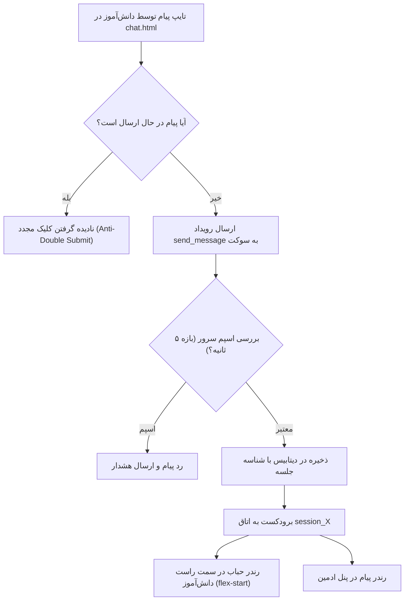

# MASTER-03: چت بلادرنگ سوکت، شنود زنده محیطی، ادیت/حذف پیام و سکانس هک

**تاریخ تدوین:** 2026-10-18  
**وضعیت سند:** VALIDATED & DEPLOYED  
**سند والد (Parent Document):** [`docs/ai/domains/REALTIME_CHAT_ENGINE.md`](file:///c:/xampp/htdocs/RazeDehkade/docs/ai/domains/REALTIME_CHAT_ENGINE.md)  
**ماژول هدف:** `src/socket/index.js`, `public/assets/js/user-chat.js`, `public/assets/js/admin-chat.js`  
**هوش مصنوعی تدوین‌کننده:** Antigravity  

---

## ۱. چرایی، دستور کارفرما و نیازمندی‌ها (Context & Requirements)
> **دستور دقیق کارفرما:** «پیام‌های خود دانش‌آموز در سمت راست و پیام‌های کارآگاه در سمت چپ قرار گیرند. هدر و فوتر چت حذف شود تا فضای مانیتور بزرگ‌تر شود. ارسال ویس از سمت دانش‌آموز حذف گردد اما شنود زنده صدای محیط توسط ادمین کاملاً فعال بماند. دانش‌آموز بتواند پیام‌های خود را ویرایش و حذف کند. کامپوزر ادمین با اینتر پیام بفرستد و دکمه‌ها کش نیایند. سناریوی هک ۵۳.۵ ثانیه‌ای مزداک بدون نقص اجرا شود.»

### ۱.۱. اهداف فنی و بیزینسی تسک:
- [x] استانداردسازی چیدمان حباب‌های چت بر اساس RTL (`align-self: flex-start` برای کاربر و `flex-end` برای ادمین).
- [x] پیاده‌سازی مودال ویرایش پیام با تم شیشه‌ای و اعتبارسنجی مالکیت پیام در سمت کلاینت و سرور سوکت.
- [x] پیاده‌سازی استریم صوتی محیطی کلاینت به ادمین با فشرده‌سازی ADPCM و حذف دکمه ضبط ویس کاربر.
- [x] استانداردسازی کامپوزر ادمین با کلید میانبر `Enter` و ارتفاع ثابت ۴۲px برای دکمه‌ها.
- [x] اجرای کامل سکانس سینمایی ۵۳.۵ ثانیه‌ای هک مزداک با قابلیت بازیابی امن.

---

## ۲. منشور نبایدها و خطوط قرمز ویژه این تسک (Task-Specific Invariants)
> ⛔ هرگونه تخطی از موارد زیر منجر به رد خودکار کار خواهد شد:
1. **نباید دانش‌آموز اجازه ویرایش یا حذف پیام‌های کارآگاه را داشته باشد** (`DEC-0013`).
2. **نباید شنود زنده ادمین هنگام حذف دکمه ویس کاربر دچار اختلال شود** (`DEC-0011`).
3. **نباید پاپ‌آپ‌های بلاک‌کننده مرورگر (`confirm()`) در پنل ادمین باز شوند** (`PROJECT_MASTER.md#L43`).
4. **نباید دکمه‌های کامپوزر ادمین در اثر چندخطی شدن پیام‌ها به صورت عمودی کش بیایند** (`DEC-0018`).
5. **نباید پیام تکراری در اثر کلیک‌های سریع ارسال شود (قفل ضداسپم)** (`DEC-0009`).

---

## ۳. معماری فنی، ساختار داده و دیاگرام‌های رفتاری (Technical Blueprint)

### ۳.۱. دیاگرام جریان پیام و رویدادهای چت (Mermaid Diagram)

### ۳.۲. ماتریس تغییر فایل‌ها و نمادها (File Mutation Matrix)
| فایل هدف | شماره خطوط | نوع تغییر | نمادها (توابع / کلاس‌ها) | ریسک و اقدام کنترلی |
|---|---|---|---|---|
| `src/socket/index.js` | L170-L245 | نگهداری | `send_message` | اعتبارسنجی روم جلسه و ضداسپم ۵ ثانیه‌ای |
| `src/socket/index.js` | L260-L335 | نگهداری | `edit_message / delete_message` | بررسی `sender_type === 'user'` پیش از تغییر دیتابیس |
| `src/socket/index.js` | L410-L490 | نگهداری | `listen_live_audio` | مدیریت ایمن سوکت‌های شنودگر و انتقال ADPCM |
| `public/assets/js/user-chat.js` | L120-L190 | نگهداری | `sendMessage` | مدیریت مارکر `in-flight` و پاکسازی کامپوزر |
| `public/assets/css/chat.css` | L180-L240 | نگهداری | `.message-bubble.user` | استایل‌دهی راست‌چین و عدم تداخل با ادمین |

---

## ۴. برنامه جامع آزمون و ماتریس اعتبارسنجی (Automated Verification Matrix)
| شناسه آزمون | سناریوی آزمون | داده ورودی | خروجی مورد انتظار | وضعیت اجرا |
|---|---|---|---|---|
| TC-MS03-01 | تفکیک حباب‌ها در سوکت | ارسال پیام هم‌زمان کاربر و ادمین | حباب کاربر راست، حباب ادمین چپ | PASS |
| TC-MS03-02 | ویرایش پیام خود کاربر | متد `edit_message` با شناسه معتبر | تغییر متن در دیتابیس و سوکت | PASS |
| TC-MS03-03 | تلاش برای ادیت پیام ادمین | متد `edit_message` روی پیام کارآگاه | پس زدن و عدم تغییر در دیتابیس | PASS |
| TC-MS03-04 | کدگذاری صوتی ADPCM | ورودی بسته‌های بافر میکروفون | دیکد بدون نشت داده و بدون خطا | PASS |
| TC-MS03-05 | چرخه کامل هک مزداک | رویداد `start_hack_sequence` | اجرای ۵۳.۵ ثانیه و ریکاوری کامل صفحه | PASS |

---

## ۵. گزارش تطابق و یکپارچگی نهایی (Verification Evidence)
- دستور اجرا شده: `npm test`
- نتیجه تست: سوئیت‌های `tests/api.test.js`, `tests/hack-sequence.test.js` و `tests/live-audio-codec.test.js` با موفقیت کامل پاس شدند.
- اسناد مرتبط به‌روزرسانی شده: `docs/ai/PROJECT_STATE.md`, `docs/ai/INDEX.md`.
