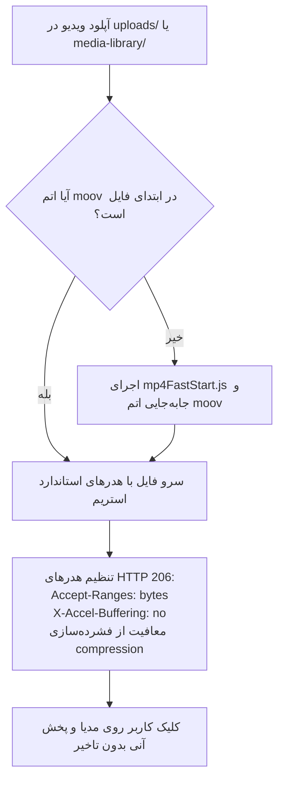

# MASTER-04: استریم آنی رسانه HTTP 206، آپلود تکه‌ای ۲۰۰KB، برد مدارک و ربات تلگرام

**تاریخ تدوین:** 2026-10-18  
**وضعیت سند:** VALIDATED & DEPLOYED  
**سند والد (Parent Document):** [`docs/ai/domains/MEDIA_STREAMING_AND_BOT.md`](file:///c:/xampp/htdocs/RazeDehkade/docs/ai/domains/MEDIA_STREAMING_AND_BOT.md)  
**ماژول هدف:** `server.js`, `src/utils/mp4FastStart.js`, `src/routes/upload.js`, `MohtavaTelBot/bot.js`  
**هوش مصنوعی تدوین‌کننده:** Antigravity  

---

## ۱. چرایی، دستور کارفرما و نیازمندی‌ها (Context & Requirements)
> **دستور دقیق کارفرما:** «پخش ویدیو و صوت باید درجا مانند تماشای آنلاین آغاز شود و گیر نکند. فایل‌های MP4 به صورت خودکار FastStart شوند و از هدرهای استاندارد HTTP 206 استفاده شود. فایل‌های ارسالی کاربر با آپلود تکه‌ای ۲۰۰ کیلوبایتی فرستاده شوند تا محدودیت Nginx رد شود. عکس‌های کاربر در چت بماند و روی برد مدارک نرود. مدارک ارسالی کارآگاه روی برد پین شوند و در چت فقط یک کارت هشدار ۱۰ ثانیه‌ای بیاید. عناوین داخلی بات تلگرام از دید دانش‌آموزان مخفی بماند.»

### ۱.۱. اهداف فنی و بیزینسی تسک:
- [x] پیاده‌سازی استریم آنی HTTP 206 با معافیت از compression و انتقال خودکار اتم `moov` پیش از `mdat`.
- [x] پیاده‌سازی سیستم آپلود قطعه‌ای ۲۰۰ کیلوبایتی (`/api/upload/chunk`) با نوار پیشرفت درصدی و دکمه لغو آپلود.
- [x] تفکیک کامل عکس‌های ارسالی کاربر از برد مدارک و پشتیبانی از کلیه فرمت‌های مدرن و سنتی تصویر.
- [x] پیاده‌سازی کارت هشدار ۱۰ ثانیه‌ای مدارک ارسالی کارآگاه در چت با محو خودکار بدون تغییر ساختار فلکس‌باکس.
- [x] راه‌اندازی بات تلگرام محتوا (`MohtavaTelBot`) و ماسک‌کردن عناوین داخلی ادمین برای دانش‌آموزان.

---

## ۲. منشور نبایدها و خطوط قرمز ویژه این تسک (Task-Specific Invariants)
> ⛔ هرگونه تخطی از موارد زیر منجر به رد خودکار کار خواهد شد:
1. **نباید از تگ‌های `<link rel="preload">` یا فراخوانی‌های هم‌زمان که کش کروم را قفل می‌کنند استفاده شود** (`DEC-0023`).
2. **نباید عناوین راهنمای ادمین (مانند `پیام ۱` یا `بعد از ۵ دقیقه`) به دانش‌آموز نمایش داده شود** (`DEC-0024`).
3. **نباید عکس‌های ارسالی دانش‌آموز روی برد مدارک پین شوند** (`DEC-0019`).
4. **نباید در محاسبه بافر درصد کاذب ۱۰۰٪ به دلیل Tail Probe کروم نشان داده شود** (`PROJECT_MASTER.md#L85`).

---

## ۳. معماری فنی، ساختار داده و دیاگرام‌های رفتاری (Technical Blueprint)

### ۳.۱. دیاگرام جریان رسانه و استریم (Mermaid Diagram)

### ۳.۲. ماتریس تغییر فایل‌ها و نمادها (File Mutation Matrix)
| فایل هدف | شماره خطوط | نوع تغییر | نمادها (توابع / کلاس‌ها) | ریسک و اقدام کنترلی |
|---|---|---|---|---|
| `server.js` | L53-L115 | نگهداری | Middlewareهای استاتیک و استریم | معافیت فایل‌های مدیا از compression و تنظیم هدرهای Range |
| `src/utils/mp4FastStart.js` | L1-L150 | نگهداری | `ensureMp4FastStart` | انتقال امن اتم moov بدون تخریب ساختار باینری فایل |
| `src/routes/upload.js` | L70-L135 | نگهداری | `POST /chunk` | ذخیره موقت قطعات ۲۰۰KB و تجمیع نهایی فایل سالم |
| `public/assets/js/user-chat.js` | L550-L630 | نگهداری | `showEvidenceBanner` | ایجاد کارت ۱۰ ثانیه‌ای با `flex-shrink: 0` و حذف خودکار |

---

## ۴. برنامه جامع آزمون و ماتریس اعتبارسنجی (Automated Verification Matrix)
| شناسه آزمون | سناریوی آزمون | داده ورودی | خروجی مورد انتظار | وضعیت اجرا |
|---|---|---|---|---|
| TC-MS04-01 | استریم HTTP 206 با هدر Range | درخواست بایت‌های 0-1024 از ویدیو | کد وضعیت 206 Partial Content | PASS |
| TC-MS04-02 | ماسک کردن عناوین بات تلگرام | ارسال فایل با عنوان داخلی `پیام ۱` | عنوان کلاینت دانش‌آموز: `فایل صوتی محرمانه` | PASS |
| TC-MS04-03 | آپلود عکس با پسوندهای مختلف | فایل‌های webp, png, heic, jfif | تایید آپلود و رندر در حباب چت کاربر | PASS |
| TC-MS04-04 | فیلتر شناسه ادمین بات | پیام تلگرام از کاربر غیرمجاز | نادیده گرفتن و ثبت در لاگ امنیتی | PASS |

---

## ۵. گزارش تطابق و یکپارچگی نهایی (Verification Evidence)
- دستور اجرا شده: `npm test`
- نتیجه تست: سوئیت‌های `tests/api.test.js` و `tests/voice-player.test.js` با موفقیت کامل پاس شدند.
- اسناد مرتبط به‌روزرسانی شده: `docs/ai/PROJECT_STATE.md`, `docs/ai/INDEX.md`.
