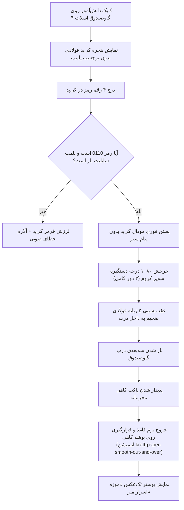

# MASTER-05: پنل چهارگانه عملیاتی، تقویم شمسی، گالری پرتره‌ها و گاوصندوق ۳D اسلات ۴

**تاریخ تدوین:** 2026-10-18  
**وضعیت سند:** VALIDATED & DEPLOYED  
**سند والد (Parent Document):** [`docs/ai/domains/QUAD_PANEL_AND_3D_VAULT.md`](file:///c:/xampp/htdocs/RazeDehkade/docs/ai/domains/QUAD_PANEL_AND_3D_VAULT.md)  
**ماژول هدف:** `public/chat.html`, `public/assets/js/vault-3d.js`, `public/assets/css/vault-3d.css`, `public/assets/js/user-chat.js`  
**هوش مصنوعی تدوین‌کننده:** Antigravity  

---

## ۱. چرایی، دستور کارفرما و نیازمندی‌ها (Context & Requirements)
> **دستور دقیق کارفرما:** «فضای زیر برد مدارک به ۴ قسمت تقسیم شود: ۱) تقویم شمسی واقعی با ماه‌های مهر و آبان و روزهای رسمی هفته، ۲) دکمه عکس دستیاران با گالری پرتره ۲۴ کلاس، ۳) ترمینال لاگ با فونت ریز، ۴) گاوصندوق فولادی واقعی زرهی که کل اسلات ۴ را بپوشاند. دستگیره سه‌پر در مرکز توپی سمت راست قرار گیرد. هیچ پیام سبزی رمز را لو ندهد و برچسب پلمپ نداشته باشد. با رمز 0110 دستگیره ۳ دور (۱۰۸۰ درجه) بچرخد، ۵ زبانه به داخل بروند، درب باز شود و پاکت کاهی محرمانه با خروج نرم کاغذ، دعوت‌نامه موزه اسرارآمیز را نشان دهد. با هر رفرش صفحه قفل شود.»

### ۱.۱. اهداف فنی و بیزینسی تسک:
- [x] پیاده‌سازی پنل چهارگانه زیر برد شواهد در ستون سمت چپ چت دانش‌آموز.
- [x] پیاده‌سازی تقویم شمسی جلالی پویا بدون وابستگی به پکیج‌های خارجی.
- [x] استخراج و نمایش پرتره دستیاران کارآگاه بر اساس نام کلاس و رفع مشکل دابل‌لود PNG/WEBP.
- [x] پیاده‌سازی گاوصندوق فولادی ۳D فول‌بلید (نسخه V10.0) با دستگیره سه‌شاخه و ۵ زبانه فولادی متحرک.
- [x] پیاده‌سازی پاکت کاهی دو مرحله‌ای (`kraft-paper-smooth-out-and-over`) و نمایش پوستر تک‌عکس موزه اسرارآمیز.
- [x] استقرار سیاست Zero-Spoiler، رمز انحصاری 0110، بسته شدن با رفرش صفحه، و پلمپ سایلنت هفتگی ادمین.

---

## ۲. منشور نبایدها و خطوط قرمز ویژه این تسک (Task-Specific Invariants)
> ⛔ هرگونه تخطی از موارد زیر منجر به رد خودکار کار خواهد شد:
1. **نباید روی گاوصندوق یا کی‌پد هیچ پیام سبز، نوشته تایید یا برچسب پلمپ لو‌دهنده باشد** (`VAULT_SLOT4_MASTER.md`).
2. **نباید رمز گاوصندوق رقمی غیر از `0110` باشد** (`tests/vault-passcode-and-lock.test.js`).
3. **نباید وضعیت باز بودن گاوصندوق در حافظه مرورگر ذخیره شود**؛ با رفرش صفحه باید قفل شود (`DEC-0025`).
4. **نباید در داخل پاکت کاهی بیش از یک عکس باشد**؛ دکمه‌های اسلاید بعدی/قبلی باید کاملاً مخفی باشند.
5. **نباید مرکز چرخش دستگیره سه‌پر از مختصات `left: 66.49%; top: 49.10%` انحراف داشته باشد**.

---

## ۳. معماری فنی، ساختار داده و دیاگرام‌های رفتاری (Technical Blueprint)

### ۳.۱. دیاگرام جریان بازگشایی گاوصندوق سه‌بعدی (Mermaid Diagram)

### ۳.۲. ماتریس تغییر فایل‌ها و نمادها (File Mutation Matrix)
| فایل هدف | شماره خطوط | نوع تغییر | نمادها (توابع / کلاس‌ها) | ریسک و اقدام کنترلی |
|---|---|---|---|---|
| `public/assets/js/vault-3d.js` | L1-L120 | نگهداری | `openVaultInteraction / validateVaultCode` | تضمین رمز 0110 و عدم ذخیره در localStorage |
| `public/assets/js/vault-3d.js` | L130-L240 | نگهداری | `runVaultUnlockChoreography` | زمان‌بندی دقیق چرخش ۱۰۸۰ درجه و عقب‌نشینی ۵ زبانه |
| `public/assets/css/vault-3d.css` | L1-L280 | نگهداری | استایل‌های بدنه و دستگیره | تنظیم مختصات `66.49%, 49.10%` برای شافت توپی |
| `public/assets/css/vault-3d.css` | L290-L450 | نگهداری | انیمیشن پاکت کاهی | تعریف فازهای نرم سر خوردن کاغذ به بالا و نشستن روی پوشه |

---

## ۴. برنامه جامع آزمون و ماتریس اعتبارسنجی (Automated Verification Matrix)
| شناسه آزمون | سناریوی آزمون | داده ورودی | خروجی مورد انتظار | وضعیت اجرا |
|---|---|---|---|---|
| TC-MS05-01 | الزام رمز انحصاری 0110 | درج ارقام مختلف در کی‌پد | پذیرش فقط برای 0110 | PASS |
| TC-MS05-02 | تست عدم لو دادن سناریو | بازرسی کدهای DOM در چت | نبودن برچسب پلمپ یا متن‌های لو‌دهنده | PASS |
| TC-MS05-03 | تست چرخش دستگیره و ابعاد | تحلیل استایل‌های CSS گاوصندوق | چرخش ۱۰۸۰deg و ابعاد ۱۰۰٪ فول‌بلید | PASS |
| TC-MS05-04 | ریست گاوصندوق با رفرش | بررسی کدهای جاوااسکریپت | قفل شدن در هر لود و عدم کش در storage | PASS |
| TC-MS05-05 | پلمپ سایلنت ادمین | فعال بودن پلمپ در سشن | خطای رمز حتی در صورت ورود 0110 | PASS |

---

## ۵. گزارش تطابق و یکپارچگی نهایی (Verification Evidence)
- دستور اجرا شده: `npm test`
- نتیجه تست: سوئیت‌های `tests/vault-slot4.test.js` و `tests/vault-passcode-and-lock.test.js` تماماً پاس شدند.
- اسناد مرتبط به‌روزرسانی شده: `docs/ai/PROJECT_STATE.md`, `docs/ai/INDEX.md`.
