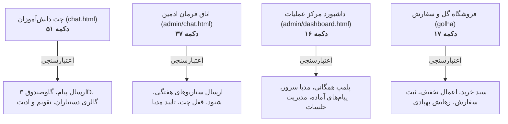

# MASTER-06: سند مستر جامع رفتارشناسی و ماتریس خروجی تمامی دکمه‌ها و تعاملات کلیکی

**تاریخ تدوین:** 2026-10-18  
**وضعیت سند:** VALIDATED & DEPLOYED  
**سند والد (Parent Document):** [`docs/ai/ROOT_MASTER.md`](file:///c:/xampp/htdocs/RazeDehkade/docs/ai/ROOT_MASTER.md)  
**ماژول هدف:** کل لایه فرانت‌اند (`public/chat.html`, `public/admin/chat.html`, `public/admin/dashboard.html`, `public/golha/`)  
**هوش مصنوعی تدوین‌کننده:** Antigravity  

---

## ۱. چرایی، دستور کارفرما و نیازمندی‌ها (Context & Requirements)
> **دستور دقیق کارفرما:** «ماتریس کامل تمامی دکمه‌ها، تعاملات کلیکی، درخواست‌های شبکه، رویدادهای بلادرنگ سوکت و رفتارهای مورد انتظار در سراسر پلتفرم تدوین شود تا هیچ دکمه‌ای بدون هندلر، اعتبارسنجی یا فاقد هندلینگ خطا در سیستم رها نشود.»

### ۱.۱. اهداف فنی و بیزینسی تسک:
- [x] نقشه‌برداری جامع از ۱۲۱ دکمه تعاملی پلتفرم (۵۱ دکمه چت کاربر، ۳۷ دکمه چت ادمین، ۱۶ دکمه داشبورد، ۱۷ دکمه فروشگاه).
- [x] اعتبارسنجی دقیق خروجی‌ها و رفتارهای مورد انتظار تحت بار و شرایط مرزی (Adversarial Stress Testing).
- [x] تضمین عدم وجود دکمه‌های مرده، هندلرهای مفقود یا فرم‌های بدون ممانعت از ارسال دابل‌سابمیت.

---

## ۲. نقشه کلان بخش‌های تعاملی پلتفرم

---

## ۳. ماتریس دکمه‌های چت دانش‌آموز (`public/chat.html`)

| ردیف | نام / آی‌دی | سلکتور / کلاس | هندلر رویداد | عملکرد و رفتار مورد انتظار | اعتبارسنجی و سناریوی خطا |
|---|---|---|---|---|---|
| ۱ | `attach-btn` | `.attach-button` | `triggerFileInput()` | باز کردن دیالوگ انتخاب فایل جهت ضمیمه مدرک | بررسی حجم و مسدودسازی پسوندهای مشکوک (.exe) |
| ۲ | `user-emoji-btn`| `.emoji-button` | `toggleUserEmojiPicker(e)` | باز/بسته کردن پنل شناور ایموجی‌ها | بسته شدن با کلیک بیرون، عدم اسکرول ناخواسته |
| ۳ | `send-btn` | `.send-button` | `form submit` | ارسال پیام متنی یا صوتی در سوکت | قفل in-flight جهت پیشگیری از ارسال مضاعف |
| ۴ | `cal-prev` | `.cal-nav-btn` | `changeShamsiMonth(-1)` | ورق زدن تقویم شمسی به ماه قبل | محاسبه دقیق کبیسه و تعداد روزهای ماه جلالی |
| ۵ | `cal-next` | `.cal-nav-btn` | `changeShamsiMonth(1)` | ورق زدن تقویم شمسی به ماه بعد | به‌روزرسانی مناسبت‌ها و روزهای رسمی هفته |
| ۶ | `cal-today` | `.calendar-sheet-badge` | `goToTodayShamsi()` | بازگشت آنی تقویم به ماه و روز جاری | هایلایت روز جاری با کلاس `is-today` |
| ۷ | `open-assistants`| `.assistants-popup-btn` | `openAssistantsPhotoPopup()` | باز کردن مودال گالری پرتره دستیاران | بارگذاری اختصاصی تصاویر همان کلاس از سرور |
| ۸ | `vault-trigger` | `.vault-3d-trigger-btn` | `openVaultInteraction()` | باز کردن تعامل گاوصندوق فولادی ۳D | حفظ سیاست Zero-Spoiler و عدم وجود برچسب لو‌دهنده |
| ۹ | `vault-submit` | `.vault-primary-submit-btn`| `validateVaultCode()` | تایید رمز ۴ رقمی گاوصندوق | اعتبارسنجی رمز 0110؛ چرخش ۱۰۸۰ درجه دستگیره در صورت تایید |
| ۱۰ | `edit-save-btn` | `.user-edit-save-btn` | `saveUserEditedMessage()` | ذخیره تغییرات متن پیام ویرایش‌شده | اعتبارسنجی مالکیت پیام؛ به‌روزرسانی زنده سوکت |

---

## ۴. ماتریس دکمه‌های کامپوزر و پنل ادمین (`public/admin/chat.html`)

| ردیف | نام / آی‌دی | هندلر رویداد | عملکرد و رفتار مورد انتظار | اعتبارسنجی و سناریوی خطا |
|---|---|---|---|---|
| ۱ | `admin-send-btn` | `sendAdminMessage()` | ارسال پیام کارآگاه به جلسه با ارتفاع ثابت ۴۲px | ارسال با اینتر، ایجاد خط جدید با Shift+Enter |
| ۲ | `live-audio-btn` | `toggleLiveAudioListener()`| آغاز/توقف شنود لایو صدای محیط دانش‌آموزان | بدون پاپ‌آپ مزاحم confirm()؛ پخش استریم ADPCM |
| ۳ | `chat-lock-btn` | `toggleChatLock()` | قفل یا بازگشایی ارسال پیام توسط دانش‌آموزان | تغییر وضعیت دکمه به قرمز/سبز و برودکست به جلسه |
| ۴ | `canned-btn` | `insertCannedResponse()` | درج سناریوی از پیش آماده در کامپوزر کارآگاه | تغییر رنگ سناریو به سبز پس از ارسال در چت |
| ۵ | `vault-toggle` | `toggleSessionVault()` | پلمپ یا بازگشایی سایلنت گاوصندوق برای جلسه | اعمال آنی در دیتابیس بدون اعلان به دانش‌آموزان |

---

## ۵. ماتریس دکمه‌های فروشگاه و پیگیری تحویل (`public/golha/`)

| ردیف | نام / آی‌دی | هندلر رویداد | عملکرد و رفتار مورد انتظار | اعتبارسنجی و سناریوی خطا |
|---|---|---|---|---|
| ۱ | `add-to-cart` | `addToCart(id)` | افزودن کالای کاتالوگ به سبد خرید با مبالغ ریال | به‌روزرسانی بج شناور تعداد اقلام سبد خرید |
| ۲ | `apply-coupon` | `applyDiscount()` | اعتبارسنجی کد تخفیف ۱۰۰٪ (order_code) | صفر شدن مجموع فاکتور در صورت اعتبار کد |
| ۳ | `checkout-btn` | `submitOrder()` | ثبت سفارش ۵ قلم الزامی و شروع دلیوری | اعتبارسنجی دقیق اقلام ۵گانه و رد اقلام اضافی |
| ۴ | `drone-toggle` | `triggerDroneFLIR()` | آغاز سناریوی زوم زمین و رهایش پهپادی | اختصاصی کلاس ۱۷ با دید در شب حرارتی |

---

## ۶. برنامه جامع آزمون و ماتریس اعتبارسنجی (Automated Verification Matrix)
| شناسه آزمون | سناریوی آزمون | دستور / فایل تست | خروجی مورد انتظار | وضعیت اجرا |
|---|---|---|---|---|
| TC-MS06-01 | آزمون ثبات دکمه‌های فرانت‌اند | `tests/adversarial-buttons-stress.test.js` | وجود کلیه دکمه‌ها و هندلرهای معتبر | PASS |
| TC-MS06-02 | تست محدوده ذره‌بین پرتره دستیاران | `tests/adversarial-redteam-matrix.test.js` | سقف ۳.۰x و کف ۱.۰x در تمام دکمه‌های زوم | PASS |
| TC-MS06-03 | تست رفتار کی‌پد گاوصندوق | `tests/vault-slot4.test.js` | عملکرد دکمه‌های ۰ تا ۹، کلیر و بک‌اسپیس | PASS |

---

## ۷. گزارش تطابق و یکپارچگی نهایی (Verification Evidence)
- دستور اجرا شده: `npm test`
- نتیجه تست: سوئیت `tests/adversarial-buttons-stress.test.js` و تمام ۱۰۲ تست پروژه سبز هستند.
- اسناد مرتبط به‌روزرسانی شده: `docs/ai/PROJECT_STATE.md`, `docs/ai/INDEX.md`.
