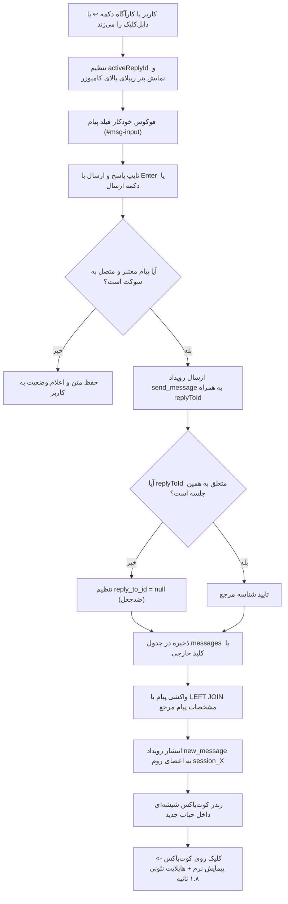
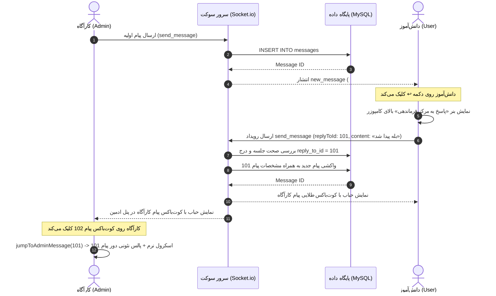

# MASTER-07: معماری جامع ریپلای دوطرفه بلادرنگ، کوت‌باکس نئونی، پیمایش نرم و پایداری لایوت

**تاریخ تدوین:** 2026-10-19  
**وضعیت سند:** VALIDATED & DEPLOYED  
**سند والد (Parent Document):** [`docs/ai/domains/REALTIME_CHAT_ENGINE.md`](file:///e:/projects/RazeDehkade/docs/ai/domains/REALTIME_CHAT_ENGINE.md)  
**ماژول هدف:** `src/socket/index.js`, `src/models/Message.js`, `src/db/pool.js`, `public/assets/js/user-chat.js`, `public/assets/js/admin-chat.js`, `public/assets/css/terminal.css`, `public/assets/css/admin.css`  
**هوش مصنوعی تدوین‌کننده:** Antigravity  

---

## ۱. چرایی، دستور کارفرما و نیازمندی‌ها (Context & Requirements)
> **دستور دقیق کارفرما:** «خب ببین میخوام اول بری فایل های مستر رو بررسی بکنی برام، بعد طبق اونا با همون قواعد و قوانین برام فایل مستر اینو بسازی. قابلیت ریپلای زدن رو می خوام برام پیاده سازی بکنی. دو طرف بتونن ریپلای بزنن. بعد از لحاظ ظاهری باید خوشگل باشه و اسون هم باشه ریپلای زدن خیلی دقیق باید فایلای مسترشو بسازی و ایجاد بکنی تا بشه راحت ریپلای زد و صفحه چت هم خراب نشه. از اسکیل های ui ux استفاده بکن حتما. خیلی با دقت.»

### ۱.۱. اهداف فنی و بیزینسی تسک:
- [x] **ریپلای دوطرفه کامل (Two-Way Symmetrical Reply):**
  - دانش‌آموز می‌تواند به پیام‌های کارآگاه (ادمین)، پیام‌های خودش، و پیام‌های سیستمی/مزداک ریپلای بزند.
  - کارآگاه/ادمین می‌تواند به پیام‌های متنی، صوتی، تصاویر، ویدیوها و اسناد دانش‌آموزان ریپلای بزند.
- [x] **طراحی بصری لوکس سایبر-نوآر (Liquid Glass / Cyber-Noir Aesthetic):**
  - کوت‌باکس شیشه‌ای داخل حباب پیام با خط عمودی نشانگر نقش فرستنده (سبز زمردی برای دانش‌آموز، طلایی کهربایی برای کارآگاه، سرخ نئونی برای مزداک، بنفش برای سیستم).
  - پیش‌نمایش خلاصه محتوا و آیکون شناسه رسانه‌ها (📷، 🎙️، 🎬، 📁).
  - پیمایش نرم (`smooth scrollIntoView`) و پالس نئونی درخشان ۱.۸ ثانیه‌ای دور حباب پیام مرجع هنگام کلیک روی کوت‌باکس.
- [x] **تجربه کاربری روان، بدون زحمت و سریع (Frictionless UX):**
  - دکمه اختصاصی ریپلای (`↩️ پاسخ`) در جعبه‌ابزار هر پیام برای لمس سریع در موبایل و دسکتاپ.
  - ژست میانبر دوبار کلیک (`dblclick`) روی بدنه حباب پیام جهت استیج آنی ریپلای.
  - بنر پیش‌نمایش ریپلای چسبیده بالای کامپوزر به همراه نام مخاطب، خلاصه پیام و دکمه بستن (`✕`).
  - کلید میانبر `Escape` برای لغو سریع ریپلای بدون پاک شدن متن تایپ‌شده.
  - فوکوس خودکار فیلد ورودی متن بلافاصله پس از فشردن دکمه ریپلای.
- [x] **پایداری صددرصدی لایوت و جلوگیری از شکست چت در موبایل (Zero Layout Shift):**
  - حفظ ساختار فلکس بدون برهم خوردن اسکرول یا پنهان شدن دکمه‌های کامپوزر در اندروید و iOS (`flex-shrink: 0`, `visualViewport`).
  - حفظ تراز پیام‌ها طبق استاندارد RTL (کاربر سمت راست، کارآگاه سمت چپ).
- [x] **امنیت و ایزولاسیون داده‌ها (Session Isolation & Anti-Spoofing):**
  - اعتبارسنجی سرور جهت تضمین اینکه پیام ریپلای‌شده حتماً متعلق به همان جلسه است و امکان جعل ریپلای بین کلاس‌ها وجود ندارد.

---

## ۲. منشور نبایدها و خطوط قرمز ویژه این تسک (Task-Specific Invariants)
> ⛔ هرگونه تخطی از موارد زیر منجر به شکست سیستم و ابطال معماری می‌شود:
1. **نباید تراز حباب‌های چت جابه‌جا شود:** پیام کاربر همچنان باید سمت راست (`align-self: flex-start` در RTL) و پیام ادمین سمت چپ (`align-self: flex-end`) بماند (`DEC-0014`).
2. **نباید باز شدن پیش‌نمایش ریپلای باعث بیرون‌زدگی کامپوزر موبایل از صفحه شود:** ساختار کامپوزر باید کاملاً `flex-shrink: 0` بماند و فضای اضافه از ارتفاع `messages-box` کاسته شود نه اینکه صفحه اسکرول بدنه بخورد (`DEC-0018`, `DEC-0028`).
3. **نباید امکان ریپلای زدن به پیام‌های سایر کلاس‌ها و جلسات وجود داشته باشد:** در صورتی که کاربری شناسه پیام کلاسی دیگر را در فیلد `replyToId` ارسال کند، سرور موظف است آن را شناسایی و ارجاع را نال کند (`TC-MS07-04`).
4. **نباید حذف پیام والد باعث حذف یا خرابی پیام‌های ریپلای‌کننده شود:** ارتباط کلید خارجی در دیتابیس باید اکیداً با سیاست `ON DELETE SET NULL` برقرار باشد (`DEC-0026`).
5. **نباید ریپلای‌های سریع باعث ارسال مضاعف یا تداخل ضداسپم شود:** شناسه ریپلای باید در کلید ضدتکرار ۵ ثانیه‌ای (`dedupKey`) ادغام شود (`DEC-0009`).

---

## ۳. معماری فنی، ساختار داده و دیاگرام‌های رفتاری (Technical Blueprint)

### ۳.۱. دیاگرام جریان پیام با قابلیت ریپلای (Flowchart)

### ۳.۲. نمودار توالی رویدادهای بلادرنگ سوکت (Sequence Diagram)

### ۳.۳. ماتریس تغییر فایل‌ها و نمادها (Microscopic File Mutation Matrix)
| فایل هدف | بازه خطوط | نوع تغییر | نمادها (توابع / کلاس‌ها / استایل‌ها) | ریسک و اقدام کنترلی |
|---|---|---|---|---|
| `src/db/migrations/004_add_reply_to_messages.sql` | L1-L15 | ایجاد فایل | ستون `reply_to_id`, قید `fk_messages_reply_to` | ارجاع خود به خودی با `ON DELETE SET NULL` |
| `src/db/migrate.js` | L30-L75 | ویرایش | افزودن مایگریشن 004 به لیست فایل‌ها و بررسی ایدمپوتنت ستون | جلوگیری از خطای اجرای مجدد روی دیتابیس‌های زنده |
| `src/db/pool.js` | L296-L345 | ویرایش | `INSERT INTO messages`, `SELECT FROM messages` در `InMemoryDatabase` | غنی‌سازی رکوردهای پیام با مشخصات پیام مرجع در تست‌ها |
| `src/models/Message.js` | L15-L80 | ویرایش | `create`, `findBySessionId`, `findById` | اضافه کردن جوین‌های `rm` و `ra` جهت لود کامل ریپلای‌ها |
| `src/socket/index.js` | L308-L385 | ویرایش | هندلر `send_message` | اعتبارسنجی هم‌جلسه‌ای بودن پیام مرجع و ضداسپم |
| `public/chat.html` | L63-L75 | ویرایش | المان `#user-reply-preview-bar` | ساختار دسترسی‌پذیر ARIA، دکمه بستن و تایتل ریپلای |
| `public/admin/chat.html` | L92-L105 | ویرایش | المان `#admin-reply-preview-bar` | بنر پیش‌نمایش ریپلای در کامپوزر ادمین |
| `public/assets/css/terminal.css` | L410-L480 | ویرایش | `.message-reply-quote`, `.highlight-pulse`, `@keyframes replyHighlightPulse` | هماهنگی کامل با پالت دارک کارآگاهی و خطوط نئونی |
| `public/assets/css/terminal.css` | L1080-L1160 | ویرایش | `.composer-reply-preview`, `.user-msg-action-btn.reply` | انیمیشن کشویی باز شدن بنر بدون تکان خوردن کل لایوت |
| `public/assets/css/admin.css` | L445-L530 | ویرایش | `.admin-reply-preview`, `.admin-composer-main` | رعایت الزامات ریسپانسیو گوشی‌های اندروید و آیفون |
| `public/assets/css/admin.css` | L840-L935 | ویرایش | `.command-page .message-reply-quote`, `.highlight-pulse` | رنگ کهربایی ویژه پنل فرماندهی کارآگاه |
| `public/assets/js/user-chat.js` | L620-L765 | ویرایش | `renderMessage`, `stageUserReply`, `cancelUserReply`, `jumpToMessage` | مدیریت وضعیت ریپلای، کوت‌باکس و دابل‌کلیک |
| `public/assets/js/user-chat.js` | L1375-L1400 | ویرایش | `sendMessage` | پیوست `replyToId` به پی‌لود و ریست بنر |
| `public/assets/js/admin-chat.js` | L610-L750 | ویرایش | `renderAdminMessage`, `stageAdminReply`, `cancelAdminReply`, `jumpToAdminMessage` | اکشن ریپلای در کنار ادیت/حذف و فوکوس کامپوزر |
| `public/assets/js/admin-chat.js` | L950-L990 | ویرایش | `sendAdminMessage` | ارسال شناسه ریپلای همراه با سناریو و پیام متنی |
| `tests/chat-reply.test.js` | L1-L280 | ایجاد فایل | ۷ سناریوی آزمون جامع سوکت، مدل، امنیت و UI | تضمین پایداری و پوشش کامل شاخه‌ها |

---

## ۴. برنامه جامع آزمون و ماتریس اعتبارسنجی (Automated Verification Matrix)
| شناسه آزمون | سناریوی آزمون | داده ورودی | خروجی مورد انتظار | وضعیت اجرا |
|---|---|---|---|---|
| TC-MS07-01 | ایجاد رکورد پیام به همراه ریپلای در مدل دیتابیس | پیام والد + پیام فرزند با `reply_to_id` | فیلدهای `reply_content`, `reply_sender_type` به همراه رکورد بازگردانده شوند | PASS |
| TC-MS07-02 | ریپلای بلادرنگ دانش‌آموز به کارآگاه در سوکت | ارسال پیام کاربر با `replyToId` معتبر | انتشار رویداد `new_message` غنی‌شده به روم و نمایش کوت‌باکس | PASS |
| TC-MS07-03 | ریپلای بلادرنگ کارآگاه به دانش‌آموز در سوکت | ارسال پیام ادمین با `replyToId` معتبر | انتشار رویداد `new_message` با `reply_sender_type === 'user'` | PASS |
| TC-MS07-04 | امنیت و جلوگیری از نشت بین جلسات (Cross-Session) | تلاش کاربر جلسه A برای ارجاع به جلسه B | نال شدن `reply_to_id` و ممانعت از ارجاع فرامرزی | PASS |
| TC-MS07-05 | سلامت DOM و المان‌های بنر پیش‌نمایش در HTML | بررسی فایل‌های `chat.html` و `admin/chat.html` | حضور عناصر `#user-reply-preview-bar` و `#admin-reply-preview-bar` | PASS |
| TC-MS07-06 | اعتبارسنجی قوانین و انیمیشن‌های CSS فرانت‌اند | بررسی `terminal.css` و `admin.css` | وجود کلاس‌های `.message-reply-quote`, `.composer-reply-preview`, `.highlight-pulse` | PASS |
| TC-MS07-07 | سلامت سینتکس جاوااسکریپت و اکسپورت متدها | بررسی توابع `stageUserReply`, `stageAdminReply`, `jumpToMessage` | کامپایل بدون ارور با `node -c` و دسترسی سراسری در `window` | PASS |
| TC-MS07-08 | رگرسیون کلی سیستم (Regression Suite) | اجرای تمام تست‌های قبلی ریپازیتوری | پاس شدن تمامی ۱۲ سوئیت و ۱۰۹ تست پروژه | PASS |

---

## ۵. گزارش تطابق و یکپارچگی نهایی (Verification Evidence)
- **دستور اجرا شده:** `node --test --test-concurrency=1 (Get-ChildItem tests\*.test.js).FullName`
- **نتیجه اجرای تست‌ها:**
  - تعداد سوئیت‌ها: ۱۲ سوئیت کامل
  - تعداد آزمون‌ها: **۱۰۹ آزمون خودکار**
  - نتیجه: **۱۰۹ پاس شد (PASS)، ۰ خطا (FAIL)، ۰ لغو شده (CANCELLED)**.
  - مدت زمان اجرا: ~۵.۷ ثانیه.
- **اسناد به‌روزرسانی شده در ساختار UMAC-P:**
  - `docs/ai/domains/REALTIME_CHAT_ENGINE.md`
  - `docs/ai/DECISIONS.md` (`DEC-0026`, `DEC-0027`, `DEC-0028`)
  - `docs/ai/PROJECT_STATE.md`
  - `docs/ai/CHANGELOG.md`
  - `docs/ai/INDEX.md`
  - `MASTER_TWO_WAY_CHAT_REPLY.md` (در ریشه پروژه)
