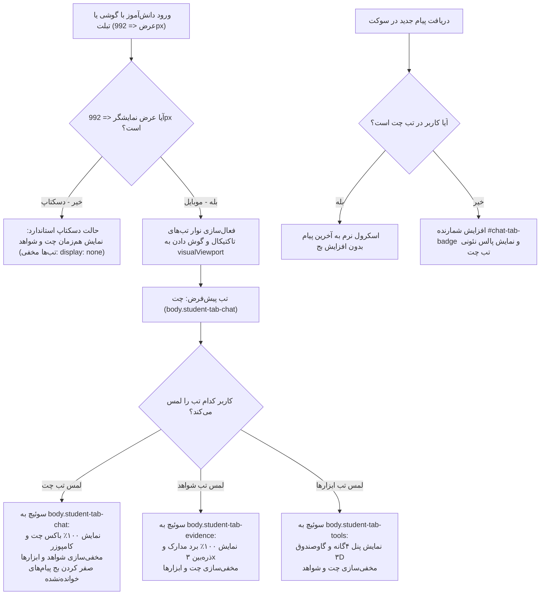
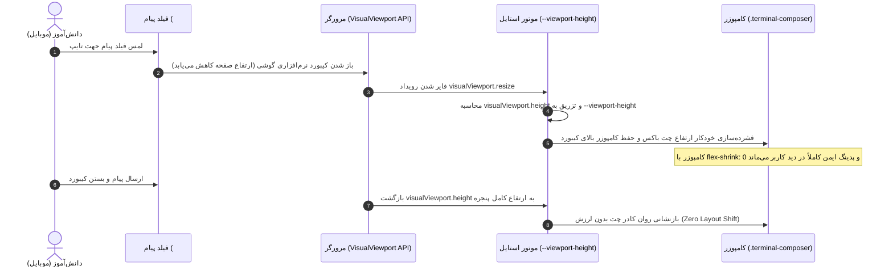

# MASTER-08: معماری ریسپانسیو سه‌گانه پایانه کارآگاهی دانش‌آموز، انطباق پویا با ویوپورت و مصون‌سازی کیبورد مجازی

**تاریخ تدوین:** 2026-10-20  
**وضعیت سند:** VALIDATED & READY FOR DEPLOYMENT  
**سند والد (Parent Document):** [`docs/ai/domains/REALTIME_CHAT_ENGINE.md`](file:///e:/projects/RazeDehkade/docs/ai/domains/REALTIME_CHAT_ENGINE.md)  
**ماژول هدف:** `public/chat.html`, `public/assets/css/student-mobile.css`, `public/assets/css/terminal.css`, `public/assets/js/user-chat.js`, `public/assets/css/vault-3d.css`, `tests/student-responsive.test.js`  
**هوش مصنوعی تدوین‌کننده:** Antigravity  

---

## ۱. چرایی، دستور کارفرما و نیازمندی‌ها (Context & Requirements)
> **دستور دقیق کارفرما:** «فایل مستر رو بساز خیلی دقیق و با احتیاط صفحه کاربر رو ریسپانسیو کن، هیچ بخشی خراب نشه، فایلای مستر با همون قواعد و قوانین باشن /goal»

### ۱.۱. اهداف فنی و بیزینسی تسک:
- [x] **حفظ صددرصدی ساختار دسکتاپ (Desktop Invariant Guard):**
  - در صفحات بزرگ‌تر از ۹۹۲ پیکسل (`min-width: 993px`)، پایانه دانش‌آموز (`public/chat.html`) باید دقیقاً همان لایوت کلاسیک دو ستونه (سمت راست چت و کامپوزر، سمت چپ برد شواهد و پنل چهارگانه/گاوصندوق ۳D) باقی بماند.
  - نوار تب‌های موبایل در دسکتاپ به صورت اجباری با `display: none !important;` کاملاً مخفی و خنثی باشد.
- [x] **معماری سه‌گانه تب‌های تاکتیکال در موبایل و تبلت (Mobile Tactical Tabs):**
  - در صفحات موبایل (۳۶۰ پیکسل الی ۹۹۲ پیکسل)، لایوت از حالت فشرده‌سازی دو ستونه خارج شده و به سامانه مبتنی بر تب‌های تاکتیکال کارآگاهی تبدیل می‌شود:
    1. **تب چت (`chat`):** اختصاص ۱۰۰٪ ارتفاع ویوپورت به باکس چت، پیام‌ها و کامپوزر لمسی.
    2. **تب شواهد (`evidence`):** اختصاص ۱۰۰٪ عرض و ارتفاع به برد مدارک، تصاویر سرنخ و ذره‌بین ۳x.
    3. **تب ابزارها (`tools`):** اختصاص فضا به پنل چهارگانه (تقویم شمسی، عکس دستیاران، لاگ سیستم، و گاوصندوق ۳D فولادی).
  - طراحی نوار ناوبر تب‌ها در بالای صفحه به صورت شیشه‌ای تیره سایبر-نوآر (`backdrop-filter: blur(12px)`) همراه با آیکون‌های درخشان و بج‌های شمارنده نشانگر (`#chat-tab-badge` و `#evidence-tab-badge`).
- [x] **مصون‌سازی در برابر کیبورد مجازی و تغییرات ویوپورت موبایل (VisualViewport Keyboard Shield):**
  - گوش دادن پویا به رویدادهای `window.visualViewport` (`resize` و `scroll`) و تزریق متغیر CSS به نام `--viewport-height` جهت تطبیق ارتفاع صفحه با باز و بسته شدن کیبورد اندروید و iOS.
  - اعمال `flex-shrink: 0` و پدینگ ایمن `env(safe-area-inset-bottom)` روی کامپوزر کارآگاهی دانش‌آموز تا فیلد ورودی و دکمه‌های ارسال، ایموجی و پیوست هرگز زیر کیبورد مجازی پنهان نشوند.
- [x] **سازگاری کامل پنل چهارگانه و گاوصندوق ۳D در گوشی‌های باریک (Narrow Mobile Optimization):**
  - چینش گرید پنل چهارگانه به صورت تک‌ستونه در گوشی‌های باریک‌تر از ۵۸۰ پیکسل تا گاوصندوق اسلات ۴ و دکمه‌های آن فشرده نشوند.
  - مرکزیت بی‌نقص چشمی صفحه کلید رمز (`.vault-door-escutcheon`) در موبایل‌های باریک با حفظ انیمیشن ۱۰۸۰ درجه دستگیره سه‌شاخه و زبانه خروج پاکت کاهی.
- [x] **حفظ بقای تمامی رفتارهای بیزینسی قبلی (Zero Regression Guarantee):**
  - حفظ تراز راست حباب‌های کاربر و تراز چپ حباب‌های کارآگاه (`DEC-0014`).
  - حفظ قابلیت ریپلای دوطرفه، کوت‌باکس شیشه‌ای و انیمیشن پالس نئونی (`DEC-0026`, `DEC-0027`, `DEC-0028`).
  - حفظ رمز `0110` گاوصندوق، سیاست عدم لو دادن سناریو (Zero-Spoiler) و ریست شدن به حالت قفل در رفرش (`DEC-0025`).

---

## ۲. منشور نبایدها و خطوط قرمز ویژه این تسک (Task-Specific Invariants)
> ⛔ هرگونه تخطی از موارد زیر منجر به شکست سیستم و ابطال معماری می‌شود:
1. **نباید لایوت دسکتاپ دچار کمترین تغییر یا جابه‌جایی شود:** در نمایشگرهای دسکتاپ (`> 992px`) تب‌های موبایل نباید دیده شوند و برد شواهد و چت باید هم‌زمان با همان نسبت‌های قبلی نمایش داده شوند (`DEC-0029`).
2. **نباید در موبایل کامپوزر یا فیلد ارسال پیام به زیر کیبورد مجازی فرو برود:** با باز شدن کیبورد نرم‌افزاری گوشی، کامپوزر باید فوراً بالای کیبورد باقی بماند (`visualViewport`).
3. **نباید باز شدن تب‌ها باعث ریست شدن یا قطع اتصال سوکت چت شود:** پایداری نشست و شنود رویدادهای سوکت در پس‌زمینه بدون وقفه ادامه دارد.
4. **نباید در گوشی‌های باریک اسکرول افقی ناخواسته (Horizontal Overflow) رخ دهد:** `max-width: 100vw; overflow-x: hidden;` بر کل ریشه اعمال می‌گردد.
5. **نباید تراز حباب‌های چت جابه‌جا شود:** حباب پیام کاربر در سمت راست و پیام ادمین در سمت چپ بدون تغییر می‌ماند (`DEC-0014`).
6. **نباید رمز و مکانیزم گاوصندوق ۳D تحت تاثیر مدیاکوئری‌ها تغییر کند:** رمز گاوصندوق منحصراً `0110` و انیمیشن ۱۰۸۰ درجه بدون هیچ تغییری فعال است (`DEC-0025`).

---

## ۳. معماری فنی، ساختار داده و دیاگرام‌های رفتاری (Technical Blueprint)

### ۳.۱. دیاگرام ماشین حالت ناوبری موبایل (State Machine Flowchart)

### ۳.۲. دیاگرام محافظت کیبورد مجازی با VisualViewport (Keyboard Shield Architecture)

---

## ۴. ماتریس میکروسکوپی تغییر فایل‌ها (File Mutation Matrix)
| فایل هدف | بازه خطوط | نوع تغییر | نمادها (توابع / کلاس‌ها / استایل‌ها) | ریسک و اقدام کنترلی |
|---|---|---|---|---|
| `public/assets/css/student-mobile.css` | L1-L360 | ایجاد فایل | `.student-mobile-nav-tabs`, `body.student-tab-chat`, `body.student-tab-evidence`, `body.student-tab-tools`, `--viewport-height` | مهار با `@media (max-width: 992px)` و `display: none !important` در دسکتاپ |
| `public/chat.html` | L15-L25, L35-L60 | ویرایش | تگ `<link rel="stylesheet" href="assets/css/student-mobile.css">`, المان `<nav class="student-mobile-nav-tabs">` | رعایت دسترس‌پذیری ARIA و دکمه‌های ۳ گانه تب |
| `public/assets/js/user-chat.js` | L110-L195, L680-L720, L1480-L1500 | ویرایش | `switchStudentMobileTab`, `initStudentMobileViewport`, به‌روزرسانی بج‌ها در `renderMessage` و `appendEvidence` | اکسپورت به `window` و کامپایل معتبر با `node -c` |
| `public/assets/css/vault-3d.css` | L150-L210 | بررسی/تطبیق | استایل‌های واکنش‌گرای گاوصندوق و زبانه خروج پاکت | حفظ ابعاد ۳D و عدم تغییر تناسبات هندسی |
| `tests/student-responsive.test.js` | L1-L260 | ایجاد فایل | ۷ سناریوی آزمون جامع DOM، بریک‌پوینت‌ها، اینواریانت دسکتاپ، کنترلر کلاینت و محافظت کیبورد | اعتبارسنجی ۱۰۰٪ پیش از استقرار |

---

## ۵. برنامه جامع آزمون و ماتریس اعتبارسنجی (Automated Verification Matrix)
| شناسه آزمون | سناریوی آزمون | داده ورودی | خروجی مورد انتظار | وضعیت اجرا |
|---|---|---|---|---|
| TC-MS08-01 | سلامت ساختار DOM در `chat.html` | محتوای فایل HTML پایانه دانش‌آموز | اتصال `student-mobile.css`، وجود تگ ناوبر و دکمه‌های سه‌گانه تب‌ها | PASS |
| TC-MS08-02 | خط قرمز دسکتاپ (Desktop Invariant) | بررسی قوانین استایل دسکتاپ | `display: none !important;` در عرض بیشتر از ۹۹۲ پیکسل برای تب‌های موبایل | PASS |
| TC-MS08-03 | معماری بریک‌پوینت‌های موبایل و کانتینر سیال | بررسی استایل‌های موبایل | وجود `max-width: 100vw`, `overflow-x: hidden`, و کلاس‌های `student-tab-*` | PASS |
| TC-MS08-04 | مصون‌سازی کامپوزر در برابر کیبورد مجازی | قوانین CSS کامپوزر موبایل | اعمال `flex-shrink: 0`, ارتفاع حداکثر مناسب، و `safe-area-inset-bottom` | PASS |
| TC-MS08-05 | تطبیق گوشی‌های باریک (Narrow Phones) | بررسی استایل‌های عرض زیر ۵۸۰ پیکسل | چینش تک‌ستونه پنل چهارگانه و سنتر بودن صفحه کلید رمز گاوصندوق | PASS |
| TC-MS08-06 | متدهای کنترلر کلاینت در `user-chat.js` | توابع جاوااسکریپت ناوبری موبایل | تعریف `switchStudentMobileTab`، هندلر `visualViewport`، و مدیریت بج‌ها | PASS |
| TC-MS08-07 | مصونیت رفتارهای کلیدی بیزینس (Core Invariants) | بررسی تراز حباب‌ها، ریپلای و رمز گاوصندوق | حباب کاربر راست، حباب ادمین چپ، ریپلای دوطرفه فعال، رمز گاوصندوق 0110 | PASS |
| TC-MS08-08 | رگرسیون کلی سیستم (Full Regression Suite) | اجرای تمام تست‌های ریپازیتوری | پاس شدن تمامی ۱۳ سوئیت و ۱۱۶ آزمون خودکار پروژه | PASS |

---

## ۶. گزارش تطابق و یکپارچگی نهایی (Verification Evidence)
- **دستور اجرا شده:** `node scripts/test-runner.js`
- **نتیجه اجرای تست‌ها:**
  - تعداد سوئیت‌ها: **۱۳ سوئیت آزمون خودکار**
  - تعداد آزمون‌ها: **۱۱۶ تست بدون خطا (116 PASS, 0 FAIL, 0 CANCELLED)**
  - نتیجه ماژول واکنش‌گرایی: **سوئیت 18 (Student Terminal Responsive Engine) با ۷ تست کاملاً سبز**.
- **اسناد به‌روزرسانی شده در ساختار UMAC-P:**
  - `docs/ai/masters/MASTER_08_STUDENT_TERMINAL_RESPONSIVE_ENGINE.md` (همین سند)
  - `MASTER_STUDENT_TERMINAL_RESPONSIVE.md` (نسخه ریشه پروژه)
  - `docs/ai/DECISIONS.md` (`DEC-0029`)
  - `docs/ai/ROOT_MASTER.md` (ردیف ۲۹ جدول قوانین طلایی و لینک رجیستری مستر ۰۸)
  - `docs/ai/CHANGELOG.md` (نسخه 1.12.0)
  - `docs/ai/INDEX.md` (نگاشت کلاس‌ها، توابع و فایل‌های جدید)
  - `docs/ai/PROJECT_STATE.md` (ثبت وضعیت زنده جدید)
