# MASTER-17: بازطراحی بنیادین سینماتیک نفوذ مزداک، تعاملات چت و مینی‌گیم‌های واکنش‌گرا

> **سند والد ریشه:** [ROOT_MASTER.md](../ROOT_MASTER.md)  
> **سند والد دامنه:** [CORE_BUSINESS_ENGINE.md](../domains/CORE_BUSINESS_ENGINE.md)  
> **تاریخ تدوین:** ۲۶ اکتبر ۲۰۲۶  
> **وضعیت:** در حال اجرا (Active Implementation)  
> **شناسه مستر:** `MASTER-17-MAZDAK-REDEFINED`

---

## ۱. اهداف کلان و صورت‌مسئله (Objectives & Problem Statement)

بر اساس بازخورد میدانی کارفرما در ۴ تصویر ارسالی و متن چت‌های سناریو (هفته سوم و ویدیوهای دهکده‌ها):
1. **تصویر اول (مشکلات چت، بورد اسناد و تایپ):**
   - حباب‌های پیام چت نبرد در مقایسه با پیام‌های اصلی سیستم زشت و ناهماهنگ بودند. باید ساختار HTML/CSS پیام‌های چت دقیقاً با حباب‌های اصلی [chat.html](file:///e:/projects/RazeDehkade/public/chat.html) و [user-chat.js](file:///e:/projects/RazeDehkade/public/assets/js/user-chat.js) یکپارچه و زیبا شود.
   - ترتیب رویدادها باید تصحیح شود: ابتدا پرده سیاه ۷ ثانیه‌ای؛ بلافاصله ترمینال باز می‌شود؛ حین باز شدن ترمینال، دو پیام اضطراری اول سرکارآگاه در بک‌گراند چت قرار می‌گیرند؛ پیام‌ها باید در چت ادمین نیز همگام و نمایش داده شوند.
   - بورد شواهد: آرم مزداک در وسط حذف شده و تمام کارت‌های مدارک و اسناد با روکش مات `mazdak.jpg` و افکت مخدوش قرمز پوشانده شوند.
   - افکت‌های پارازیت، نویز و خطوط گلیچ باید روی عکس‌های دستیاران کارآگاه، تقویم و گاوصندوق اعمال شود.
   - اینپوت پیام دانش‌آموزان هنگام تایپ روح (Ghost Typing) نباید خاکستری و غیرقابل دیدن باشد؛ باید با استایل نئونی روشن و باکنتراست بالا (سبز نئونی/سیان درخشان) با کرسر تپنده به صورت خوانا و حرف به حرف تایپ شود.
2. **تصویر دوم (ترمینال و نبرد کلامی دهکده آخر):**
   - ترمینال ابتدا ۲ تا ۳ خط لاگ شکست امنیتی واقعی نشان می‌دهد، سپس صفحه ترمینال پاک/گلیچ شده و پیام مزداک حرف به حرف با صدای کلیدهای مکانیکی تایپ می‌شود.
   - سپس ترمینال بسته شده و به جایگاه اولیه خود می‌نشیند.
   - شروع نبرد چت ۱ الی ۲ دقیقه‌ای بر اساس ماجرای دهکده آخر، فیلم چهارم و کدهای چهار دهکده (۹۲۷۳، ۴۶۹۱، ۶۷۱۸ و ۱۱۶۳)، جایی که مزداک خودش را جای بچه‌ها جا زده و با اصرار می‌خواهد رمز گاوصندوق را استخراج کند.
3. **تصویر سوم (مودال اخراج اضطراری):**
   - دکمه بزرگ نارنجی «انتقال فوری» برای کاربران عادی حذف می‌شود (فقط در حالت تست/دیباگ موجود باشد).
   - متن مودال: دستور فوری به بچه‌ها برای رفتن به یک جای امن و پاسخ‌دهی جداگانه به سوالات احراز هویت. انتقال خودکار پس از پایان تایمر.
4. **تصویر چهارم (احراز هویت اضطراری و مینی‌گیم‌های واکنش‌گرا):**
   - بازطراحی ۱۰۰٪ واکنش‌گرا و مدرن صفحه احراز هویت برای موبایل (بیش از ۹۰٪ کاربران) و دسکتاپ.
   - حذف متن‌های اضافه، متکلف و خارج از حس کارآگاهی (حذف کلمات مثل «نوستالژیک» و توضیحات غیرداستانی).
   - تبدیل اکثر سوالات به مینی‌گیم‌های تعاملی با المان‌های لمسی جذاب.
   - عدم نمایش درست/غلط در پایان؛ نمایش پیام رسمی ارسال داده‌ها به سرور مرکزی جهت بررسی و اعلام نتیجه در اتاق فرماندهی.

---

## ۲. دیاگرام وضعیت و ترنزیشن‌های سینماتیک (State Machine)

```mermaid
stateDiagram-v2
    [*] --> NORMAL_ACTIVE: وضعیت عادی جلسه
    NORMAL_ACTIVE --> BLACKOUT_7S: ادمین دکمه هک را می‌زند
    
    state BLACKOUT_7S {
        [*] --> SCREEN_PURE_BLACK: پرده سیاه مطلق (7 ثانیه)
        SCREEN_PURE_BLACK --> DISMISS_CURTAIN: محو شدن پرده سیاه
    }
    
    BLACKOUT_7S --> TERMINAL_ELEVATION: آغاز فاز نفوذ بصری
    
    state TERMINAL_ELEVATION {
        [*] --> ASCEND_TO_CENTER: پرواز ترمینال از جایگاه فیزیکی
        ASCEND_TO_CENTER --> INTRUSION_LOGS: نمایش ۳ خط لاگ نفوذ
        INTRUSION_LOGS --> FLASH_CLEAR: پاکسازی و گلیچ صفحه ترمینال
        FLASH_CLEAR --> MAZDAK_TYPEWRITER: تایپ کاراکتری مزداک با صدای کلیک
        MAZDAK_TYPEWRITER --> DOCK_TO_GRID: فرود و بازگشت به گرید اولیه
    }
    
    state BACKGROUND_CHAT_STAGING {
        [*] --> DETECTIVE_PRE_MSG_1: پیام ۱ کارآگاه (سیگنال عجیب)
        DETECTIVE_PRE_MSG_1 --> DETECTIVE_PRE_MSG_2: پیام ۲ کارآگاه (نوسان شبکه)
        DETECTIVE_PRE_MSG_2 --> SYNC_TO_ADMIN: همگام‌سازی پیام‌ها با پنل ادمین
    }
    
    TERMINAL_ELEVATION --> CHAT_BATTLE_STORY: فرود ترمینال و نمایش چت
    
    state CHAT_BATTLE_STORY {
        [*] --> GHOST_TYPE_1: تایپ درخشان مزداک در اینپوت بچه‌ها (کد دهکده آخر)
        GHOST_TYPE_1 --> DETECTIVE_REPLY_1: پاسخ کارآگاه و شک در لحن
        DETECTIVE_REPLY_1 --> GHOST_TYPE_2: اصرار مزداک برای رمز گاوصندوق
        GHOST_TYPE_2 --> DETECTIVE_UNMASK: کشف کلک و نام بردن از لیلیوم
        DETECTIVE_UNMASK --> MAZDAK_UNMASKED: افشای هویت مزداک و تهدید
    }
    
    CHAT_BATTLE_STORY --> EJECTION_ALERT: پایان نبرد
    
    state EJECTION_ALERT {
        [*] --> SHOW_SECURITY_MODAL: نمایش مودال هشدار بدون دکمه میانبر
        SHOW_SECURITY_MODAL --> REDIRECT_AUTH: انتقال خودکار به emergency-auth
    }
    
    EJECTION_ALERT --> EMERGENCY_MINIGAMES: درگاه احراز هویت بازی‌محور
    EMERGENCY_MINIGAMES --> SUCCESS_SUBMISSION: ارسال بدون نمایش درست/غلط
```

---

## ۳. جزییات فنی فایل‌های مؤثر (Target Files & Microscopic Edits)

1. **`public/assets/js/cyber-breach-engine.js`**:
   - بازتنظیم تایم‌لاین به ۱۸۵ ثانیه با ترتیب دقیق درخواستی.
   - اصلاح ساختار DOM حباب‌های پیام در متد `appendChatMessage` تا ۱۰۰٪ با ساختار پیام‌های اصلی چت مطابقت کند (`message-bubble`, `message-header`, `message-body`, `message-time`).
   - ارسال سوکت یا شبیه‌سازی همگام پیام‌های نفوذ به روم ادمین‌ها.
   - پیاده‌سازی تایپ حروف در ترمینال با صدای کلیک وب‌آدیو (`playGeigerTickSFX`).
   - دیالوگ‌های داستانی مرتبط با دهکده آخر، فیلم ارسالی و کدهای دهکده‌ها.
   - مخفی‌سازی دکمه انتقال فوری در مودال اخراج برای کاربران عادی.
2. **`public/assets/css/cyber-breach-engine.css`**:
   - اصلاح کلاس‌های گلیچ و نویز روی عکس‌های دستیاران (`.assistant-photo.corrupted-noise`).
   - اصلاح افکت روی تقویم (`.calendar-container.corrupted-noise`).
   - اصلاح افکت روی گاوصندوق (`.vault-slot.corrupted-noise`).
   - پوشش سراسری مدارک بورد اسناد با عکس `mazdak.jpg` و فیلتر قرمز.
   - استایل درخشان نئونی برای چت‌باکس حین تایپ روح (`.ghost-typing-active`).
3. **`public/emergency-auth.html` & `public/assets/js/emergency-auth.js` & `public/assets/css/emergency-auth.css`**:
   - بازطراحی موبایل‌فرست با طراحی مدرن کارت‌های بازی (Micro-Interactions).
   - حذف تمام متن‌های اضافه و غیرحرفه‌ای.
   - ساخت مینی‌گیم‌های تعاملی برای اکثر سوالات (تلفن چرخشی، پازل روزنامه، انتخاب کارت‌های سرنخ، اسلایدرها و ارتباطات کارآگاهی).
   - پیام پایانی اعلام ارسال مدارک به مرکز فرماندهی بدون قضاوت بلادرنگ کارنامه.

---

## ۴. استانداردهای آزمون و پذیرش (Acceptance Criteria)

- [ ] اجرای ۱۰۰٪ سبز تمام ۲۰ فایل آزمون پروژه با دستور `node scripts/test-runner.js`.
- [ ] آزمایش پروسه در نمای موبایل (۳۷۵ و ۴۱۴ پیکسل) بدون اسکرول افقی و با تاچ تارگت استاندارد.
- [ ] آزمایش پروسه روی مرورگر دسکتاپ.
- [ ] استقرار نهایی روی سرور `razedehkade.ir` و تست زنده.
