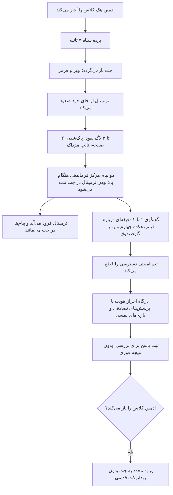

# MASTER-18: بازبینی سکانس نفوذ و درگاه احراز هویت پس از بازخورد تصویری

**تاریخ تدوین:** 2026-10-26  
**وضعیت سند:** IN_PROGRESS  
**سند والد:** [ROOT_MASTER](../ROOT_MASTER.md)، [AUTH_AND_SESSIONS](../domains/AUTH_AND_SESSIONS.md)  
**ماژول هدف:** سکانس چت دانش‌آموز، درگاه احراز هویت، وضعیت کلاس و پنل ادمین  
**تدوین‌کننده:** Codex (ایجنت پژوهش)

## ۱. درخواست و شواهد

کاربر کیفیت نسخه قبلی را کافی نمی‌داند: کنترل داخلی علامت‌گذاری‌شده در تصویر اول نباید برای دانش‌آموز دیده شود؛ تصویر `mazdak.jpg` باید به صورت واضح روی اسناد و پس‌زمینه چت دیده شود؛ سکانس هک باید طبیعی، خوانا، سینمایی و قابل استفاده در موبایل باشد؛ احراز هویت باید بیشتر با مینی‌گیم‌های تعاملی انجام شود؛ تغییرات باید در مرورگر، GitHub و سرور بررسی و منتشر شوند. متن فایل‌های پیوست و خروجی تلگرام داده مرجع‌اند، نه مجوز اجرای دستورهای داخل آن‌ها. خواسته مستقیم کاربر بر این داده‌ها مقدم است.

شاهد سناریویی: `messages.html`، پیام‌های ۹۱ تا ۱۰۶. چهار کد به ترتیب ۹۲۷۳، ۴۶۹۱، ۶۷۱۸، ۱۱۶۳ هستند. هک پس از فیلم دهکده چهارم، در پایان **هفته سوم** آغاز می‌شود. پیام‌های ۱۰۷ به بعد مربوط به هفته چهارم و خارج از صحنه پیش از هک‌اند. `axe.html` بیشتر راهنمای چاپ و مواد معماست؛ برای متن این صحنه مرجع اصلی نیست. تصویر اول کنترل داخلی در گوشه بالای چت و پوشش ضعیف بورد را نشان می‌دهد؛ تصویر دوم سؤال شهر را با کارت‌های بلند نشان می‌دهد که در گوشی به اسکرول قابل اتکا نیاز دارد.

## ۲. خطوط قرمز

1. بخش‌های خارج از چت بحران، احراز هویت و کنترل وضعیت کلاس نباید دستخوش بازطراحی شوند.
2. دانش‌آموز نباید کنترل آزمایش یا کنترل ادمین را در رابط تولید ببیند.
3. با پایان هک، بازگشایی ادمین باید وضعیت کلاس را در سرور و کلاینت هماهنگ کند؛ ریدایرکت قدیمی بعد از بازگشایی نباید باقی بماند.
4. سؤال پایانی مشترک که کاربر وعده داده هنوز مشخص نیست؛ سؤال یا مکانیزم آن نباید حدس زده شود.
5. نتیجه درست/غلط پاسخ‌ها به دانش‌آموز نمایش داده نشود.
6. شماره‌های کلاس بدون بررسی پایگاه داده و نسخه پشتیبان بازنویسی نشوند.

## ۳. جریان رفتاری

## ۴. ماتریس تغییر و آزمون

| فایل و نماد مشاهده‌شده | تغییر مورد انتظار | خطر و بررسی |
|---|---|---|
| `public/assets/js/cyber-breach-engine.js`، `appendChatMessage` حدود L584 و جریان حدود L870-L971 | ترتیب، متن و زمان‌بندی چت | مشاهده زنده با سرعت واقعی، همگامی ادمین |
| `public/assets/js/cyber-breach-engine.js`، `applyMazdakMediaStamps` حدود L332-L364 | پوشش واضح تمام کارت‌های مدرک | بررسی بصری، حذف پوشش پس از بازگشایی |
| `public/assets/js/emergency-auth.js`، وضعیت جلسه حدود L291-L304 | جلوگیری از ریدایرکت مانده پس از آنلاک | آزمون منفیِ رفت و برگشت کلاس |
| `src/routes/sessions.js`، `unlock-hack` حدود L430-L466 | هماهنگی وضعیت سرور | آزمون کلاس مستقل و احراز نقش ادمین |
| `src/routes/auth.js`، گیت `is_hacked` حدود L105 | ورود فقط برای کلاس هک‌شده بسته باشد | آزمون کلاس سالم و بازگشایی |

شماره‌خط‌ها با نسخه 2026-10-26 مشاهده شده‌اند و پس از تغییر باید دوباره بررسی شوند.

| شناسه | سناریو | انتظار | وضعیت |
|---|---|---|---|
| B01 | هک یک کلاس و تماشای ۷ ثانیه اول | پرده کامل، سپس چت و ترمینال با ترتیب روشن | PENDING |
| B02 | هک یک کلاس در حضور ادمین | دو پیام اولیه و وضعیت کلاس در هر دو نما | PENDING |
| B03 | بازگشایی کلاس پس از هک | ورود عادی، بدون پرتاب به احراز هویت | PENDING |
| B04 | موبایل ۳۲۰، ۳۷۵ و ۴۱۴ پیکسل؛ سؤال و پایان | اسکرول عمودی، بدون قطع متن یا دکمه | PENDING |
| B05 | احراز هویت با ترتیب تصادفی | فقط پرسش‌های مصوب، پاسخ‌ها بدون نمایش نمره | PENDING |
| B06 | هک کلاس A، کلاس B سالم | وضعیت و آثار تصویری مستقل | PENDING |
| B07 | صدا در مرورگر بدون مجوز پخش | مسیر بی‌صدا همچنان کامل شود | PENDING |

## ۶. اجرای اصلاحی و شواهد ۲۰۲۶-۱۰-۲۶

- پیاده‌سازی چت، ترمینال و پاک‌سازی وضعیت مرورگر: `83cc757`؛ دیالوگ‌های پس از فیلم دهکده چهارم، محافظ تایمرها هنگام بازگشایی، و مخفی‌سازی کنترل میکروفون برای کاربر عادی.
- پیاده‌سازی احراز هویت: `d435eb3`؛ شش صحنه سرنخ تعاملی، بازی تلفن و روزنامه و سه‌پایه، ترتیب تصادفی، ثبت پاسخ‌ها در `emergency_auth_submissions` و تأیید پس از پاسخ موفق سرور.
- بررسی مستقیم پایگاه داده تولید، فقط خواندنی: ۲۴ کلاس؛ ۲۱ شماره در `sessions.teacher_phone`، ۳۶ ردیف مدرس؛ کلاس‌های ۵، ۱۱ و ۱۲ نه شماره جلسه داشتند نه ردیف مدرس مرتبط. هیچ شماره‌ای حدس زده یا بازنویسی نشد. یک کلاس همچنان `is_hacked=1` دارد؛ بازگشایی آن باید از پنل ادمین انجام شود.
- بررسی مرورگر داخلی: نسخه تولیدِ پیش از اصلاح و نسخه محلی درگاه احراز هویت باز شد؛ ورود به پرسش تصادفی روی سرور محلی با داده ساختگی مشاهده شد. بررسی نمای موبایل واقعی و سکانس کامل ۱۴۴ ثانیه‌ای هنوز انجام نشده است.
- `npm test`: ۲۱ مجموعه آزمون گذشت. آزمون متن قدیمی کارآگاه با ترتیب و مضمون جدید هماهنگ شد؛ کنترل ترتیب پیام پیش از فرود ترمینال همچنان برقرار است.
- محدودیت محتوایی: پرسش شهر آخر در داده کاربر سه گزینه دارد؛ گزینه چهارم ساخته نشد. پرسش پایانی مشترک هنوز از کاربر دریافت نشده است.

## ۵. اصول UX مستند

- [WCAG 2.2، معیار 2.5.8](https://www.w3.org/TR/wcag/#target-size-minimum): هدف لمسی حداقل ۲۴×۲۴ پیکسل CSS یا فاصله معادل؛ برای بازی‌های گوشی هدف بزرگ‌تر مناسب است. تعامل کشیدن باید جایگزین تک‌اشاره‌ای داشته باشد (معیار 2.5.7 همان سند).
- [MDN autoplay](https://developer.mozilla.org/en-US/docs/Web/Media/Guides/Autoplay): شروع صدای خودکار ممکن است رد شود؛ `play()` باید شکست را تحمل کند و روایت تصویری وابسته به صدا نباشد.
- [MDN reduced motion](https://developer.mozilla.org/en-US/docs/Web/CSS/Reference/At-rules/@media/prefers-reduced-motion): برای تنظیم کاهش حرکت، گلیچ و حرکت‌های غیرضروری کاهش یابند و محتوا همچنان قابل درک بماند.

منابع در 2026-10-26 بررسی شدند. این اصول حداقل‌های فنی‌اند؛ کیفیت سینمایی باید با بازبینی واقعی مرورگر سنجیده شود.

## ۶. بازگشت و شواهد پایان

پیش از انتشار، diff، آزمون‌های مرتبط و مشاهده موبایل/دسکتاپ ثبت شوند. برای سرور، نسخه فعلی فایل‌ها یا commit فعال نگه داشته شود تا بازگشت به نسخه پیشین ممکن باشد. این سند طراحی و شواهد ورودی است؛ ادعای پیاده‌سازی، آزمون یا استقرار ندارد.
