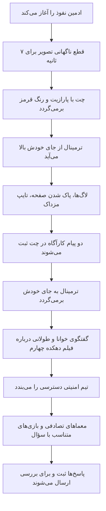

# MASTER-19: بازطراحی کامل دو صحنه نفوذ و احراز هویت

**تاریخ:** 2026-10-26  
**وضعیت:** IN_PROGRESS  
**والد:** `../ROOT_MASTER.md`، `../domains/AUTH_AND_SESSIONS.md`  
**دامنه:** `public/assets/js/cyber-breach-engine.js`، `public/assets/css/cyber-breach-engine.css`، `public/emergency-auth.html` و فایل‌های CSS/JS آن

## خواسته و شاهد مخالف

کاربر نسخه مستقر قبلی را از نظر ظاهر، ریسپانسیو بودن، دقت متن سؤال‌ها و منطق تلفن رد کرد. بنابراین قبولی ۲۱ آزمون قبلی اثبات پذیرش تجربه نیست. پیاده‌سازی فعلی تلفن را با کلیک روی عدد و چرخش نمایشی صفحه انجام می‌دهد؛ چرخش با حرکت دست کاربر رخ نمی‌دهد. شش صحنه دیگر نیز عمدتاً باز کردن کارت پیش از انتخاب گزینه‌اند.

## خطوط قرمز

1. متن ۱۱ سؤال فهرست‌شده و گزینه‌ها باید با نوشته کاربر یکی باشد؛ پرسش تلفن که جداگانه توصیف شده، سؤال دوازدهم است. سؤال پایانی مشترک تا دریافت متن آن ساخته نشود.
2. دو سؤال پایانی مذهبی با انتخاب ساده و محترمانه بمانند. برای سؤال شهر فقط سه گزینه ارائه شده؛ گزینه چهارم از کاربر درخواست شده و نباید جعل شود.
3. پاسخ درست/غلط به مخاطب نشان داده نشود. ثبت واقعی پاسخ در سرور و جداسازی کلاس‌ها حفظ شود.
4. بخش‌های دیگر سایت تغییر نکنند؛ نسخه پشتیبان پیش از استقرار حفظ شود.

## تجربه هدف

## ماتریس تغییر و راستی‌آزمایی

| بخش | تغییر | شاهد لازم |
|---|---|---|
| تلفن | صفحه شماره‌گیر مقیاس‌پذیر، کشیدن واقعی صفحه، بازگشت فنری؛ جایگزین لمسی/کیبوردی | حرکت Pointer و ثبت رقم پس از رهاسازی، کلیک/کیبورد بدون drag |
| متن معما | تطبیق حرف‌به‌حرف متن مصوب و حذف دستورهای خارج از داستان | آزمون داده سؤال و مشاهده صفحه |
| بازی‌ها | تعامل مربوط به مفهوم سؤال، نه باز کردن تزئینی کارت | اجرای واقعی هر نوع در مرورگر |
| موبایل | عرض ۳۲۰/۳۷۵/۴۱۴، اسکرول عمودی، کنترل‌های بزرگ | مشاهده viewport و نبود برش افقی/عمودی |
| نفوذ | کنتراست چت و ترمینال، افکت‌های لایه‌ای روی بورد/تقویم/عکس/گاوصندوق | مشاهده سکانس در مرورگر و صدای اختیاری |
| پایان | فقط «ارسال برای بررسی»، بدون نمره | آزمون درخواست موفق/ناموفق سرور |

## مبنای فنی

برای حرکت صفحه تلفن از Pointer Events و `setPointerCapture` استفاده می‌شود؛ `touch-action: none` فقط روی خود شماره‌گیر اعمال می‌شود تا اسکرول بقیه صفحه حفظ شود. راه جایگزین با ضربه و کیبورد روی اعداد ارائه می‌شود. این با [راهنمای MDN درباره `touch-action`](https://developer.mozilla.org/en-US/docs/Web/CSS/Reference/Properties/touch-action) و [WCAG 2.2 درباره جایگزین drag و اندازه هدف](https://www.w3.org/WAI/standards-guidelines/wcag/new-in-22/) سازگار است.

## بازگشت

کد قبل از بازطراحی در کامیت `9f66b05` و نسخه پشتیبان فایل‌های سرور در `.deploy_backups/task18_pre_20261026.tar.gz` حفظ شده است. استقرار تازه فقط پس از آزمون و بررسی بصری انجام شود.
