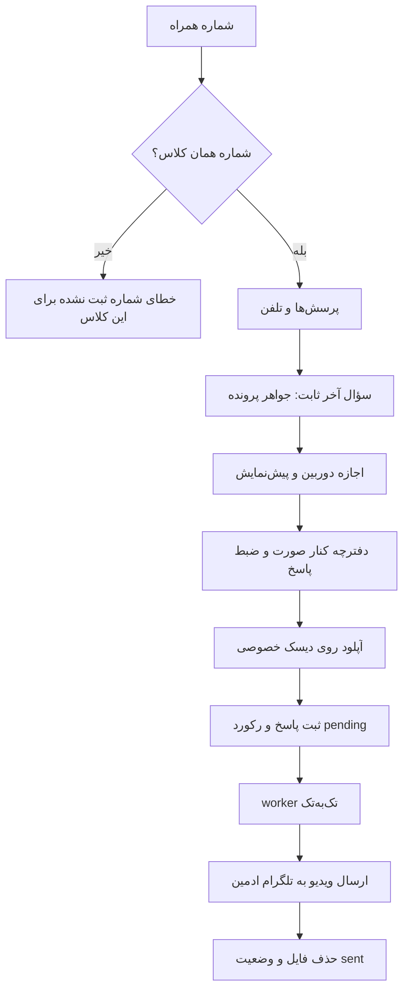

# MASTER-20: احراز شماره کلاس، پرسش‌های ساده و ویدیوی سلفی پایانی

**تاریخ:** 2026-10-26  
**وضعیت:** ACTIVE  
**والد:** `MASTER_19_CINEMATIC_REDESIGN_AND_REAL_MINIGAMES.md`، `MASTER_04_MEDIA_STREAMING_TELEGRAM_BOT.md`  
**دامنه:** درگاه اضطراری، API احراز، ذخیره خصوصی ویدیو، صف ارسال تلگرام و کنترل ادمین

## خواسته قطعی کاربر

1. شماره فقط وقتی پذیرفته شود که با شماره ثبت‌شده همان کلاس/جلسه یکی باشد؛ بقیه شماره‌ها خطا بگیرند.
2. بازی‌های تزئینی سؤال‌های پلیس، جواهر، سرمایه‌گذاری، نامه، مهاجرت، رنگ روغن و پادری حذف شوند و سؤال و گزینه‌ها بماند.
3. تلفن «کفش فروشی تنها» سه‌بعدی و صفحه گردان آن از نظر فیزیکی درست باشد.
4. گزینه‌ها کامل شوند: «قرآن مجید»، «پیامبر صلی الله علیه و آله و سلم»، «امام زمان علیه السلام».
5. سؤال «جواهر ارزشمند داخل پرونده چه بود؟» همیشه مرحله آخر باشد. کاربر اجازه دوربین می‌دهد، دفترچه را کنار صورت نگه می‌دارد و پاسخ را در ویدیوی سلفی می‌گوید.
6. ویدیو روی دیسک خصوصی ذخیره و با صف تک‌به‌تک به تلگرام ادمین ارسال شود تا ورود همزمان کاربران فشار ناگهانی نسازد.
7. پایان فقط پیام «برای بررسی ارسال شد» داشته باشد و هیچ دکمه یا لینک خروجی نشان داده نشود.

## قرارداد امنیت و داده

- API شماره با توکن کاربر و `sessionId` توکن، فقط `sessions.teacher_phone` همان جلسه را مقایسه می‌کند. شماره جلسه دیگر معتبر نیست.
- ویدیو حداکثر 45 ثانیه و 25MiB و فقط `video/webm` یا `video/mp4` است. Multer مستقیم در `storage/emergency-selfies/` می‌نویسد و فایل عمومی نیست.
- کاربر قبل از ضبط توضیح استفاده را می‌بیند و خودش دوربین و ضبط را فعال می‌کند. فایل فقط با ارسال نهایی آپلود می‌شود.
- جدول `emergency_auth_videos` وضعیت `pending/sending/sent/failed`، تعداد تلاش، زمان retry و خطا را نگه می‌دارد. worker فقط یک ارسال فعال دارد.
- توکن تلگرام و شناسه ادمین فقط از متغیر محیطی خوانده می‌شود و هرگز به مرورگر یا پاسخ API نمی‌رود.
- پس از ارسال موفق تلگرام، فایل محلی حذف می‌شود؛ فایل شکست‌خورده برای retry می‌ماند.

## جریان

## کنترل ادمین

API فقط‌ادمین فهرست ویدیوها را بر اساس کلاس و وضعیت می‌دهد و endpoint صف‌کردن دوباره همه ویدیوهای pending/failed یک کلاس را دارد. worker مستقل از باز بودن پنل کار می‌کند.

## پذیرش و آزمون

- شماره غلط، شماره کلاس دیگر و کلاس بدون شماره رد؛ شماره همان کلاس قبول شود.
- سؤال‌های علامت‌خورده فقط چهارگزینه‌ای؛ روزنامه و تلفن تعاملی؛ سؤال ویدیویی همیشه آخر.
- نبود دوربین، رد permission، ضبط ناقص، فایل بزرگ و خطای تلگرام وضعیت قابل بازیابی داشته باشند.
- ارسال تکراری فرم رکورد ویدیوی تکراری نسازد و worker در چند upload همزمان فقط یک ارسال فعال داشته باشد.
- در پایان هیچ `a` یا `button` قابل مشاهده نباشد.

## بازگشت

فایل‌های رابط و API از backup هدفمند برمی‌گردند. جدول افزایشی باقی می‌ماند و worker با `DISABLE_EMERGENCY_VIDEO_WORKER=true` خاموش می‌شود.

