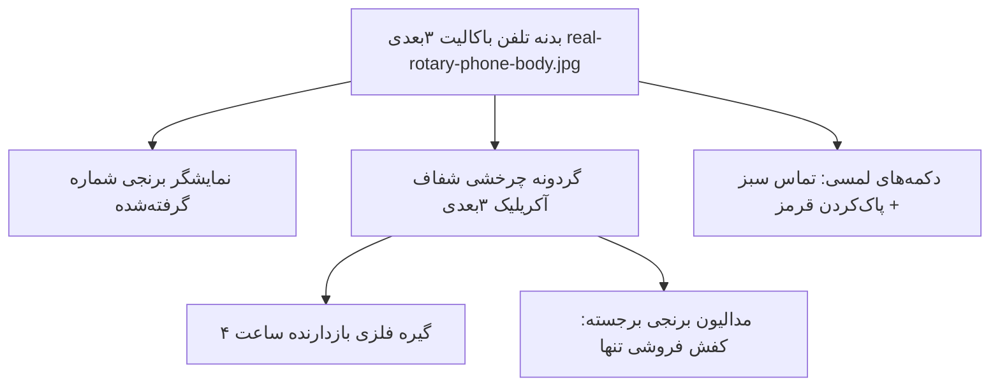

# MASTER-22: بازطراحی سه‌بعدی و حل باگ برش تلفن چرخشی کفش‌فروشی تنها

**تاریخ:** 2026-10-26  
**وضعیت:** ACTIVE  
**والد:** `MASTER_20_EMERGENCY_IDENTITY_SELFIE_VIDEO_QUEUE.md`، `MASTER_19_CINEMATIC_REDESIGN_AND_REAL_MINIGAMES.md`  
**دامنه:** فقط مینی‌گیم تلفن چرخشی سوال «کفش‌فروشی تنها» در احراز هویت اضطراری (`emergency-auth.js` و `emergency-auth.css`)

---

## ۱. خواسته قطعی کاربر و علت ریشه‌ای مشکل

1. **رفع کامل باگ برش خوردن صفحه (Clipping Bug):**
   - در نسخه قبلی، صفحه چرخشی تلفن در موبایل از وسط به شکل افقی نصف می‌شد و اعداد ۱ تا ۵ ناپدید بودند.
   - **علت ریشه‌ای:** استفاده از `perspective: 900px` و `transform-style: preserve-3d` روی کانتینر با پس‌زمینه سالید همراه با `transform: rotateX(8deg)` روی گردونه، باعث می‌شد نیمه بالایی گردونه به مختصات منفی Z (`Z < 0`) فرورفته و پشت پس‌زمینه والد پنهان (Z-Clipped) شود. به علاوه کدهای تکراری و متناقض CSS در خطوط ۵۶۶ تا ۸۴۸ ابعاد گردونه را فشرده می‌کردند.
2. **طراحی سه‌بعدی واقعی (همانند گاوصندوق سه‌بعدی):**
   - کاربر صریحاً خواست: *«میخوام برام بری عکسشو طراحی بکنی عین گاوصندوق ک سه بعدی شده اینم سه بعدی بشه»*.
   - دارایی استودیویی فوتورئالیستیک سه‌بعدی بدنه تلفن باکالیت دهه ۱۹۶۰ میلادی (`/assets/images/telephone/real-rotary-phone-body.jpg`) آماده‌سازی شد.
3. **چرخش فیزیکی و ارگونومیک استاندارد:**
   - چیدمان استاندارد Western Electric / اروپایی:
     - گیره فلزی انگشت‌گیر (Finger Stop) در زاویه ساعت ۴ (۳۵+ درجه نسبت به افق).
     - اعداد ۱ در ساعت ۲ (۶۵ درجه فاصله تا گیره)، ۲ در ساعت ۱، ۳ در ساعت ۱۲ ... تا ۰ در ساعت ۵ (۳۳۵ درجه چرخش کامل تا گیره).
     - مدالیون برنجی وسط گردونه با عنوان خوش‌نقش **«کفش فروشی تنها»**.
     - فنر بازگشت مکانیکی با صدای چرخ‌دنده‌ای رچت (Web Audio SFX Ticks) هنگام بازگشت گردونه به حالت اولیه.
4. **دکمه‌های ارگونومیک و صفحه نمایش شماره:**
   - صفحه نمایش شماره گرفته‌شده شبیه پلاک برنجی/حکاکی با اعداد باکنتراست بالا در بالای گردونه.
   - دو دکمه لمسی فیزیکی برجسته: دکمه سبز زمردی «تماس» و دکمه قرمز یاقوتی «پاک کردن».
5. **محدودیت مطلق دامنه:**
   - هیچ سوال، منطق، API یا سرویس دیگری دستکاری نمی‌شود.

---

## ۲. مشخصات هندسی و معماری رابط

- کانتینر بدون پرسپکتیو متقاطع Z، با مقیاس‌بندی ریسپانسیو `width: min(92vw, 360px)` برای تمامی گوشی‌ها از ۳۲۰ پیکسل تا تبلت و دسکتاپ.
- حذف کامل قوانین متناقض و تکراری خطوط ۵۶۶ تا ۷۵۲ در `emergency-auth.css`.
- پشتیبانی کامل لمسی (Touch / Pointer Events) با جلوگیری از رها شدن اشتباهی و فیلتر کلیک کیبورد برای دسترس‌پذیری (`event.detail !== 0`).

---

## ۳. پذیرش و راستی‌آزمایی

- [x] عدم وجود هرگونه بریدگی و دیده شدن کامل تمامی اعداد ۰ تا ۹ روی موبایل و دسکتاپ.
- [x] بدنه فوتورئالیستیک ۳بعدی با متریال باکالیت و پلاک فلزی.
- [x] کارکرد دقیق لمسی گردونه، صدای تق‌تق مکانیکی در فنر بازگشت، و ثبت اعداد.
- [x] پاس شدن ۱۰۰٪ تمام سوئیت‌های تست بدون هیچ رگرسیون.
- [x] استقرار بدون قطعی روی سرور VPS و ری‌لود PM2.
