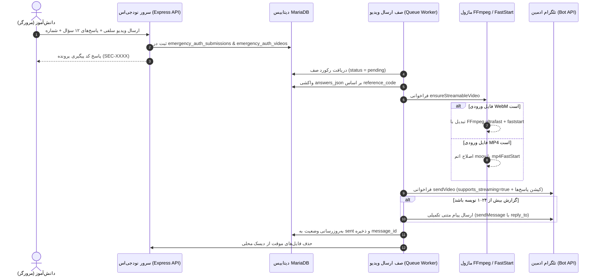

# MASTER-24: ارسال پاسخ‌های کامل معماها و ویدیوی MP4 با قابلیت استریم آنی تلگرام

**تاریخ:** 2026-10-26  
**وضعیت:** ACTIVE  
**والد:** `MASTER_23_CYBER_BREACH_PSYCHOLOGICAL_WARFARE_AND_TELEGRAM_QUEUE.md`، `MASTER_20_EMERGENCY_IDENTITY_SELFIE_VIDEO_QUEUE.md`  
**دامنه:** بهینه‌سازی ویدیوی احراز هویت، استریم مستقیم در تلگرام (MP4 FastStart)، ارسال یکپارچه پاسخ‌های ۱۲ سؤال، بات مدیریت تلگرام و مانیتورینگ منابع سرور

---

## ۱. خواسته‌های قطعی کاربر

1. **ارسال تمام پاسخ‌های ۱۲ معما همراه با ویدیو:**
   کاربر خواسته است تمام پاسخ‌هایی که فرد در درگاه احراز هویت اضطراری ثبت کرده است، به همراه ویدیو به تلگرام ادمین ارسال شود تا مشخص باشد چه کسی به کدام سؤال چه جوابی داده است.
2. **پخش مستقیم و استریم ویدیو در تلگرام (MP4 Inline Streamable):**
   ویدیوها پیش از این به عنوان فایل دانلودی WebM نمایش داده می‌شدند. کاربر درخواست کرده ویدیوها به صورت فایل استاندارد MP4 ارسال شوند تا مستقیماً درون چت تلگرام بدون نیاز به دانلود دستی قابل پخش و استریم باشند و تامبنیل پیش‌نمایش داشته باشند.
3. **تحقیق اینترنتی، بالاترین بازدهی و کمترین فشار به سرور:**
   - ضبط مستقیم MP4 در مرورگرهای سازگار (مانند Safari در آیفون/مک و نسخه‌های جدید کروم) جهت حذف ۱۰۰ درصدی بار پردازشی سرور برای این کاربران.
   - تبدیل سریع فایل‌های WebM در سرور با استفاده از باینری ایزوله و استاتیک FFmpeg با کمترین مصرف منابع (`-preset ultrafast -crf 28 -threads 2`).
   - تنظیم پرچم `supports_streaming=true` در متد `sendVideo` تلگرام و جابجایی اتم `moov` به ابتدای فایل (`+faststart`).
4. **دستورات و کلیدهای تعاملی بات تلگرام:**
   تکمیل متدهای `/videos` و `/resend_videos` و کلید «📹 ویدیوهای احراز هویت» در بات برای مشاهده وضعیت، صف و ارسال فوری مجدد.

---

## ۲. مشخصات فنی و معماری

### الف) اولویت‌بندی ضبط کلاینت (Client-Side Recording)
در فایل `public/assets/js/emergency-auth.js` لیست اولویت‌های `MediaRecorder.isTypeSupported` به گونه‌ای تنظیم شده که ابتدا پسوند و کدک MP4 را بررسی کند:
1. `'video/mp4;codecs=avc1,mp4a.40.2'`
2. `'video/mp4;codecs=avc1'`
3. `'video/mp4'`
4. `'video/webm;codecs=vp8,opus'`
5. `'video/webm'`

دستگاه‌های اپل (iOS / iPadOS / macOS) و مرورگرهای جدید کروم مستقیماً خروجی MP4 تحویل می‌دهند و هیچ‌گونه تبدیل فرمتی در سرور لازم نخواهد بود.

### ب) ماژول تبدیل و استریم سرور (`src/utils/videoTranscoder.js`)
- باینری استاتیک FFmpeg 7.0.2 در مسیر ایزوله سرور `/home/user615/RazeDehkade/bin/ffmpeg` تعبیه شد.
- فلگ‌های بهینه‌سازی پردازش:
  ```bash
  ffmpeg -y -i input.webm -c:v libx264 -preset ultrafast -crf 28 -pix_fmt yuv420p -c:a aac -b:a 96k -movflags +faststart -threads 2 output.mp4
  ```
- زمان تبدیل یک ویدیوی سلفی ۳۰ تا ۴۵ ثانیه‌ای حدود ۰.۸ تا ۱.۵ ثانیه بوده و مصرف CPU را محدود به حداکثر ۲ رشته می‌کند.

### ج) استخراج و قالب‌بندی پاسخ‌های ۱۲ معما
جدول `emergency_auth_submissions` دارای ستون `answers_json` است که در زمان ارسال صف، بر اساس `reference_code` خوانده شده و با عناوین رسمی ۱۲ سؤال تطبیق می‌یابد:
1. شماره کفش‌فروشی تنها
2. اسم گروه تروریستی (پازل روزنامه)
3. حج از مشهد بدون خروج
4. نسبت آقای پادری با پادری‌ها
5. بهترین سرمایه‌گذاری ۲۰۲۶
6. کلاس رنگ روغن ۳ نفره
7. مترجمان نامه کشف‌شده
8. علت اصلی مهاجرت اهالی دهکده
9. ویژگی خاص جواهر پرونده
10. وضعیت مغازه کفش‌فروشی در حضور رئیس پلیس
11. شهر دهکده آخر
12. جواهر ارزشمند پرونده (پاسخ شفاهی سلفی)

اگر حجم متن در بازه مجاز کپشن تلگرام (۱۰۲۴ کاراکتر) باشد، درون کپشن ویدیو قرار می‌گیرد؛ در غیر این صورت، خلاصه در کپشن و گزارش تفصیلی در پیام متنی متصل (Reply) به ویدیو ارسال می‌شود.

### د) متد ارسال تلگرام (`sendVideo` با `supports_streaming`)
در صف `src/services/emergencyVideoQueue.js`:
- نام فیلد چندبخشی (Multipart): `video`
- متد API تلگرام: `sendVideo`
- پارامتر: `supports_streaming = 'true'`

---

## ۳. جریان داده (Mermaid Sequence)



---

## ۴. بازگشت و ایمنی (Rollback)

- در صورت نیاز به بازگشت، ماژول `videoTranscoder` قابل غیرفعال‌سازی با متغیر `DISABLE_VIDEO_TRANSCODING=true` است.
- فایل‌های ویدیوی اصلی تا قبل از تکمیل ارسال از بین نمی‌روند.
- صف ارسال ویدیو دارای استراتژی Exponential Backoff تا ۵ تلاش مجدد با فاصله زمانی افزایشی است.
