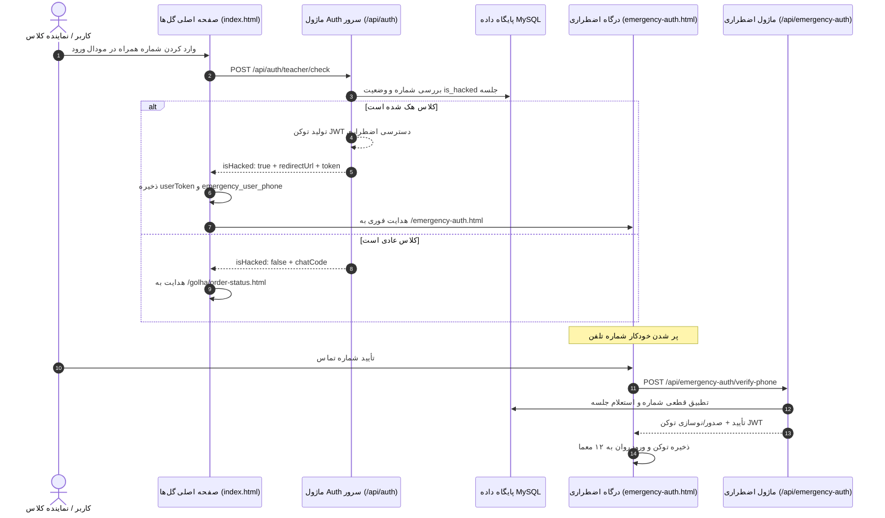

# MASTER-25: هدایت مستقیم کلاس‌های هک‌شده به درگاه اضطراری و احراز بدون بن‌بست شماره

**تاریخ:** 2026-10-26  
**وضعیت:** ACTIVE  
**والد:** `MASTER_24_STREAMABLE_MP4_AND_SUBMISSION_ANSWERS_DISPATCH.md`، `MASTER_20_EMERGENCY_IDENTITY_SELFIE_VIDEO_QUEUE.md`  
**دامنه:** ورود صفحه اصلی سایت (گل‌ها)، تطبیق وضعیت هک کلاس، هدایت مستقیم به درگاه اضطراری، صدور توکن خودکار و برطرف‌سازی خطای «دوباره وارد شوید»

---

## ۱. خواسته‌های قطعی کاربر

1. **هدایت مستقیم از صفحه اصلی گل‌ها در صورت هک بودن کلاس:**
   - کاربر در صفحه اصلی سایت (`index.html`) شماره ثبت‌نامی کلاس را در مودال ورود می‌زند.
   - اگر کلاس در وضعیت نفوذ سایبری (`is_hacked = 1`) باشد، کاربر نباید به صفحه پیگیری سفارش گل (`order-status.html`) یا ورود کد (`enter-code.html`) برود؛ بلکه باید فوراً و مستقیماً به درگاه احراز هویت اضطراری (`/emergency-auth.html`) هدایت شود.
2. **برطرف‌سازی قطعی خطای «دوباره وارد بشین» در استعلام شماره:**
   - کاربر هنگام وارد کردن شماره در درگاه احراز هویت اضطراری با خطای «برای ادامه، دوباره وارد کلاس شوید» مواجه می‌شد زیرا توکن در `sessionStorage` وجود نداشت و اندپوینت اعتبارسنجی توکن می‌خواست.
   - سیستم باید طوری باشد که چه کاربر از صفحه گل‌ها آمده باشد، چه از صفحه کد، و چه صفحه را مستقیم رفرش کرده باشد، با زدن شماره ثبتی کلاس، هویت کلاس احراز شده، توکن معتبر به صورت خودکار صادر/تجدید گردد و فرآیند بدون بن‌بست به ۱۲ سؤال هدایت شود.
3. **پر شدن خودکار شماره تلفن:**
   - شماره تلفنی که کاربر در صفحه ورود گل‌ها وارد کرده، در درگاه اضطراری پیش‌فرض در کادر شماره قرار گیرد تا کاربر نیازی به تایپ مجدد نداشته باشد.

---

## ۲. ریشه‌یابی و تحلیل فنی باگ قبلی

1. **عدم تشخیص نفوذ در اندپوینت `/api/auth/teacher/check`:**
   - این اندپوینت فقط کد چت را برمی‌گرداند و بررسی نمی‌کرد که آیا جلسه کلاس هک است یا خیر. در نتیجه کلاینت کاربر را به `/golha/order-status.html?from=login` هدایت می‌کرد.
2. **عدم صدور توکن در خطای 403 ورود کد (`/api/auth/user/join`):**
   - هنگامی که کلاس هک بود، اندپوینت خطای ۴۰۳ می‌داد اما هیچ توکنی به کلاینت نمی‌داد. کلاینت کاربر را بدون توکن به `/emergency-auth.html` می‌فرستاد.
3. **پرتاب خطای سمت کلاینت قبل از ارسال به سرور در `emergency-auth.js`:**
   - کد کلاینت قبل از فراخوانی `/verify-phone` بررسی می‌کرد `if (!token) throw new Error('برای ادامه، دوباره وارد کلاس شوید.')` که مستقیماً باعث ایجاد این پیام خطا می‌شد.
4. **الزام توکن در اندپوینت `/api/emergency-auth/verify-phone`:**
   - اندپوینت از میدلور اجباری `authenticateToken` استفاده می‌کرد؛ در نتیجه بدون توکن، پاسخ ۴۰۱ برمی‌گرداند.

---

## ۳. معماری راه‌حل جامع

### الف) اندپوینت `/api/auth/teacher/check`
- وضعیت نفوذ سایبری جلسه (`targetSession.is_hacked`) بررسی می‌شود.
- در صورت هک بودن:
  - توکن JWT معتبر برای جلسه تولید می‌شود.
  - پاسخ شامل پرچم `isHacked: true`، `redirectUrl: '/emergency-auth.html'` و مشخصات کامل `token` و `session` است.
- در کلاینت (`public/index.html`):
  - مقادیر `userToken`, `userSession`, `teacherPhone`, `emergency_user_phone` ذخیره می‌گردند.
  - پیام هشدار امنیتی به کاربر نمایش داده شده و مستقیماً به `/emergency-auth.html` منتقل می‌شود.

### ب) اندپوینت خودترمیم‌کننده `/api/emergency-auth/verify-phone`
- از میدلور توکن اختیاری (`optionalToken`) استفاده می‌کند:
  - اگر توکن معتبر کاربر در هدر باشد، تطبیق شماره با جلسه همان توکن بررسی می‌شود.
  - اگر توکنی نباشد یا منقضی شده باشد، شماره تلفن مستقیماً با پایگاه داده (`Session.findByTeacherPhone`) بررسی می‌شود (با پشتیبانی از حالت‌های با صفر و بدون صفر و بررسی همزمان جدول `sessions` و `teachers`).
  - در صورت تطبیق، یک توکن تازه و رسمی JWT برای کاربر تولید و در پاسخ ارسال می‌شود.
- کلاینت (`emergency-auth.js`):
  - پرتاب خطای زودهنگام حذف شد.
  - توکن دریافتی از سرور بلافاصله در `sessionStorage.setItem('userToken', ...)` ذخیره می‌شود تا ارسال پاسخ‌ها و ویدیوی سلفی با اعتبار ۱۰۰٪ انجام گیرد.
  - شماره تلفن از پیش در فیلد `emergencyPhone` مقداردهی می‌شود.

---

## ۴. دیاگرام جریان توالی (Mermaid Sequence)

---

## ۵. پذیرش و مانیتورینگ

1. ورود با شماره کلاسی که هک شده، بلافاصله به `/emergency-auth.html` می‌رود (بدون هیچ صفحه میانی).
2. هیچ پیام خطایی مانند «دوباره وارد شوید» به کاربر نشان داده نمی‌شود و مرحله شماره مستقیماً تایید می‌شود.
3. در گام ۱۲، ویدیو و پاسخ‌ها با توکن معتبر با موفقیت آپلود شده و کد پیگیری صادر می‌گردد.
4. تمامی ۲۶ تست سوئیت پروژه با موفقیت سبز پاس می‌شوند.
