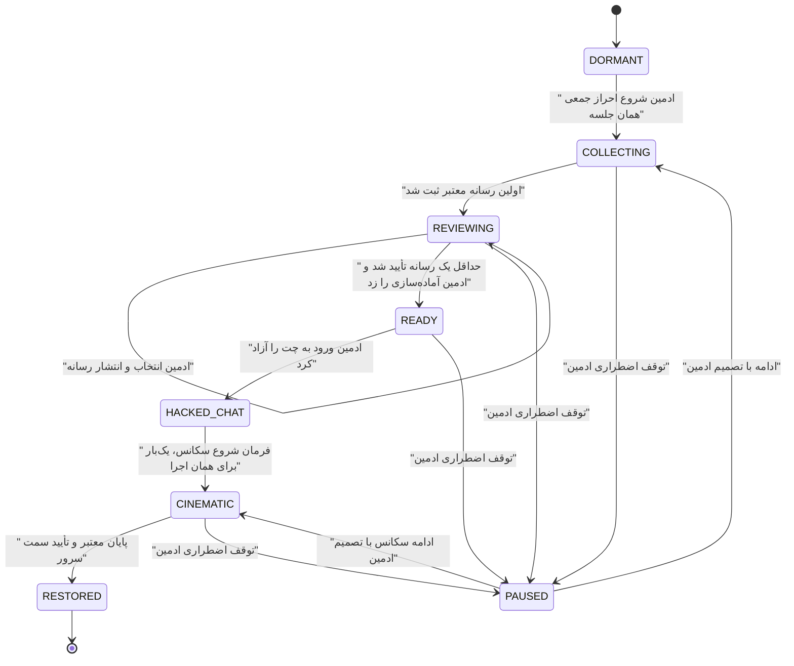

# MASTER-36: احراز جمعی، بازگشت کنترل و بازیابی سینمایی هر جلسه

**تاریخ تدوین:** 2026-10-31  
**وضعیت سند:** IN_PROGRESS — پیاده‌سازی و آزمون فقط روی checkout محلی؛ رسانه نهایی و آزمون کارفرما باقی است  
**اسناد والد:** `docs/ai/ROOT_MASTER.md`، `docs/ai/domains/AUTH_AND_SESSIONS.md`، `docs/ai/domains/REALTIME_CHAT_ENGINE.md`، `docs/ai/domains/MEDIA_STREAMING_AND_BOT.md`  
**تدوین‌کننده:** Codex

## ۱. هدف و ترتیب تجربه

هر کلاس این ماجرا را فقط یک‌بار و با یک لپ‌تاپ اجرا می‌کند. ادمین با فرمان مستقل، مرحله احراز جمعی را فعال می‌کند. همه بچه‌ها با همان دستگاه یک ویدیوی جمعی حداکثر ۶۰ ثانیه‌ای ضبط و ارسال می‌کنند. تایمر ضبط از ۶۰ تا صفر پایین می‌آید و ضبط در صفر خودکار متوقف می‌شود. امکان ارسال مجدد پیش از تأیید ادمین وجود دارد. ادمین در مودال داخل صفحه چت، ارسال‌های همان کلاس را با شماره ثبت‌شده می‌بیند و فقط موارد دلخواه را منتشر می‌کند. کاور ارسال‌های منتشرشده با تیک سبز در پرده انتظار همان کلاس دیده می‌شود. ویدیوی جمعی در صف پایدار تلگرام نیز قرار می‌گیرد. ادمین سپس فرمان ورود به چت و اجرای سکانس را کنترل می‌کند؛ دانش‌آموز دکمه شروع ندارد. چت ابتدا همچنان هک‌شده است و سکانس مزداک، نقشه، پیام مرکز فرماندهی، ویدیو و توقف پاک‌سازی اجرا می‌شود. در پایان، وضعیت هک فقط همان جلسه به‌طور خودکار رفع و اجزای صفحه به حالت پیشین برمی‌گردند.

**شرط پیوستگی شنود:** مرحله احراز جمعی و پرده انتظار به صورت لایه تمام‌صفحه در `public/chat.html` اجرا می‌شوند تا همان سند، Socket و اتصال میکروفون باقی بمانند. ورود مجدد از احراز فردیِ خانگی همچنان به مسیر فعلی خودش تعلق دارد؛ وقتی ادمین مرحله جمعی را فعال کند، ورود تازه کلاس باید به صفحه چت با لایه احراز جمعی برسد. مودال ادمین نیز در همان `public/admin/chat.html` می‌ماند. ضبط ویدیوی جمعی با میکروفونِ شنودِ فعال باید روی مرورگر و لپ‌تاپ واقعی آزموده شود؛ ترجیح فنی استفاده مشترک از track صوتی موجود است و در صورت ناسازگاری باید راهکار سازگار با همان دستگاه قبل از انتشار انتخاب شود.

متن پیام مدرس و دیالوگ‌های نمایشی در مرحله اجرا جداگانه نهایی می‌شوند. اطلاعات پشت صحنه که کارفرما خواسته برای مخاطب بیان نشود، وارد متن رابط کاربری نخواهد شد. این سند برنامه فنی است و برای مخاطب نهایی نمایش داده نمی‌شود.

## ۲. واقعیت‌های فعلی و نقاط اتصال

| بخش | آدرس دقیق و نماد موجود | اثر بر طراحی |
|---|---|---|
| هک جلسه | `src/models/Session.js#L410-L433`، `setHackState` / `isHacked` | وضعیت هک در `sessions` پایدار است؛ بازگشت نهایی باید با فرمان مستقل همان جلسه باشد. |
| فرمان‌ها | `src/socket/index.js#L801-L957`، `trigger_hack_sequence`، `unlock_hack_sequence`، `toggle_chat_lock` | الگوی مجوز، اتاق `session_${sessionId}` و اعلان ادمین موجود است. |
| هدایت چت | `public/assets/js/user-chat.js#L257-L324`، `loadHistory` و `#L591-L625`، رویدادهای هک | ورود مجدد در وضعیت هک اکنون به `emergency-auth.html` می‌رود؛ برای ورود سکانس جدید باید شرط مرحله‌ای اضافه شود تا حلقه هدایت رخ ندهد. |
| ورود | `src/routes/auth.js#L105-L126` و `#L189-L256`، مسیرهای ورود کاربر | ورود تازه نیز باید مرحله جلسه را از سرور دریافت کند. |
| احراز فردی | `src/routes/emergencyAuth.js#L113-L222`، `verify-phone` و `submissions` | این مسیر و جدول‌هایش متعلق به احراز فردی هستند؛ تأیید جمعی روی آن‌ها سوار نشود. |
| آپلود فردی | `src/db/migrate.js#L146-L177`، جدول‌های `emergency_auth_*` | عکس/ویدیوی جمعی جدول و فضای خصوصی مستقل لازم دارد. |
| پنل | `public/admin/chat.html#L31-L37` و `#L181-L187`؛ `public/assets/js/admin-chat.js#L2329-L2400` | مودال باید داخل همان صفحه ساخته شود تا اتصال شنود پنل حفظ شود. |
| شنود | `public/assets/js/admin-chat.js#L1498-L1569` و `public/assets/js/user-chat.js#L1660-L1800` | خود پنل با مودال از صفحه خارج نمی‌شود؛ تداوم صدای کلاس هنگام جابه‌جایی دانش‌آموز نیاز به طراحی اتصال فرستنده دارد. |

درخت کاری پیش از تدوین دارای تغییرات ثبت‌نشده، از جمله اسناد حافظه و احراز اضطراری، بود. در مرحله اجرا نباید آن‌ها بازنشانی یا بی‌بررسی بازنویسی شوند.

## ۳. خطوط قرمز

1. تمام وضعیت‌ها، رسانه‌ها، فرمان‌ها و رویدادها با `session_id` سمت سرور محدود شوند؛ شماره موبایل فقط عامل تطبیق/نمایش است، نه کلید یکتای مالکیت جلسه.
2. هیچ تأیید یا انتشار ویدیو تنها با داده کلاینت انجام نشود؛ مجوز ادمین و تعلق رسانه به همان جلسه در سرور بررسی شود.
3. `is_hacked` تا پایان سکانس بازیابی فعال بماند. بازکردن ساده چت نباید آن را زودتر پاک کند.
4. باز کردن مودال، پخش پیش‌نمایش و تغییر کلاس در پنل نباید اتصال شنود ادمین را قطع کند. محدودیت جابه‌جایی صفحه دانش‌آموز برای صدای فرستنده باید با آزمون واقعی مشخص شود.
5. فایل جمعی در فضای خصوصی ذخیره و از مسیر احراز شده با پشتیبانی Range پخش شود؛ نشانی فایل خام یا شماره تلفن در URL عمومی نباشد.
6. مختصات کلاس در دیتابیس سمت سرور اعتبارسنجی شود؛ موقعیت مرورگر صرفاً با اجازه کاربر و با دقت نامطمئن قابل دریافت است و مبنای این سکانس نخواهد بود.
7. محرک‌ها idempotent و مرحله‌دار باشند؛ رفرش، قطع و وصل و کلیک دوباره باعث انتشار دوباره، اجرای موازی یا خروج ناخواسته نشود.
8. امکان توقف اضطراری و ادامه از مرحله پایدار بدون خراب‌کردن قفل چت، احراز فردی، آرشیو و سایر کلاس‌ها باشد.

## ۴. طرح داده و ماشین وضعیت پیشنهادی

`session_recovery` با `session_id` یکتا: `phase`, `revision`, `latitude`, `longitude`, `map_label` اختیاری، `started_at`, `released_at`, `sequence_started_at`, `completed_at`, `updated_by`. اجرای دوم با قید پایدار ممنوع است. مختصات باید محدوده معتبر داشته باشند و قبل از شروع سکانس کامل باشند. `collective_submissions`: `id`, `session_id`, `phone_normalized`, `file_path`, `mime_type`, `size`, `duration`, `status` (`pending/approved/rejected`), `approved_by`, `approved_at`, `client_submission_id` یکتا در همان جلسه، `telegram_status`, `telegram_message_id`, `created_at`. فقط ویدیو پذیرفته شود. چند ارسال از همان دستگاه/شماره مجاز است، اما ادامه نیازمند حداقل یک تأیید است. صف تلگرام ارسال را پس از ثبت موفق، مستقل از انتخاب نمایشی ادمین، با شناسه جلسه و شماره به مقصدهای موجود می‌فرستد؛ عدم دسترسی تلگرام نباید اجرای کلاس را متوقف کند و وضعیت خطا/تلاش مجدد ثبت شود.

انتقال‌ها در سرویس بازیابی با مقایسه `phase` و `revision` اتمیک انجام می‌شوند؛ Socket فقط اعلان تغییر است و حقیقت از MySQL خوانده می‌شود. دسترسی چت نیز سمت سرور بر پایه وضعیت اعمال شود تا وارد کردن مستقیم URL درگاه را دور نزند. `is_hacked` و `recovery.phase` باید به صورت سازگار در یک تراکنش در پایان تغییر کنند.

## ۵. سکانس نمایشی و همگام‌سازی

1. فرمان ادمین برای ورود به چت هک‌شده؛ نمایش پایانه قرمز و خط اول مزداک بدون دکمه شروع دانش‌آموز. شروع صوت و ویدیو در مرورگر لپ‌تاپ باید با تعامل قبلی کاربر در مرحله ضبط آماده شود؛ اگر مرورگر پخش خودکار را مسدود کند، فقط کنترل بسیار ساده «پخش صدا» به‌عنوان راه بازیابی نشان داده شود و زمان روایت تا فعال‌شدن رسانه متوقف بماند.
2. نقشه با نمای جهان باز شود؛ لایه کد قرمز نمایشی است. دوربین از جهان به مختصات ذخیره‌شده همان جلسه حرکت نرم کند، نشانگر ضربانی ۵ ثانیه بماند. سرویس نقشه و سطح جزئیات مقصد باید قبل از اجرا روی دستگاه‌های هدف ارزیابی شود؛ ادعای دقت کوچه/ساختمان بدون داده نقشه معتبر ممنوع است.
3. پایانه مزداک برگردد؛ دیالوگ تهدید و سه چرخه نقطه‌چین نمایش داده شود. شکستن پایانه به پایانه سیاه و سبز مرکز فرماندهی منتهی شود.
4. شمارش ۵ ثانیه، پرده اتصال دوربین و پخش بخش اول ویدیوی تحویلی کارفرما. سپس نمای دسکتاپ نمایشی، کوچک شدن ویدیو در گوشه و نوار حذف ۸۰ تا ۸۳ درصد؛ دخالت مرکز فرماندهی درصد را معکوس و عملیات را لغو کند. بعد ویدیو بزرگ شود و بخش دوم پخش شود. کارفرما می‌تواند دو فایل با نقاط برش مشخص بدهد.
5. اجزای صفحه به ترتیب مشخص بازیابی شوند؛ سرور پایان را برای همان جلسه ثبت کند و `is_hacked` را خاموش کند. برای دستگاهی که وسط سکانس وصل می‌شود، وضعیت/زمان مرجع سرور تعیین می‌کند چه چیزی دیده شود؛ رسانه و انیمیشن باید امکان ادامه یا شروع مجدد کنترل‌شده داشته باشند.

بارگذاری ویدیو و نقشه قبل از آغاز یا با وضعیت انتظار انجام شود تا قطع شبکه روایت را بی‌صدا جلو نبرد. برای کاهش حرکت، تبدیل‌ها ساده شوند اما ترتیب و پیام‌ها حفظ شوند. نمای ساختمان فقط وقتی وعده داده شود که داده تصویر/نقشه همان مختصات کیفیت کافی داشته باشد؛ در غیر این صورت نمای دقیق نقطه روی نقشه با نشانگر واضح ارائه شود. قبل از انتخاب سرویس نقشه، چند مختصات واقعی مشهد در همان سرویس و روی مرورگر هدف باید بررسی شوند.

## ۶. ماتریس تغییر مرحله اجرا

| فایل/بخش | نماد یا محل اتصال | اقدام برنامه‌ریزی‌شده |
|---|---|---|
| `src/db/migrate.js#L60-L182` | `ensureColumn` و DDL | مایگریشن بازبینی‌شده برای جدول‌ها و شاخص‌های هر جلسه |
| `src/models/Session.js#L410-L433` | وضعیت هک | سرویس بازیابی مستقل و تراکنش پایان |
| `src/routes/emergencyAuth.js#L113-L222` | احراز فردی | حفظ رفتار؛ مسیر جمعی در router مستقل |
| `src/routes/sessions.js#L70-L112` | `hack-status` و پیام‌ها | خواندن مرحله بازیابی و کنترل دسترسی چت |
| `src/routes/auth.js#L105-L126` و `#L189-L256` | ورود کاربر | هدایت بر اساس مرحله معتبر سمت سرور |
| `src/socket/index.js#L801-L957` | فرمان‌های جلسه | اعلان‌های مرحله‌دار و محدود به اتاق جلسه؛ حفظ رویدادهای فعلی |
| `public/admin/chat.html#L31-L37` و `#L181-L187` | کنترل‌های دسکتاپ/موبایل | دکمه و مودال جمعی در همان صفحه |
| `public/assets/js/admin-chat.js#L2329-L2400` | کنترل هک | مدیریت مودال و فرمان‌ها بدون ناوبری |
| `public/assets/js/user-chat.js#L257-L324` و `#L591-L625` | هدایت/هک | جلوگیری از حلقه و سکانس بازیابی پس از آزادسازی |
| `public/emergency-auth.html` و `public/assets/js/emergency-auth.js#L310-L355` | درگاه فعلی | حفظ احراز فردی خانگی؛ هدایت مرحله جمعی پس از فرمان ادمین |
| `public/chat.html` و فایل‌های جدید `public/assets/js/*recovery*` | لایه جمعی و سکانس | رابط ضبط با تایمر ۶۰ ثانیه، پرده انتظار سیاه، روایت سینمایی؛ حفظ Socket و شنود در همان سند |
| `src/services/emergencyVideoQueue.js#L208-L491` | صف تلگرام موجود | اشتراک منطق ارسال/مقصد با صف مستقل جمعی؛ عدم تغییر معنای جدول احراز فردی |

شماره خطوط مربوط به نسخه فعلی checkout است و قبل از ویرایش دوباره باید تأیید شود.

## ۷. ماتریس اعتبارسنجی پیشنهادی — هنوز اجرا نشده

| شناسه | سناریو | انتظار |
|---|---|---|
| TC-01 | دو کلاس همزمان در دو مرحله مختلف | هیچ فرمان/رسانه/وضعیتی میان اتاق‌ها نشت نکند |
| TC-02 | ورود با URL مستقیم به چت پیش از آزادسازی | سرور دسترسی را رد و به مرحله درست هدایت کند |
| TC-03 | ده ارسال از یک شماره و انتخاب دو مورد | فقط دو کاور تأییدشده دیده شوند |
| TC-04 | رفرش دانش‌آموز در انتظار، چت هک‌شده و میان فیلم | مرحله درست بدون اجرای تکراری بازگردد |
| TC-05 | دو ادمین همزمان یک رسانه/فرمان را تأیید کنند | تغییر اتمیک و یک رویداد مؤثر |
| TC-06 | تغییر کلاس در پنل با مودال باز | رسانه و فرمان به کلاس انتخاب‌شده اولیه مقید بماند |
| TC-07 | ضبط ۶۰ ثانیه، انتظار، پخش فیلم و مودال حین شنود | شنود از لپ‌تاپ کلاس تا پنل پیوسته بماند؛ شمارنده از ۶۰ به صفر برسد و ضبط متوقف شود |
| TC-08 | فایل نامعتبر، حجیم، قطع آپلود، نقش نامجاز | رد امن؛ بدون فایل رهاشده یا افشای رسانه |
| TC-09 | مختصات نامعتبر یا بدون کاشی نقشه | شروع سکانس مسدود یا مسیر نمایشی پشتیبان با اطلاع ادمین |
| TC-10 | پایان سکانس | فقط همان جلسه به تم اصلی برگردد و جلسه دیگر هک‌شده بماند |

## ۸. تصمیم‌های ثبت‌شده و ورودی‌های باقیمانده

- قطعی از کارفرما: یک اجرا برای هر جلسه؛ یک لپ‌تاپ برای همه بچه‌های همان کلاس؛ ویدیو تا ۶۰ ثانیه با شمارنده معکوس؛ کنترل شروع و آزادسازی با ادمین؛ مختصات مستقل هر کلاس در مشهد؛ دو فایل ویدیو قابل تحویل؛ بازگشت خودکار؛ شنود پیوسته در احراز و انتظار؛ ارسال ویدیوی جمعی به تلگرام مانند ویدیوهای قبلی.
- ورودی لازم پیش از پایان تولید: دو ویدیوی نهایی با ترتیب و نقاط برش، چند مختصات واقعی برای ارزیابی سطح جزئیات نقشه و تست روی لپ‌تاپ/مرورگر کلاس. سقف حجم فایل بر اساس خروجی ۶۰ ثانیه‌ای واقعی و ظرفیت سرور تعیین و در سند اجرا ثبت شود.
- متن دیالوگ‌ها و زمان‌بندی دقیق، پس از دیدن رسانه نهایی با کارفرما نهایی می‌شود. هیچ متن نمایشی نباید اطلاعات پشت صحنه‌ای را که کارفرما خواسته پنهان بماند، آشکار کند.

## ۹. وضعیت تحویل

کارفرما شروع اجرا را تأیید کرده است. کد اولیه و آزمون‌های محلی در جریان‌اند. **هیچ فایل، داده یا مایگریشنی به VPS منتقل یا روی آن اجرا نمی‌شود تا کارفرما نسخه محلی را تست کند و جداگانه دستور استقرار بدهد.** رسانه و مختصات واقعی برای تکمیل و آزمون بخش‌های وابسته لازم‌اند.

## ۱۰. قرارداد اجرایی برای ادامه‌دادن توسط عامل دیگر

### ۱۰.۱. مرز وضعیت‌ها و فرمان‌ها

`DORMANT` پیش‌فرض برای جلسه‌های موجود است و تا فرمان ادمین هیچ تغییری در احراز فردی فعلی ایجاد نمی‌کند. `COLLECTING` ضبط و ارسال را فعال می‌کند. `REVIEWING` همان صفحه ضبط/انتظار است و با نخستین فایل معتبر پدید می‌آید. `READY` یعنی حداقل یک ویدیو تأیید شده است. `HACKED_CHAT` پرده احراز را برمی‌دارد ولی `sessions.is_hacked=1` می‌ماند؛ نمایش چت هک‌شده مجاز است و بازگشت به احراز فردی ممنوع. `CINEMATIC` آغاز سکانس است و `sequence_started_at` زمان مرجع آن است. `RESTORED` پایان خودکار و `sessions.is_hacked=0` است. `PAUSED` باید `previous_phase` را نگه دارد. اجرای مجدد پس از `RESTORED` ممنوع است.

دستورهای ادمین به ترتیب `activate`, `approve/reject media`, `release`, `start cinematic`, `pause/resume` هستند. `complete` فقط از کلاینت همان جلسه پس از پایان واقعی رسانه و انیمیشن دریافت می‌شود و سرور حداقل زمان سکانس را بررسی می‌کند؛ ادمین امکان تکمیل اضطراری ثبت‌شده دارد. برای همه فرمان‌ها `expected_revision` اجباری است و پاسخ تعارض `409` با snapshot تازه برمی‌گردد. هر اعلان سوکت فقط `{sessionId, phase, revision, serverTime}` را حمل می‌کند؛ کلاینت پس از رویداد snapshot معتبر را از API می‌گیرد. هیچ فایل ویدیویی یا شماره‌ای با سوکت عمومی پخش نشود.

### ۱۰.۲. API و دسترسی

پیشوند پیشنهادی `/api/recovery`. `GET /sessions/:id` برای ادمین و کاربر همان جلسه snapshot می‌دهد؛ پاسخ کاربر فیلدهای مدیریتی و شماره‌ها را حذف می‌کند. `POST /sessions/:id/activate`, `/release`, `/start`, `/pause`, `/resume`, `/complete-admin`, `PUT /sessions/:id/location` فقط ادمین هستند. `POST /sessions/:id/submissions` فقط کاربر همان جلسه است و یک فایل ویدیویی multipart با `client_submission_id` می‌گیرد. `GET /sessions/:id/submissions` برای ادمین همه ارسال‌ها و برای کاربر فقط شناسه/کاور/وضعیت تأییدشده را می‌دهد. `POST /sessions/:id/submissions/:mediaId/decision` فقط ادمین، با مقدار `approved/rejected` است. `GET /sessions/:id/submissions/:mediaId/media` با توکن همان کلاس یا ادمین، فقط برای رسانه‌های تأییدشده به دانش‌آموز و برای همه رسانه‌ها به ادمین پاسخ Range می‌دهد. `POST /sessions/:id/complete` فقط کاربر همان جلسه و فقط در `CINEMATIC` پذیرفته می‌شود.

احراز نقش در `src/middleware/auth.js#L19-L56` است. `super_admin` در همه نقاط ادمین محسوب شود. هیچ درخواست مبتنی بر `sessionId` ارسالی کلاینت بدون مقایسه با JWT پذیرفته نشود. آپلود قبل از ذخیره یا بلافاصله پس از رد، پاک شود. MIME، امضای فایل و مدت واقعی با `ffprobe` کنترل شوند؛ نبود `ffprobe` در محیط تولید نباید به تأیید ویدیوی نامعلوم منجر شود. زمان ۶۰ ثانیه در سرور با تلورانس کوچک برای encode، مستقل از تایمر کلاینت کنترل شود.

### ۱۰.۳. رسانه و تلگرام

فضای نگهداری `storage/collective-auth/` خارج از `public` است. برای ویدیوهای جمعی جدول مستقل `collective_submissions` با وضعیت تأیید نمایشی و وضعیت ارسال تلگرام جداگانه لازم است. هر آپلود پذیرفته‌شده به صف تلگرام می‌رود؛ ادمین ممکن است فقط بخشی را روی پرده کلاس تأیید کند. ارسال تلگرام با همان مقصدهای مجاز سرویس `src/services/emergencyVideoQueue.js#L75-L205` و همان مکانیزم تلاش مجدد/قفل claim استفاده شود، اما formatter احراز فردی و پاک‌کردن فایل پس از ارسال تلگرام استفاده نشود؛ فایل باید تا پایان نمایش برای کلاس باقی بماند. کپشن فقط نام کلاس، شناسه جلسه و شماره ثبت‌شده را داشته باشد. نبود تنظیم تلگرام در محیط محلی نباید آپلود و ادامه کلاس را متوقف کند؛ صف `pending` بماند.

### ۱۰.۴. جزئیات UI و زمان‌بندی

لایه جمعی در `public/chat.html` باید قبل از هر محتوای چت دیده شود و عناصر پشت آن از فوکوس/کلیک خارج شوند. مراحل قابل فهم: «همه روبه‌روی دوربین»، «شروع ضبط»، شمارنده بزرگ `۶۰…۰`, «دیدن ویدیو»، «ارسال»، «در انتظار بررسی». خطای اجازه دوربین/میکروفون، قطع شبکه و ارسال ناموفق دکمه تلاش دوباره داشته باشد. پس از آپلود، صفحه سیاه انتظار با کاور و تیک سبز فقط برای ویدیوهای تأییدشده به‌روز شود. ادمین در مودال داخلی همان جلسه، پیش‌نمایش ویدیو، شماره، زمان، وضعیت تلگرام و دکمه تأیید/رد را ببیند؛ هدف مودال با شناسه جلسه در زمان بازشدن ثابت شود، حتی اگر sidebar تغییر کند. دکمه `release` فقط وقتی دست‌کم یک تأیید وجود دارد فعال شود.

در سکانس، ادمین یک‌بار `start` می‌زند و زمان سرور ثبت می‌شود. ترتیب بصری قطعی: پایانه قرمز → نمای جهان/کد قرمز → زوم نرم به مختصات جلسه و نشانگر ۵ ثانیه → پایانه قرمز و سه چرخه نقطه‌چین → شکست پایانه و پایانه سبز → شمارش ۵ ثانیه → اتصال به دوربین/ویدیوی بخش اول → نمای دسکتاپ و کوچک‌شدن تصویر وب‌کم → حذف ۸۰ تا ۸۳ درصد و توقف/برگشت → بزرگ‌شدن ویدیوی بخش دوم → رفع تدریجی قفل/خطا/نشان مزداک/برد اسناد → `RESTORED`. دیالوگ‌های فارسی کارفرما در سند اصلی باید عیناً مبنای نوشتن متن نهایی باشند و قبل از تحویل بصری بازبینی شوند. بارگذاری نشدن نقشه یا فیلم، سکانس را در همان نقطه نگه می‌دارد و پیام ساده برای ادمین نشان می‌دهد؛ به‌صورت خاموش از آن مرحله عبور نمی‌کند.

### ۱۰.۵. ترتیب اجرا و گیت‌های پذیرش

گام ۱: مایگریشن دستی بازبینی‌شده و سرویس حالت جلسه؛ گام ۲: API/رسانه و صف تلگرام؛ گام ۳: مودال ادمین و لایه جمعی با شنود؛ گام ۴: سکانس نمایشی و نقشه؛ گام ۵: آزمون همزمانی دو کلاس، آپلود/مجوز/رفرش/شنود و آزمون مرورگر روی لپ‌تاپ هدف؛ گام ۶: ثبت شواهد در `PROJECT_STATE.md`, `CHANGELOG.md`, `DECISIONS.md`, `INDEX.md` و تحویل نسخه **لوکال** برای تست کارفرما. استقرار روی سرور فقط پس از دستور جداگانه کارفرما انجام می‌شود. هر گام باید با وضعیت واقعی در همین سند علامت‌گذاری شود. نباید موفقیت کل برنامه قبل از دریافت و تست دو ویدیوی نهایی و مختصات واقعی ادعا شود.

### ۱۰.۶. دفتر وضعیت اجرا — 2026-10-31

- انجام‌شده در لوکال: DDL جدول‌های جدید، API و گیت سمت سرور، صف تلگرام، رابط‌های دانش‌آموز و ادمین، ضبط و آپلود فایل گوشی، نقشهٔ زوم‌دار، شکست شیشه‌ای و سکانس بازگشت. آزمون دیتابیس واقعی و لپ‌تاپ کلاس هنوز لازم است.
- شواهد فعلی: `node --check` بدون خطای نحوی؛ `npm test` با ۳۹ مجموعه موفق؛ آزمون مرورگر headless برای ضبط، آپلود MP4/MOV، تأیید ادمین، شنود شبیه‌سازی‌شده، زوم نقشه، توقف/رفرش/ادامه و پایان `RESTORED` موفق. اینها جای آزمون واقعی کلاس و دیتابیس MySQL را نمی‌گیرند.
- باز: آزمون یکپارچگی با MySQL محلی، دو فایل ویدیوی نهایی کارفرما، آزمون فیزیکی وب‌کم/میکروفون و شنود روی لپ‌تاپ مقصد، بازبینی ظاهر و سرعت کل سکانس توسط کارفرما، و آزمون همزمانی دو کلاس در مرورگر. تا بسته‌شدن این موارد، وضعیت `VALIDATED` نیست.
- اصلاح بصری ۱۴۰۵/۰۸/۰۹: شکست سادهٔ دو نیمه‌ای با ۱۵ قطعهٔ نامنظم از خود سطح پایانه، ترک‌های شعاعی، نور ضربه و صدای کوتاه جایگزین شد (`recovery-shatter.js`). طبق بازخورد کارفرما مکث پس از ترک به ۷۰۰ میلی‌ثانیه و حرکت قطعه‌ها به ۲٫۵ ثانیه افزایش یافت؛ کل گذار حدود ۳٫۷ ثانیه است. پیش‌نمایش مستقل محلی در `/shatter-preview.html` برای بازبینی سرعت و ظاهر موجود است. این بازبینی به‌تنهایی به معنی تأیید کل سکانس نیست.
- خطای بارگذاری نقشه دیگر با گذشت ۸ ثانیه به مرحله بعد عبور خاموش نمی‌کند؛ سکانس در همان نقطه خطا و امکان تلاش دوباره نشان می‌دهد.
- ادامهٔ سکانس در همان لپ‌تاپ کلاس: پس از تکمیل هر یک از ۱۱ صحنه، شمارهٔ صحنه همراه با `sequenceStartedAt` و شناسهٔ جلسه در `localStorage` ثبت می‌شود؛ رفرش یا توقف/ادامهٔ ادمین صحنه‌های تمام‌شده را تکرار نمی‌کند. صحنه‌ای که وسط آن رفرش یا توقف رخ دهد از ابتدا پخش می‌شود. توقف ادمین، تایمرها و ویدیوی فعال را متوقف و پردهٔ انتظار نشان می‌دهد؛ دکمهٔ ادامه در مودال ادمین افزوده شد. تست API توقف/ادامه، بررسی نحوی JS و آزمون مرورگر واقعی headless با توقف، رفرش در توقف، ادامه، ثبت checkpoint و رفرش در نقشه پاس شدند (`artifacts/recovery-resume-browser.cjs`). هنوز آزمون فیزیکی رفرش/توقف میان فیلم‌ها و حفظ نقطهٔ دقیق داخل همان ویدیو باقی است؛ بنابراین این مورد `VALIDATED` نیست.
- بازگشت بصری پایانی مرحله‌ای شد: پردهٔ سکانس نیمه‌شفاف می‌شود، لایهٔ قرمز نفوذ کنار می‌رود، برد اسناد از وضعیت هک خارج می‌شود و موتور هک پاک‌سازی نهایی را انجام می‌دهد؛ سپس API پایان همان جلسه فراخوانی می‌شود. اجرای کامل `artifacts/recovery-browser-flow.cjs` پس از این تغییر به `RESTORED` رسید، بدون خطای صفحه یا پیام خطای دانش‌آموز. بازبینی سلیقه‌ای ظاهر روی لپ‌تاپ کارفرما هنوز باز است.
- مسیر جایگزین بدون وب‌کم: دانش‌آموز می‌تواند ویدیوی گوشی را از فایل MP4/WebM/MOV انتخاب و با همان جریان بررسی ادمین آپلود کند. مرورگر تا حد امکان پیش‌نمایش و مدت را بررسی می‌کند؛ سرور حجم ۱۰۰ مگابایت، امضای فایل و سقف ۶۰٫۵ ثانیه را مستقل بررسی می‌کند. MOV پس از پذیرش با FFmpeg محلی به MP4 سازگار با مرورگر تبدیل می‌شود تا ادمین و کلاس آن را ببینند؛ اصل فایل MOV پس از تبدیل حذف می‌شود. آزمون مرورگر بدون مجوز دوربین، هم با MP4 و هم با MOV واقعی remux شده پاس شد و MIME ثبت‌شده برای هر دو `video/mp4` بود (`artifacts/recovery-file-upload-browser.cjs`).
- نقشهٔ مرحلهٔ سینمایی از iframe با بزرگ‌نمایی ظاهری به Leaflet محلی و کاشی OSM تغییر کرد. `flyTo` در ۷ ثانیه از نمای جهان به مختصات همان جلسه و زوم ۱۸ می‌رود؛ نشانگر جغرافیایی دقیق روی همان طول/عرض افزوده می‌شود و ۵ ثانیه می‌ماند. آزمون مرورگری `artifacts/recovery-map-browser.cjs` دریافت کاشی زوم ۱۸، نشانگر و انتساب قابل‌دیدن OSM را تأیید کرد. این نقشه خیابانی است و جزئیات ساختمان تنها در صورت وجود دادهٔ آن مکان در OSM دیده می‌شود؛ تصویر ماهواره‌ای یا تأیید تطبیق ساختمان ادعا نمی‌شود. کاشی‌ها از URL رسمی OSM، بدون پیش‌بارگذاری انبوه، با ارجاع مرورگر و کش عادی بارگیری می‌شوند. مرجع: https://leafletjs.com/reference.html و https://operations.osmfoundation.org/policies/tiles/ .
- پخش ویدیو پس از مسدودشدن autoplay دکمهٔ واضح «پخش و ادامه» نشان می‌دهد. زمان هر بخش ویدیو در `localStorage` با کلید جلسه/شروع سکانس/فایل ثبت می‌شود و پس از توقف ادمین و رفرش همان لپ‌تاپ از همان زمان ادامه می‌یابد. آزمون مرورگر `artifacts/recovery-video-resume-browser.cjs` با مسدودسازی عمدی autoplay، کلیک روی دکمه، توقف وسط ویدیو، رفرش و ادامه از زمان ۲٫۰۶ ثانیه پاس شد. `npm test` پس از این تغییر: هر ۳۹ مجموعه آزمون موفق.

### ۱۰.۷. بررسی مقررات نقشه و تصمیم منبع — 2026-10-31

- نسخه فعلی از `openstreetmap.org/export/embed.html` برای نشان دادن مختصات ثبت‌شده توسط ادمین استفاده می‌کند؛ از Google Maps API، کاشی گوگل، geolocation دستگاه و داده Google Places استفاده نمی‌کند. بنابراین نباید تصویر یا مختصات را به گوگل نسبت داد. لایه مداری موجود در پروژه فقط جلوه نمایشی است، نه تصویر معتبر همان مقصد؛ نشانگر مقصد با عدد lat/lon سمت سرور تنظیم می‌شود.
- اگر در آینده سرویس Google Maps انتخاب شود، استفاده مستقیم از کاشی/ماهواره‌ای گوگل یا ذخیره آن‌ها خارج از Maps Platform مجاز نیست؛ Maps JavaScript API به کلید و billing فعال نیاز دارد و کلید مرورگر باید به API و دامنه مجاز محدود شود. نشان و انتساب Google Maps و ارائه‌دهنده‌های ثالث باید خوانا و بدون پوشاندن باقی بماند. برنامهٔ دارای Maps JavaScript API باید شرایط استفاده و حریم خصوصی قابل دسترس با ارجاع به شرایط گوگل داشته باشد. منابع رسمی: [FAQ و ممنوعیت دسترسی مستقیم به کاشی](https://developers.google.com/maps/faq)، [سیاست انتساب و حریم خصوصی Maps JavaScript API](https://developers.google.com/maps/documentation/javascript/policies)، [کلید و billing](https://developers.google.com/maps/documentation/javascript/get-api-key).
- سرویس کاشی عمومی OSM ظرفیت تضمین‌شده ندارد؛ اگر به‌جای iframe از تایل مستقیم استفاده شود باید انتساب قابل دید، Referer صحیح، cache مطابق هدرها و بدون prefetch انبوه رعایت شود. منبع رسمی: [OSM Tile Usage Policy](https://operations.osmfoundation.org/policies/tiles/). راهکار فعلی iframe رسمی خود OSM است؛ انتساب داخل iframe نباید پوشانده شود و یک لینک انتساب مستقل نیز کنار آن قرار می‌گیرد.
- دقت نشانی ساختمان از روی مختصات ادمین و کیفیت تصویر همان نقطه سنجیده می‌شود؛ هیچ کد یا جلوه‌ای نباید ادعا کند مکان لپ‌تاپ را کشف کرده است. تصویر ساختمانی برای همه کلاس‌های مشهد بدون بررسی داده منبع تضمین نشده است. برای اعتبارسنجی نهایی، چند مختصات واقعی از کارفرما لازم است.
